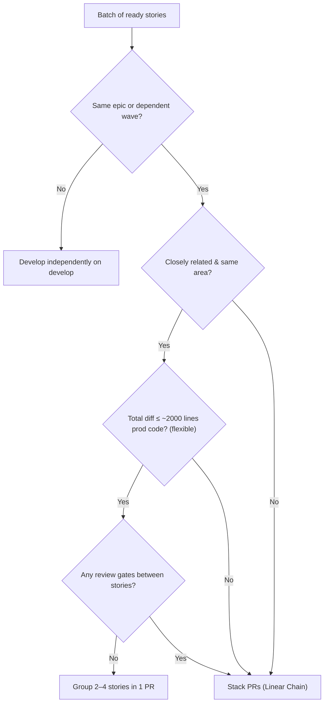

# Stacked Pull Request Workflow

Baseline branch model, commit formats, and validation gates: [`docs/CONTRIBUTING.md`](../../../docs/CONTRIBUTING.md). Issue lifecycle and gating rules: [`github_issue.instructions.md`](../../rules/github_issue.instructions.md). This skill governs batch decision logic, stack mechanics, rebase cascades, and sequential merges.

## 1. Strategy Decision: Grouping vs. Stacking

When assigned a batch of ready stories (e.g. "implement the next N items" or an entire epic wave):



### Path A: Grouping (Preferred for Small Closely Related Siblings)

Evaluate grouping first when working on multiple small stories:
- **Inspect**: Run `python3 -B .agents/skills/issue-logger/scripts/gh_related_issues.py <number>`.
- **Criteria**:
  - 2 to 4 sibling stories under the same parent epic.
  - Same domain/area (e.g. storefront header or product allergens).
  - Total combined diff is within the recommended guideline (≤ ~2000 lines of production code; flexible guideline that may be exceptionally bypassed when stories are tightly coupled).
  - No intermediate review gates (`gate: needs-review` or `gate: design-change`).
  - *Constraint*: Maintenance issues (`type: bug`) are never grouped; they must remain isolated.
- **Workflow**:
  - Implement locally on a single branch `feature/<primary-issue>-<slug>`.
  - Keep working locally without pushing until all grouped stories pass tests.
  - Tick acceptance criteria for all grouped issues.
  - Open a single PR closing all grouped issues (`Closes #A, Closes #B`).

### Path B: Stacking (For Dependent or Broader Sibling Requirements)

Use PR stacks when requirements are part of the same epic wave or have sequential dependencies, such as:
- Sibling stories significantly exceed recommended grouping guidelines (> ~2000 lines combined without close architectural cohesion).
- Stories span distinct architectural layers or sequential dependencies (Story B builds on Story A's schema/components).
- Stories contain intermediate review gates (`gate: needs-review` or `gate: design-change`) that would otherwise stall progress.
- Delivering a full epic wave iteratively (e.g. 5–15 stories).

> [!NOTE]
> If assigned items are completely independent across distinct domains (e.g. `orders`, `settings`, `analytics`), develop them on independent branches targeting `develop` (or via separate git worktrees) rather than creating artificial dependency chains.

---

## 2. Stack Architecture & Conventions

### Linear Chaining Model

Every PR in the stack builds directly on top of the preceding branch:

```text
develop
  └── feature/203-menu-search           (PR #219, base: develop)
        └── feature/205-manager-catalog (PR #220, base: feature/203-menu-search)
              └── feature/204-featured  (PR #221, base: feature/205-manager-catalog)
                    └── ...
```

### Stack PR Metadata Rules

1. **Base branch**: PR 1 targets `develop`. Each downstream PR N targets the branch of PR N-1.
   > [!IMPORTANT]
   > **NEVER target `develop` directly while the stack is in progress.** Targeting `develop` before parent PRs merge pollutes the PR diff with all ancestor commits, making review impossible and triggering bogus CI failures.
2. **Issue tracking**:
   - Starting a story:
     ```bash
     gh issue edit <id> --remove-label "status: planned" --add-label "status: in-progress"
     python3 -B .agents/skills/issue-logger/scripts/gh_parent_issue.py <id> --set-in-progress
     ```
   - Opening the PR:
     ```bash
     gh issue edit <id> --remove-label "status: in-progress" --add-label "status: in-review"
     ```
3. **PR Stack Header**:
   Include this exact header block in every stacked PR body:
   ```markdown
   > **Stacked PR**: Base is `<parent-branch>`. Part of stack for Epic #<epic-number>.
   > Merge downstream PRs in order after base merges, or cascade-merge into develop.
   ```

---

## 3. Autonomous Stack Construction (Continuous Iteration)

Do **NOT** idle between ungated stories. Work iteratively from bottom to top:

For each story in the batch:

1. **Branch off previous story**:
   ```bash
   git switch <parent-branch>   # or 'develop' for PR 1
   git switch -c feature/<number>-<slug>
   ```

2. **Implement**:
   - Follow ponytail (minimalism) and TDD.
   - For user-facing screens in [`SCREENS.md`](../../../docs/design/SCREENS.md), inspect/generate the mobile Stitch canvas first ([`design.instructions.md`](../../rules/design.instructions.md)).
   - Commit each working slice with conventional commits: `<type>(<scope>): <description> (#<number>)`.

3. **Local Slice Validation**:
   Run the fast validation suite per story slice:
   ```bash
   npm run format:check && npm run lint && npm run typecheck && npm run test:coverage && npm run test:tooling
   ```

4. **Commit & Push**:
   ```bash
   git push -u origin feature/<number>-<slug>
   ```

5. **Open Stacked PR**:
   ```bash
   gh pr create --base <parent-branch> --title "<type>(<scope>): <description> (#<number>)" --body "Closes #<number>

   > **Stacked PR**: Base is \`<parent-branch>\`. Part of stack for Epic #<epic-number>.
   > Merge downstream PRs in order after base merges, or cascade-merge into develop.

   ## Changes
   - <summary>

   ## Acceptance criteria
   - [x] <each AC from the issue> — <how it was verified>

   ## Verification
   - [x] Validation gate passes"
   ```

6. **Update Issue Label**:
   ```bash
   gh issue edit <number> --remove-label "status: in-progress" --add-label "status: in-review"
   ```

7. **Advance or Gated Halt**:
   - **If the next story is ungated**: Proceed directly to step 1 for the next story without waiting for CI or code review.
   - **If the next story is gated (`gate: needs-review` or `gate: design-change`)**: **Halt stack construction**. Proceed to §5 and §6 to cascade-merge all ungated predecessors (`PR_first` through `PR_pre_gate`), then present the implementation plan / UI proposal for the gated issue.

---

## 4. Rebase & Upstream Update Discipline

When an upstream PR in the stack is amended (e.g. fixing a CI check, lint failure, or review feedback):

### The Golden Rebase Rule
Always rebase the child branch using explicit `--onto` with the commit hash immediately before the child branch started:

```bash
# 1. Fetch latest changes
git fetch origin

# 2. Checkout clean local copy of child branch
git checkout -B <child-branch> origin/<child-branch>

# 3. Rebase child commits onto the updated parent branch
# If the child branch has 1 commit (standard), <old-base-parent-commit> is origin/<child-branch>~1.
# For N child commits, use origin/<child-branch>~N.
git rebase --onto origin/<parent-branch> origin/<child-branch>~<N> <child-branch>
```

> [!TIP]
> If git pauses with a clean working tree (due to autostash application), simply run:
> ```bash
> git rebase --continue
> ```

### Validate and Force-Push
Always run validation gates locally before pushing changes:

```bash
npm run test:coverage && npm run typecheck && npm run lint && npm run test:tooling
git push origin <child-branch> --force-with-lease
```

Repeat this rebase step down the chain for any subsequent branches in the stack.

---

## 5. Pre-Merge Verification (Quality Gates)

Before merging any PRs in the stack:

1. **Verify Full Validation Gate on Stack Top**:
   On the top branch of the stack, ensure full build and e2e checks pass:
   ```bash
   npm run build && npm run test:e2e
   ```

2. **Verify CI Status and Mergeability**:
   Verify that all PRs in the chain are `MERGEABLE` and have all required CI checks passing (`SUCCESS`):
   ```bash
   for pr in <pr-list>; do
     gh pr view $pr --json number,mergeable,statusCheckRollup --jq '
       {
         pr: .number,
         mergeable: .mergeable,
         passed: ([.statusCheckRollup[] | select((.state // .conclusion // .status) == "SUCCESS")] | length),
         total: (.statusCheckRollup | length)
       } | "#\(.pr): \(.mergeable) (\(.passed)/\(.total) checks passed)"
     '
   done
   ```

If any check fails or shows `CONFLICTING`, resolve the issue and rebase downstream branches before proceeding.

---

## 6. Cascading Merge Strategy

Once all PRs in the stack are green, merge autonomously from the bottom up to the first review gate:

### Step 1: Find the First Review Gate
Inspect the stack in order (`PR_1` to `PR_N`):
- Review gates: `gate: needs-review` or `gate: design-change`.
- Identify:
  - `PR_first`: Bottom PR targeting `develop`.
  - `PR_gate`: The first PR in the stack with a `gate:` label.
  - `PR_pre_gate`: The PR immediately before `PR_gate`. If no PRs have a gate, `PR_pre_gate` is `PR_N` (the top of the stack).

### Step 2: Execute Cascading Merge with Retargeting Wait Loop
Merge sequentially from `PR_first` up to `PR_pre_gate`.

> [!IMPORTANT]
> GitHub's automatic base-retargeting runs asynchronously (taking 3–15 seconds). Always wait for GitHub to complete retargeting before issuing the next merge:

```bash
PRS_TO_MERGE=(<pr_first> ... <pr_pre_gate>)

for pr in "${PRS_TO_MERGE[@]}"; do
  # Wait for GitHub to retarget PR base to develop after parent merge/deletion
  while [ "$(gh pr view "$pr" --json baseRefName --jq .baseRefName)" != "develop" ]; do
    echo "Waiting for PR #$pr to retarget base to develop..."
    sleep 3
  done

  # Merge and delete branch
  gh pr merge "$pr" --merge --delete-branch
done
```

### Why Cascading Merge Works
1. When `PR_1` merges into `develop` and its branch is deleted on GitHub, GitHub automatically re-targets `PR_2`'s base from `feature/1` to `develop`.
2. When `PR_2` merges and its branch is deleted, `PR_3` automatically re-targets to `develop`.
3. When `PR_pre_gate` merges and its branch is deleted, `PR_gate` (the review-gated PR) automatically re-targets to `develop`!
4. `PR_gate` now cleanly displays only its own changes against `develop` and remains open for human review.
