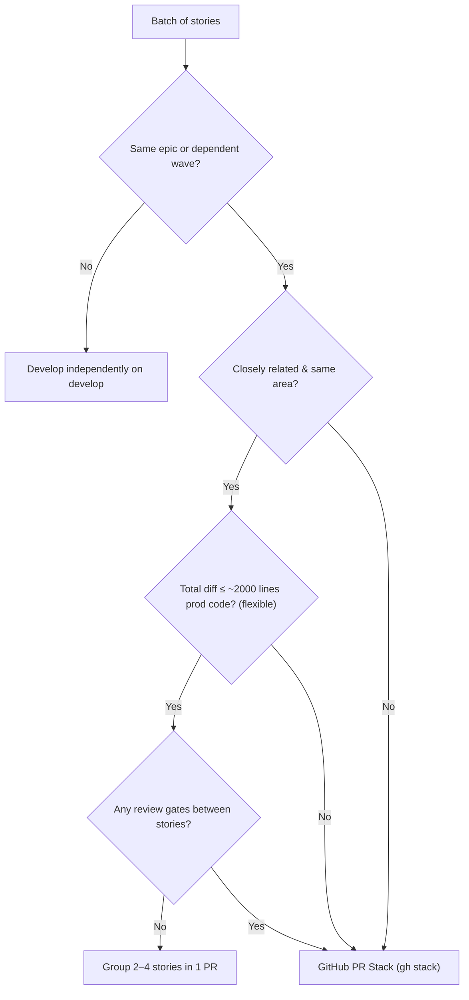

# Stacked Pull Request Workflow

Baseline branch model, commit formats, and validation gates: [`docs/CONTRIBUTING.md`](../../../docs/CONTRIBUTING.md). Issue lifecycle and gating rules: [`implement-issue`](../implement-issue/SKILL.md). Official GitHub reference: [About stacked pull requests](https://docs.github.com/en/pull-requests/get-started/about-stacked-prs) and [`gh stack` CLI commands](https://docs.github.com/en/pull-requests/reference/stacked-prs-cli-commands).

This skill governs batch decision logic, upfront stack planning, dedicated GitHub stack management (`gh stack`), cascading rebases, and selective stack merging up to review gates.

## 1. Strategy Decision: Grouping vs. Stacking

When assigned a batch of stories (e.g. "implement the next N items" or an entire epic wave):



### Path A: Grouping (Preferred for Small Closely Related Siblings)

Evaluate grouping first when working on multiple small stories:
- **Inspect**: Run `python3 -B .agents/skills/issue-logger/scripts/gh_related_issues.py <number>`.
- **Criteria**:
  - 2 to 4 sibling stories under the same parent epic.
  - Same domain/area (e.g. storefront header or product allergens).
  - Total combined diff is within the recommended guideline (≤ ~2000 lines of production code; flexible guideline that may be exceptionally bypassed when stories are tightly coupled).
  - No intermediate review gates (`gate: needs-review` or `gate: design-change`).
  - *Constraint*: Maintenance issues (`type: bug`) are never grouped; they must remain isolated.
- **Workflow**:
  - Implement locally on a single branch `feature/<primary-issue>-<slug>`.
  - Keep working locally without pushing until all grouped stories pass tests.
  - Tick acceptance criteria for all grouped issues.
  - Open a single PR closing all grouped issues (`Closes #A, Closes #B`).

### Path B: GitHub PR Stack (For Dependent or Broader Requirements)

Use a dedicated GitHub PR stack when requirements are part of the same epic wave or have sequential dependencies, such as:
- Sibling stories significantly exceed recommended grouping guidelines (> ~2000 lines combined without close architectural cohesion).
- Stories span distinct architectural layers or sequential dependencies (Story B builds on Story A's schema/components).
- The batch contains review gates (`gate: needs-review` or `gate: design-change`) alongside ungated stories.
- Delivering a full epic or multi-story wave iteratively (e.g. 3–15 stories).

> [!NOTE]
> If assigned items are completely independent across distinct domains (e.g. `orders`, `settings`, `analytics`), develop them on independent branches targeting `develop` (or via separate git worktrees) rather than creating artificial dependency chains.

---

## 2. Core Principles of GitHub PR Stacks

### 2.1 Upfront Planning of the Full Stack
- **Plan all PR requirements upfront before starting a stack**, regardless of whether individual stories carry a review gate (`gate: needs-review` or `gate: design-change`).
- **Review gates stop MERGING, not implementing.** Do not pause implementation mid-stack when reaching a gated story. Implement the entire planned chain of PRs in the stack from bottom to top, then use the review gate to determine which PR in the stack to merge up to (§6).

### 2.2 Dedicated GitHub Stack Object (`#<stack-number>`)
- A stack on GitHub is a **first-class repository object** with its own distinct ID (`#<stack-number>`, viewable at `https://github.com/<owner>/<repo>/stack/<stack-number>`).
- **Simply setting `gh pr create --base <parent-branch>` is NOT enough.** Chaining branch bases without registering a GitHub Stack object prevents GitHub Actions (`pull_request` targeting `develop`) from running on upper PRs and prevents atomic stack merges.
- Always manage stacks with the official `gh stack` CLI extension:
  ```bash
  # Ensure gh-stack extension is installed
  gh extension list | grep -q "github/gh-stack" || gh extension install github/gh-stack
  ```

### 2.3 Linear Chaining Model

```text
Stack #259 (trunk: develop)
  ├── PR #257: feature/118-local-supabase-devcontainer     (base: develop)                                 ← bottom (position 1)
  ├── PR #258: feature/119-migrations-and-generated-types  (base: feature/118-local-supabase-devcontainer) ← position 2 (PR_pre_gate)
  ├── PR #260: feature/120-rls-policies                    (base: feature/119-migrations-and-generated-types) [gate: needs-review] ← PR_gate
  └── PR #261: feature/121-order-rpc-functions             (base: feature/120-rls-policies)                ← top
```

- **Trunk**: The bottom PR targets `develop`. Each subsequent PR targets the branch immediately below it.
- **CI Execution**: Once linked in a GitHub Stack (`#<stack-number>`), GitHub Actions automatically evaluates every PR in the stack as if it targets `develop` (exposing `github.event.pull_request.stack`).
- **PR Stack Header**: Include this callout in every stacked PR body:
  ```markdown
  > **Stacked PR**: Base is `<parent-branch>`. Part of Stack #<stack-number> for Epic #<epic-number>.
  ```

---

## 3. End-to-End Stack Construction Workflow

### Step 0: Plan All Stack Layers Upfront
Before creating branches, inspect all stories in the target batch/epic (`gh issue view <id>`), verify dependencies, and write the upfront implementation plan covering every layer of the stack (`PR_1` through `PR_N`).

### Step 1: Initialize the Stack (or Check Out an Existing Stack)
- **Starting a brand-new stack on `develop`**:
  ```bash
  git switch develop && git pull origin develop
  gh stack init --base develop feature/<id-1>-<slug-1>
  ```
- **Resuming or extending an existing GitHub stack `#<stack-number>`**:
  ```bash
  gh stack checkout <stack-number>
  gh stack top
  ```

### Step 2: Implement All Planned Layers Sequentially (Bottom to Top)
Iterate through **every** planned story in the stack (both ungated and gated) without stopping implementation at review gates:

1. **Create the next stack branch** (for layer 2..N; layer 1 was created by `gh stack init`):
   ```bash
   gh stack add feature/<number>-<slug>
   ```
2. **Update issue status to `in-progress`**:
   ```bash
   gh issue edit <number> --remove-label "status: planned" --add-label "status: in-progress"
   python3 -B .agents/skills/issue-logger/scripts/gh_parent_issue.py <number> --set-in-progress
   ```
3. **Implement & commit**:
   - Follow ponytail (minimalism) and TDD.
   - For user-facing screens in [`SCREENS.md`](../../../docs/design/SCREENS.md), inspect or generate the mobile Light-mode Stitch canvas first ([`design.instructions.md`](../../rules/design.instructions.md)).
   - Commit working slices with conventional commits: `<type>(<scope>): <description> (#<number>)`.
4. **Run local slice validation**:
   ```bash
   npm run format:check && npm run lint && npm run typecheck && npm run test:coverage && npm run test:tooling
   ```
5. **Push, create PR, and link into the GitHub Stack**:
   - Push the branch and open its PR targeting `<parent-branch>` (or `develop` for layer 1):
     ```bash
     git push -u origin feature/<number>-<slug>
     gh pr create --base <parent-branch> --title "<type>(<scope>): <description> (#<number>)" --body "Closes #<number>

     > **Stacked PR**: Base is \`<parent-branch>\`. Part of Stack #<stack-number> for Epic #<epic-number>.

     ## Changes
     - <summary>

     ## Acceptance criteria
     - [x] <each AC from the issue> — <how it was verified>

     ## Verification
     - [x] Validation gate passes"
     ```
   - **Link into the dedicated GitHub Stack** as soon as 2+ branches/PRs exist:
     ```bash
     # When creating the stack object from the first two PRs:
     gh stack link --base develop --open <pr-1> <pr-2>

     # When appending a new PR to an existing stack #<stack-number>:
     gh stack link <stack-number> --open <new-pr>
     ```
     *(Alternatively, `gh stack submit --open` or `gh stack sync` links tracked local stack branches into the GitHub stack automatically.)*
   - Verify stack membership and record the stack ID (`#<stack-number>`):
     ```bash
     gh stack view --short
     ```
6. **Update issue status to `in-review`**:
   ```bash
   gh issue edit <number> --remove-label "status: in-progress" --add-label "status: in-review"
   ```
7. **Continue to the next planned story in the stack** until all planned stories (`PR_1` .. `PR_N`) are implemented and linked in Stack `#<stack-number>`.

---

## 4. Modifying a Lower Layer & Cascading Rebases

Never work around a bug in a lower layer from a higher branch. Always fix it in the layer where it belongs and let `gh stack` cascade the rebase upward:

```bash
# 1. Switch to the lower branch that needs a fix
gh stack checkout feature/<lower-id>-<slug>   # or: gh stack down

# 2. Commit the fix and run local validation
git add <files>
git commit -m "fix(<scope>): <description> (#<lower-id>)"
npm run format:check && npm run lint && npm run typecheck && npm run test:coverage && npm run test:tooling

# 3. Cascade rebase all branches above it in the stack
gh stack rebase --upstack

# 4. Atomically push all updated stack branches (--force-with-lease) and return to top
gh stack push
gh stack top
```

- If `develop` (the trunk) has moved ahead on `origin`, rebase the entire stack onto latest `develop` with:
  ```bash
  gh stack rebase
  gh stack push
  ```
- If a rebase conflict occurs, resolve the conflicted files, stage with `git add`, and run `gh stack rebase --continue` (or `gh stack rebase --abort` to restore pre-rebase state).

---

## 5. Pre-Merge Verification (Quality Gates)

Before merging any portion of the stack:

1. **Verify Full Validation Gate on Stack Top**:
   ```bash
   gh stack top
   npm run build && npm run test:e2e
   ```
2. **Verify Stack Integrity and CI Checks**:
   Confirm that the stack is linear (`needsRebase: false` in `gh stack view --json`) and that all required CI checks pass on every PR up to the merge target (`PR_pre_gate`).

---

## 6. Merging a Stack & Review Gate Discipline

> [!IMPORTANT]
> **Do NOT rebase and retarget PRs onto `develop` one by one as you climb the stack.**
> In a GitHub stack, merging a pull request **automatically merges all unmerged pull requests below it** in a single atomic operation, and automatically rebases/retargets the remaining pull requests above it onto `develop`.

### Step 1: Identify the Merge Target (`PR_pre_gate`)
Inspect the ordered PRs in Stack `#<stack-number>` from bottom (`PR_1`) to top (`PR_N`):
- **`PR_gate`**: The **first** (lowest) PR in the stack whose issue has `gate: needs-review` or `gate: design-change`.
- **`PR_pre_gate`**: The last ungated PR immediately below `PR_gate`.
  - If **no** PR in the stack has a review gate, `PR_pre_gate` is `PR_N` (the top PR of the stack).
  - If **`PR_1`** (the very bottom PR) has a review gate, there is no `PR_pre_gate` — do **not** merge anything; leave the entire stack open for human review.

### Step 2: Merge Up to `PR_pre_gate` in One Command
When `PR_pre_gate` exists and all CI checks on `PR_1 .. PR_pre_gate` are green, merge `PR_pre_gate` directly using `gh stack merge`:

```bash
gh stack merge <PR_pre_gate> --merge --yes
```

What GitHub does automatically:
1. Merges `PR_1` through `PR_pre_gate` into `develop` together in bottom-up order.
2. Automatically rebases and retargets `PR_gate` to target `develop` directly (making `PR_gate` the new bottom of Stack `#<stack-number>`), keeping `PR_gate .. PR_N` open and linked for human review.

### Step 3: Sync Local Environment & Clean Up Merged Issue Labels
After the stack merge completes:
```bash
# Fast-forward develop, rebase remaining local stack branches onto develop, and prune merged local branches
gh stack sync --prune
```
Ensure each merged issue has its `status: in-review` label removed and is closed (handled automatically by `Closes #<id>` / `Issue status` workflow, or verified via `gh issue view <id>`).
