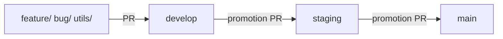

# Contributing to FoodBiz PWA

Code standards live in [`AGENTS.md`](../AGENTS.md#rules) and [`.agents/rules/`](../.agents/rules/); they apply to humans and agents alike. Local setup: [`README.md`](../README.md#getting-started).

## Branches

| Branch    | Purpose                                                    |
| --------- | ---------------------------------------------------------- |
| `develop` | Integration branch; all work PRs target it. Not deployed.  |
| `staging` | Pre-production qualification (promoted from `develop`).    |
| `main`    | Production (promoted from `staging`).                      |



Never commit or push directly to `develop`, `staging` or `main`. Branch off `develop`:

| Prefix     | Use                                     | Example                          |
| ---------- | --------------------------------------- | -------------------------------- |
| `feature/` | Story issue                             | `feature/42-order-status-filter` |
| `bug/`     | Bug issue                               | `bug/38-kpi-profit`              |
| `utils/`   | Tooling, docs, config, dependencies, CI | `utils/agentic-setup`            |

## Workflow

1. Pick or create an issue (agents: [`github_issue.instructions.md`](../.agents/rules/github_issue.instructions.md); create issues only via the `issue-logger` skill).
2. Branch off `develop` (see [Branches](#branches)) and commit small working slices.
3. Pass the [validation gate](#validation-gate).
4. Open a PR against `develop`; the [PR template](../.github/pull_request_template.md) is the checklist.
5. Promotion to `staging`/`main`: [`DEPLOYMENT.md#releasing`](DEPLOYMENT.md#releasing).

## Commits and PR titles

Format: `<type>(<scope>): <description> (#<issue>)`, e.g. `feat(orders): add order status filter (#42)`. PR titles use the same format (checked by CI).

- Types: `feat`, `fix`, `refactor`, `docs`, `test`, `chore`, `ci`, `build`, `perf`, `style`
- Scopes: an issue `area:` (`dashboard`, `orders`, `products`, `expenses`, `analytics`, `storefront`, `auth`, `settings`, `customers`, `design-system`, `infra`) or `pwa`, `supabase`, `config`

## Validation gate

All must pass with zero errors before a PR (CI's `Quality gate` runs the same):

```bash
npm run format:check   # Prettier (+ Tailwind class sorting); fix with npm run format
npm run lint
npm run typecheck      # next typegen && tsc --noEmit
npm run test:coverage  # tests + coverage floors + ratchet
npm run test:tooling   # tooling tests (Vitest + Python)
npm run build
```

Coverage policy:

- **Production floors** (global, in `vitest.config.mts`): `test:coverage` fails below them, then `scripts/coverage-ratchet.mjs` raises lines/functions/statements toward actual coverage (capped at 70%; branches fixed at 80%). Commit the raised thresholds. A drop is fine while floors pass.
- Never lower thresholds, add coverage excludes or skip tests to pass; if a change can't meet the floors, stop and ask.
- **Per-layer targets** (reported in the CI PR comment, not enforced yet): Domain 85%, Features 80%, Config 80%, Lib 75%, Components 70%, App 70%. Mention gaps in the PR.
- **Tooling** (`scripts/`, `.github/.scripts/`, `.agents/skills/*/scripts/`) must have tests; changes update them. Coverage target 60%, informative only.
