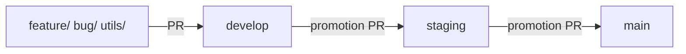

# Contributing to FoodBiz PWA

Code standards live in [`AGENTS.md`](../AGENTS.md#rules) and [`.agents/rules/`](../.agents/rules/); they apply to humans and agents alike. Local setup: [`README.md`](../README.md#getting-started).

### Agent tooling

Primary agents are GitHub Copilot and Claude Code (VS Code). Each asset has one canonical file; edit it there, never in a tool-specific copy.

| Canonical source                                      | GitHub Copilot                     | Claude Code                |
| ----------------------------------------------------- | ---------------------------------- | -------------------------- |
| `AGENTS.md`                                           | `chat.useAgentsMdFile`             | `CLAUDE.md` → `@AGENTS.md` |
| `.agents/rules/*.instructions.md` (scoped by `paths`) | `.claude/rules/` symlinks          | `.claude/rules/` symlinks  |
| `.agents/skills/`                                     | native (`.claude/skills` disabled) | `.claude/skills` symlink   |
| `.claude/agents/` (subagents)                         | native                             | native                     |
| `.claude/hooks/` via `.claude/settings.json`          | `chat.useClaudeHooks`              | native                     |
| MCP servers                                           | `.vscode/mcp.json`                 | `.mcp.json`                |
| Command auto-approval                                 | `chat.tools.terminal.autoApprove`  | `.claude/settings.json`    |

MCP servers and auto-approval lists are the only intentional duplicates (different schemas). The `graphify` skill sets `disable-model-invocation: true`; re-apply it after `graphify install` updates the skill.

## Branches

| Branch    | Purpose                                                   |
| --------- | --------------------------------------------------------- |
| `develop` | Integration branch; all work PRs target it. Not deployed. |
| `staging` | Pre-production qualification (promoted from `develop`).   |
| `main`    | Production (promoted from `staging`).                     |



Never commit or push directly to `develop`, `staging` or `main`. Branch off `develop`:

| Prefix     | Use                                     | Example                          |
| ---------- | --------------------------------------- | -------------------------------- |
| `feature/` | Story issue                             | `feature/42-order-status-filter` |
| `bug/`     | Bug issue                               | `bug/38-kpi-profit`              |
| `utils/`   | Tooling, docs, config, dependencies, CI | `utils/agentic-setup`            |

## Workflow

1. Pick or create an issue (create only via the `issue-logger` skill).
2. Branch off `develop` (see [Branches](#branches)) and commit small working slices.
3. Pass the [validation gate](#validation-gate) locally, then push once.
4. Open a PR against `develop`; the [PR template](../.github/pull_request_template.md) is the checklist. Bug fixes (`fix(...)` / `bug/`) always carry the `bug` label.
5. When checks pass, merge your own PR into `develop`. Promotion to `staging`/`main` is the owner's: [`DEPLOYMENT.md#releasing`](DEPLOYMENT.md#releasing).

Agents follow the [`ship`](../.agents/skills/ship/SKILL.md) skill for picking work, slicing PRs and stacks, review and merge.

## Commits and PR titles

Format: `<type>(<scope>): <description> (#<issue>)`, e.g. `feat(orders): add order status filter (#42)`. PR titles use the same format (checked by CI).

- Types: `feat`, `fix`, `refactor`, `docs`, `test`, `chore`, `ci`, `build`, `perf`, `style`
- Scopes: an issue `area:` (`dashboard`, `orders`, `products`, `expenses`, `analytics`, `storefront`, `auth`, `settings`, `customers`, `design-system`, `infra`) or `pwa`, `supabase`, `config`

## Validation gate

One command runs everything your change needs, cheapest first, and stops at the first failure:

```bash
npm run gate         # tiers chosen from the diff vs origin/develop (scripts/ci-scope.mjs)
npm run gate:quick   # format:check, lint, typecheck, unit tests (while iterating)
npm run gate:full    # every tier, whatever changed
```

| Tier    | Runs                                                                                                         | When                                                                         |
| ------- | ------------------------------------------------------------------------------------------------------------ | ---------------------------------------------------------------------------- |
| `check` | `format:check`, `lint`, `typecheck`, `test:coverage`; plus `db:types:check` and `test:tooling` when relevant | Always. Markdown/docs-only changes run `format:check` alone                  |
| `db`    | `db:test` (pgTAP) and `test:live` against local Supabase                                                     | `supabase/`, repositories, Supabase clients, database types, `package*.json` |
| `build` | `npm run build`                                                                                              | `src/`, `public/`, Next/TS/PostCSS config, `package*.json`                   |
| `e2e`   | `npm run test:e2e` (mock-mode Chromium journeys + light/dark WCAG AA)                                        | Same as `build`, plus `e2e/` and `playwright.config.ts`                      |

The path rules live in one place, `RULES` in [`scripts/ci-scope.mjs`](../scripts/ci-scope.mjs). The `db` tier needs a running local Supabase; if it is down the gate prints the start commands and fails. CI runs the same checks, so a green gate is what CI will confirm: never push just to find out. Fix failures locally, push once.

### Local Supabase stack

The devcontainer enables `docker-in-docker` and installs the Supabase CLI (`supabase/config.toml` sets ports `54321` for the API and `54323` for Studio):

```bash
npm run db:start   # start local Supabase stack
npm run db:reset   # reset DB, reapply supabase/migrations/, and apply supabase/seed.sql
npm run db:stop    # stop local Supabase containers
npm run db:status  # print local connection URLs and keys
```

To test Google OAuth sign-in locally, copy `supabase/.env.example` to `supabase/.env` (git-ignored) and configure your Google Client ID and Secret.

#### Live repository contract tests

To exercise the live security boundary and concurrency guarantees against local Supabase:

```bash
npm run db:start
eval "$(supabase status -o env | grep -E '^[A-Z0-9_]+=')"
SUPABASE_TEST_URL="$API_URL" SUPABASE_TEST_SERVICE_ROLE_KEY="$SERVICE_ROLE_KEY" SUPABASE_TEST_ANON_KEY="$ANON_KEY" npm run test:live
```

What this suite proves (`src/lib/repositories/tests/supabase-live.contract.test.ts`):

- **Real RLS security boundaries:** anonymous callers cannot list orders/guests/expenses or read private `business_settings` columns (`publicOnly: true` enforcement), while storefront order placement works for visible products and is rejected for hidden products or non-storefront channels.
- **Tenant isolation & CRUD:** authenticated business members have full CRUD on their tenant's resources, cannot view or modify other tenants' rows (cross-tenant denial), and cannot cancel orders from other businesses.
- **True transactional concurrency (H9):** parallel anonymous checkouts for the last unit of stock via `Promise.all` result in exactly one successful placement and one `STOCK_ERROR` rejection, with 0 final stock and no overselling. Order numbers are strictly unique and sequential under concurrent load.
- **Atomic order updates & cancel:** `orders.cancel` restores stock atomically, and `orders.update` with items replaces line items transactionally via the `replace_order_items` RPC.

#### Supabase-backed storefront journey

`npm run test:e2e:supabase` runs one anonymous checkout journey (home, add product, checkout, confirmation, tracking) in Chromium against the running local stack with `DATA_SOURCE=supabase`. It reads the stack's URL and keys from `supabase status`, starts its own `next dev` on port 3200, and is not part of `npm run test:e2e`. CI runs it in the `db-tests` job.

### Browser and accessibility checks

Install Chromium once with `npx playwright install --with-deps chromium`, then `npm run test:e2e` (or `test:e2e:ui`). Playwright starts its own mock-mode dev server at `http://127.0.0.1:3100` (stop other Next.js dev servers first); it never calls Supabase and mock auth is forbidden in production. The suite runs with one worker and no retries because the mock repositories are process-local; tests use unique names and do not depend on order.

Browser axe checks cover the storefront (EN/FR), manager sign-in, dashboard, products, orders, expenses and customers in light and dark. WCAG 2/2.1/2.2 A/AA violations, including contrast, fail the run; component axe tests in Vitest skip only the contrast rule (JSDOM cannot compute it). Automated checks supplement, but do not replace, keyboard and screen-reader testing. CI uploads `playwright-results` (report, screenshots, traces; seven days); locally use `npx playwright show-report`.

### Coverage policy

- **Production floors** (global, `vitest.config.mts`): statements 87, branches 80, functions 87, lines 89. `test:coverage` fails below them. Raise them by hand when coverage grows durably; never lower them, add coverage excludes or skip tests to pass. If a change cannot meet the floors, stop and ask.
- **Per-layer targets** (not enforced; mention gaps in the PR): Domain 85%, Features 80%, Config 80%, Lib 75%, Components 70%, App 70%.
- **Tooling** (`scripts/`, `.agents/skills/*/scripts/`, `.claude/hooks/`) must have tests; changes update them. Coverage target 60%, informative only.
