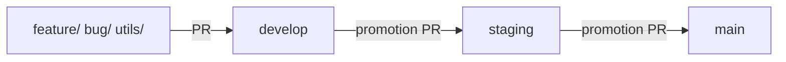

# Contributing to FoodBiz PWA

Code standards live in [`AGENTS.md`](../AGENTS.md#rules) and [`.agents/rules/`](../.agents/rules/); they apply to humans and agents alike. Local setup: [`README.md`](../README.md#quick-start).

### Agent tooling

Primary agents are GitHub Copilot and Claude Code (VS Code). Each asset has one canonical file; edit it there, never in a tool-specific copy.

| Canonical source                                      | GitHub Copilot                     | Claude Code                |
| ----------------------------------------------------- | ---------------------------------- | -------------------------- |
| `AGENTS.md`                                           | `chat.useAgentsMdFile`             | `CLAUDE.md` → `@AGENTS.md` |
| `.agents/rules/*.instructions.md` (scoped by `paths`) | `.claude/rules/` symlinks          | `.claude/rules/` symlinks  |
| `.agents/skills/`                                     | native (`.claude/skills` disabled) | `.claude/skills` symlink   |
| `.claude/agents/` (subagents)                         | native                             | native                     |
| `.claude/hooks/` via `.claude/settings.json`          | `chat.useClaudeHooks`              | native                     |
| MCP servers                                           | `.vscode/mcp.json`                 | `.mcp.json`                |
| Command auto-approval                                 | `chat.tools.terminal.autoApprove`  | `.claude/settings.json`    |

MCP servers and auto-approval lists are the only intentional duplicates (different schemas). The `graphify` skill sets `disable-model-invocation: true`; re-apply it after `graphify install` updates the skill.

## Branches

| Branch    | Purpose                                                     |
| --------- | ----------------------------------------------------------- |
| `develop` | Integration branch; all work PRs target it. Not deployed.   |
| `staging` | Pre-production (promoted from `develop`); not deployed yet. |
| `main`    | Production (promoted from `staging`); not deployed yet.     |



Never commit or push directly to `develop`, `staging` or `main`. Branch off `develop`:

| Prefix     | Use                                     | Example                          |
| ---------- | --------------------------------------- | -------------------------------- |
| `feature/` | Story issue                             | `feature/42-order-status-filter` |
| `bug/`     | Bug issue                               | `bug/38-kpi-profit`              |
| `utils/`   | Tooling, docs, config, dependencies, CI | `utils/agentic-setup`            |

## Workflow

1. Pick or create an issue (create only via the `issue-logger` skill).
2. Branch off `develop` (see [Branches](#branches)) and commit small working slices.
3. Pass the [validation gate](#validation-gate) locally, then push once.
4. Open a PR against `develop`; the [PR template](../.github/pull_request_template.md) is the checklist. Bug fixes (`fix(...)` / `bug/`) always carry the `bug` label.
5. When checks pass, merge your own PR into `develop`. Promotion to `staging`/`main` is the owner's: [`DEPLOYMENT.md#releasing`](DEPLOYMENT.md#releasing).

Agents follow the [`ship`](../.agents/skills/ship/SKILL.md) skill for picking work, slicing PRs and stacks, review and merge.

## Commits and PR titles

Format: `<type>(<scope>): <description> (#<issue>)`, e.g. `feat(orders): add order status filter (#42)`. PR titles use the same format (checked by CI).

- Types: `feat`, `fix`, `refactor`, `docs`, `test`, `chore`, `ci`, `build`, `perf`, `style`
- Scopes: an issue `area:` (`dashboard`, `orders`, `products`, `expenses`, `analytics`, `storefront`, `auth`, `settings`, `customers`, `design-system`, `infra`) or `pwa`, `supabase`, `config`

## Validation gate

One command runs everything your change needs, cheapest first, and stops at the first failure:

```bash
npm run gate         # tiers chosen from the diff vs origin/develop (scripts/ci-scope.mjs)
npm run gate:quick   # format:check, lint, typecheck, unit tests (while iterating)
npm run gate:full    # every tier, whatever changed
```

| Tier          | Runs                                                                                                                                                                | When                                                                                                            |
| ------------- | ------------------------------------------------------------------------------------------------------------------------------------------------------------------- | --------------------------------------------------------------------------------------------------------------- |
| `check`       | `secret-scan`, `format:check`, `lint`, `typecheck`, `db:types:check`, `test:coverage`, `npm audit`, `test:tooling`; each only when relevant                         | Always. Markdown/docs-only changes run `secret-scan` and `format:check` alone                                   |
| `integration` | One local Supabase, then `db:test` (pgTAP) and `test:live`, `build:local` (production build against that stack), `test:e2e:supabase` (anonymous storefront journey) | `supabase/`, repositories, Supabase clients, database types, `src/`, `public/`, `package*.json`, Next/TS config |
| `e2e`         | `npm run test:e2e` (mock-mode Chromium journeys + light/dark WCAG AA)                                                                                               | `src/`, `public/`, `package*.json`, Next/TS config, `e2e/`, `playwright.config.ts`                              |

The path rules live in one place, `RULES` in [`scripts/ci-scope.mjs`](../scripts/ci-scope.mjs), and CI calls the same script, so the gate and CI agree on the tiers and run the same commands in the same order (the gate stops at the first failure; CI reports every failure of a tier). `integration` needs a running local Supabase; if it is down the gate prints the start commands and fails. The production build needs the seeded local stack (the storefront prerenders its catalog at build time), so use `npm run build:local`, not `npm run build`. A green gate is what CI will confirm: never push just to find out. Fix failures locally, push once.

`secret-scan` (also the first pre-commit step) scans only added lines for high-signal secret patterns and never prints a match in full. Placeholders (`xxx`, `example`, `demo`, `test`, `ci-placeholder-*`, `$VAR`) are allowed; mark a deliberate false positive with a `secret-scan: ignore` comment on that line.

## CI tiers and cost

The budget below assumes a private repository on GitHub's free plan (it is public at the time of writing; the owner intends to make it private again): **2,000 Linux minutes a month, each job billed rounded up to the whole minute**. CI is therefore a few fat jobs instead of many thin ones, and the expensive tiers run only when the diff and the PR's place in its stack need them. Workflow: [`ci.yml`](../.github/workflows/ci.yml).

```text
check (always; decides the scope) --> integration (if needed) --+
                                  \-> e2e (if needed) ----------+--> Quality Gate - Summary (the required check)
```

| Change                                             | Tiers that run                                       | About (billed min) |
| -------------------------------------------------- | ---------------------------------------------------- | ------------------ |
| Docs / markdown only                               | check (format + secret scan) + summary               | 2                  |
| `scripts/`, other workflows, `.husky/`, hooks      | check (incl. tooling tests, no unit tests) + summary | 4                  |
| `e2e/` specs only                                  | check + e2e + summary                                | 9                  |
| `supabase/` migrations or seed only                | check + integration (no build) + summary             | 9                  |
| `src/`, `public/`, `package*.json`, Next/TS config | check + integration + e2e + summary                  | 14                 |
| `ci.yml` or `scripts/ci-scope.mjs`                 | every tier                                           | 14                 |
| Middle PR of a stack, whatever it changes          | check + summary                                      | 2 to 5             |
| Push to `develop` after a clean merge              | format check + summary                               | 2                  |

Estimates assume warm npm and browser caches. `check` runs the unit tests only when `src/`, package files or Vitest/TS config changed. A failing `check` skips `integration` and `e2e`, so a broken push costs about 4 minutes, not 14.

**Stacks.** A PR whose base is `develop`, `staging` or `main` runs every tier its diff needs. A PR whose base is another feature branch runs `check` alone, except the top PR of a stack (no other remote branch contains its head), which is judged against `develop` so the whole stack's diff gets the expensive tiers once. When the bottom PR merges and GitHub retargets the next one to `develop`, the `edited` event re-runs CI with the expensive tiers: the head SHA does not change, but the new run posts a fresh `Quality Gate - Summary` on it. An atomic `gh stack merge` needs every PR's required check green, and the top PR already carried the expensive tiers for the full stack diff. Add `workflow_dispatch` runs (`gh workflow run ci.yml --ref <branch>`) when you want every tier on a branch regardless.

**After merging.** CI also runs on the push to `develop`. If the merge commit's tree equals its PR head's tree (develop did not move since the PR's last rebase) nothing needs re-proving and the run is a format check. Otherwise (develop moved, squash or rebase merge) it judges the merge diff with the same scope rules, which catches semantic conflicts between PRs merged back to back.

**The required check** is `Quality Gate - Summary`. It always runs and fails when any tier failed, was cancelled, or was required by the scope but did not run. Tiers the scope did not ask for count as passed.

**Rough monthly budget.** Assumptions: about 10 merged PRs a week (3 single `src` PRs, one 4-PR `src` stack with one restack, one database PR, 2 scripts/workflow PRs, 3 docs PRs, 2 Dependabot PRs), 1.5 CI runs per PR on average, and one extra run for about half of the PRs from a title or body edit. That is about 1,300 billed minutes a month, against about 2,600 for the previous design (8 jobs per run each doing `npm ci`, no path filters, a separate title job, no stack awareness, a full re-run on every merge). Both are estimates; real usage is under Settings, Billing, Actions.

To spend fewer minutes: run `npm run gate` before the first push, push each PR once, set the PR title and body in the same `gh pr create` or `gh pr edit` call (every title or body edit re-runs CI), and restack only when a lower PR changed.

### Local Supabase stack

The devcontainer enables `docker-in-docker` and installs the Supabase CLI (`supabase/config.toml` sets ports `54321` for the API and `54323` for Studio):

```bash
npm run db:start   # start local Supabase stack
npm run db:reset   # reset DB, reapply supabase/migrations/, and apply supabase/seed.sql
npm run db:stop    # stop local Supabase containers
npm run db:status  # print local connection URLs and keys
```

To test Google OAuth sign-in locally, copy `supabase/.env.example` to `supabase/.env` (git-ignored) and configure your Google Client ID and Secret.

#### Live repository contract tests

To exercise the live security boundary and concurrency guarantees against local Supabase:

```bash
npm run db:start
eval "$(supabase status -o env | grep -E '^[A-Z0-9_]+=')"
SUPABASE_TEST_URL="$API_URL" SUPABASE_TEST_SERVICE_ROLE_KEY="$SERVICE_ROLE_KEY" SUPABASE_TEST_ANON_KEY="$ANON_KEY" npm run test:live
```

What this suite proves (`src/lib/repositories/tests/supabase-live.contract.test.ts`):

- **Real RLS security boundaries:** anonymous callers cannot list orders/guests/expenses or read private `business_settings` columns (`publicOnly: true` enforcement), while storefront order placement works for visible products and is rejected for hidden products or non-storefront channels.
- **Tenant isolation & CRUD:** authenticated business members have full CRUD on their tenant's resources, cannot view or modify other tenants' rows (cross-tenant denial), and cannot cancel orders from other businesses.
- **True transactional concurrency (H9):** parallel anonymous checkouts for the last unit of stock via `Promise.all` result in exactly one successful placement and one `STOCK_ERROR` rejection, with 0 final stock and no overselling. Order numbers are strictly unique and sequential under concurrent load.
- **Server-side order state:** members cannot write `orders`/`order_items` directly (money and integrity fields); `transition`, `recordPayment`, `markUnpaid`, `recordRefund`, `cancel` and `replaceItems` go through database functions. The suite runs every lifecycle pair against the domain transition table, the stale-status `ORDER_STATE_CONFLICT`, and item replacement (prices from the catalog, total recomputed, stock by delta).
- **Owner-only actions:** a manager and a staff member are refused (`FORBIDDEN`) payment settings, the slug and hard deletes; an owner succeeds; nobody can delete `business_settings`.
- **Tenant-safe references:** composite foreign keys refuse cross-tenant references.

#### Supabase-backed storefront journey

`npm run test:e2e:supabase` runs one anonymous checkout journey (home, add product, checkout, confirmation, tracking) in Chromium against the running local stack with `DATA_SOURCE=supabase`. It reads the stack's URL and keys from `supabase status`, starts its own `next dev` on port 3200, and is not part of `npm run test:e2e`. CI runs it in the `integration` job.

### Browser and accessibility checks

Install Chromium once with `npx playwright install --with-deps chromium`, then `npm run test:e2e` (or `test:e2e:ui`). Playwright starts its own mock-mode dev server at `http://127.0.0.1:3100` (stop other Next.js dev servers first); it never calls Supabase and mock auth is forbidden in production. The suite runs with one worker and no retries because the mock repositories are process-local; tests use unique names and do not depend on order.

Browser axe checks cover the storefront (EN/FR), manager sign-in, dashboard, products, orders, expenses and customers in light and dark. WCAG 2/2.1/2.2 A/AA violations, including contrast, fail the run; component axe tests in Vitest skip only the contrast rule (JSDOM cannot compute it). Automated checks supplement, but do not replace, keyboard and screen-reader testing. CI uploads `playwright-results` (report, screenshots, traces; seven days); locally use `npx playwright show-report`.

### Coverage policy

- **Production floors** (global, `vitest.config.mts`): statements 87, branches 80, functions 87, lines 89. `test:coverage` fails below them. Raise them by hand when coverage grows durably; never lower them, add coverage excludes or skip tests to pass. If a change cannot meet the floors, stop and ask.
- **Per-layer targets** (not enforced; mention gaps in the PR): Domain 85%, Features 80%, Config 80%, Lib 75%, Components 70%, App 70%.
- **Tooling** (`scripts/`, `.agents/skills/*/scripts/`, `.claude/hooks/`) must have tests; changes update them. Coverage target 60%, informative only.
