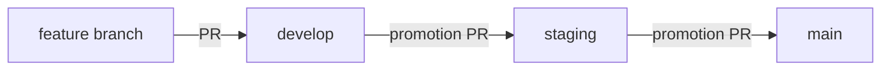

# Contributing to FoodBiz PWA

> Ported from the legacy React Native / Expo project and adapted to Next.js 16. Read [`../AGENTS.md`](../AGENTS.md): this Next.js version has breaking changes, so consult `node_modules/next/dist/docs/` before writing code.

## Branch model

| Branch    | Purpose                                                 |
| --------- | ------------------------------------------------------- |
| `develop` | Integration branch. All feature PRs target it.          |
| `staging` | Pre-production qualification (promoted from `develop`). |
| `main`    | Production (promoted from `staging`).                   |



Never commit directly to `develop`, `staging` or `main`.

## Workflow

1. Pick or create a GitHub issue (templates: bug, feature, epic in `.github/ISSUE_TEMPLATE/`).
2. Branch **off `develop`**: `<username>/issue-<number>` (documentation-only work may use a `docs/<topic>` branch).
3. Implement with small, incremental commits.
4. Run the validation commands below. All must pass.
5. Open a PR against `develop` referencing the issue.

## Conventional commits and PR titles

Format: `<type>(<scope>): <description> (#<issue>)`

- Types: `feat`, `fix`, `refactor`, `docs`, `test`, `chore`
- Scopes (suggested, aligned with the functional areas): `dashboard`, `orders`, `products`, `expenses`, `analytics`, `storefront`, `auth`, `settings`, `pwa`, `supabase`, `config`
- PR titles follow the same format as commits.

Example: `feat(orders): add order status filter (#42)`

## Validation commands

```bash
npm run lint           # ESLint (eslint-config-next)
npm run typecheck      # next typegen && tsc --noEmit
npm run test           # Vitest (single run)
npm run format:check   # Prettier (+ Tailwind class sorting)
npm run build          # Production build
```

Use `npm run format` to fix formatting, and `npm run test:coverage` for coverage.

## PR checklist

- [ ] Branch created from `develop`; PR targets `develop`
- [ ] Title follows the conventional format and references the issue
- [ ] `lint`, `typecheck`, `test`, `format:check` and `build` pass locally
- [ ] Tests added or updated for new behaviour
- [ ] No secrets committed; only `NEXT_PUBLIC_*` values are browser-exposed (see `.env.example`)
- [ ] Docs in `docs/` updated if behaviour or architecture changed
- [ ] Interactive elements are keyboard accessible and have accessible names

## Promotion process

1. **`develop` → `staging`**: open a PR with `develop` as the source and `staging` as the target once the integrated work is ready for qualification. Validation commands must pass on the PR; verify the deployment on staging.
2. **`staging` → `main`**: after staging is qualified, open a PR from `staging` to `main`. Merging to `main` releases to production.

Promotions are PRs, not direct pushes. Hotfixes follow the same path unless the maintainers decide otherwise.

> **CI:** every PR and push runs `.github/workflows/ci.yml` (PR title, format, lint, typecheck, tests + coverage, build). The `Quality gate` check must be green to merge. Promotion PRs can be opened from **Actions → Promote**. See [`DEPLOYMENT.md`](DEPLOYMENT.md).

## Code standards

### TypeScript

- Strict mode; no `any`, no `const enum` (standard `enum` or union types only).
- Named imports. Use the `@/` path alias for `src/`.
- Validate external input (env, forms, request bodies) with `zod`.

### Next.js (App Router)

- Components are **Server Components by default**; add `"use client"` only for interactivity, browser APIs or hooks. See [`architecture.md`](architecture.md).
- `middleware` is replaced by `src/proxy.ts`; do not add a `middleware.ts`.
- `cacheComponents` is enabled: wrap request-time reads (`cookies()`, `headers()`, uncached fetches) in `<Suspense>`, and use `"use cache"` for cacheable data.
- Create a new Supabase client per request on the server; never share one.
- Never expose secrets through `NEXT_PUBLIC_*`. Use `server-only` for server-only modules.

### Styling

- Tailwind CSS v4 utility classes. Run `npm run format` to apply class sorting.
- Mobile-first: design for small screens first, then scale up.
- shadcn/ui is **Planned** (Phase 5).

### Accessibility

- Touch targets at least 48×48 px (carried over from the mobile app).
- Semantic HTML, visible focus states, WCAG AA contrast.
- Give interactive elements stable identifiers (`data-testid`) where tests need them.

### State

- Immutable updates only: spread/map patterns, never in-place mutation.
- Forms: `zod` schemas for validation. Form library: **Planned** (not yet chosen).

## Local development

```bash
cp .env.example .env.local   # fill in Supabase URL + publishable key
npm install
npm run dev                  # http://localhost:3000
```

Or open the folder in VS Code and choose **Reopen in Container** (`.devcontainer/`).
