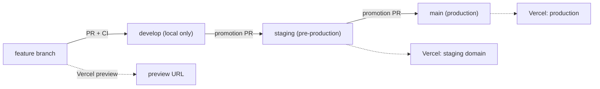

# Deployment & CI/CD

## Flow

`develop` is **not deployed**: it is exercised locally only. Pull requests get a Vercel preview, `staging` is the pre-production environment and `main` is production. This is encoded in [`vercel.json`](../vercel.json) (`git.deploymentEnabled`).

## GitHub Actions

| Workflow                                                    | Trigger                                   | What it does                                                                                         |
| ----------------------------------------------------------- | ----------------------------------------- | ---------------------------------------------------------------------------------------------------- |
| [`ci.yml`](../.github/workflows/ci.yml)                     | PR / push on `develop`, `staging`, `main` | [Validation gate](CONTRIBUTING.md#validation-gate) + `npm audit`; uploads coverage, posts PR comment |
| [`promote.yml`](../.github/workflows/promote.yml)           | Manual (`workflow_dispatch`)              | Opens `develop → staging` or `staging → main` PR (skips if one is open)                              |
| [`issue-status.yml`](../.github/workflows/issue-status.yml) | PR merged into `develop`                  | Sets `status: completed` on issues the PR closes (`Closes #N`)                                       |
| [`dependabot.yml`](../.github/dependabot.yml)               | Weekly                                    | Grouped npm minor/patch updates and Actions updates, targeting `develop`                             |

The build step uses placeholder Supabase values, so CI needs no secrets. Merged feature branches are deleted automatically (repository setting), so the legacy cleanup workflow was not ported.

## Vercel setup (manual, one time)

1. Import `MikeDzossa/foodbiz-pwa` in Vercel. Framework: Next.js (auto-detected).
2. **Production Branch:** `main`. Ensure Preview deployments are on for all branches.
3. Environment variables (Settings → Environment Variables), one Supabase project per environment:
   - **Production** → production Supabase URL + publishable key.
   - **Preview** → staging/dev Supabase URL + publishable key. Use a branch-specific value for `staging` if staging has its own project.
   - Only `NEXT_PUBLIC_SUPABASE_URL` and `NEXT_PUBLIC_SUPABASE_PUBLISHABLE_KEY` today. Never add the service-role key as `NEXT_PUBLIC_*`.
4. **Staging domain:** Settings → Domains → add a domain (e.g. `staging.<your-domain>`) and assign it to the `staging` Git branch.
5. Optional: enable Deployment Protection on previews/staging.

## Branch protection (recommended)

Required status check: `Quality gate`. For `develop`, `staging` and `main`: require PRs, require the check to pass, block force pushes and deletions. Note that GitHub only enforces branch protection on private repositories with a paid plan; on the free plan the rules are a team convention.

## Releasing

Promotions are PRs (never direct pushes) opened and merged by maintainers; hotfixes follow the same path unless maintainers decide otherwise.

1. Run **Actions → Promote → staging**, merge the PR with a **merge commit** (not squash) once CI is green, and qualify on staging.
2. Run **Actions → Promote → main**, merge, and tag the release (`git tag -a vX.Y.Z`, semantic versioning).
