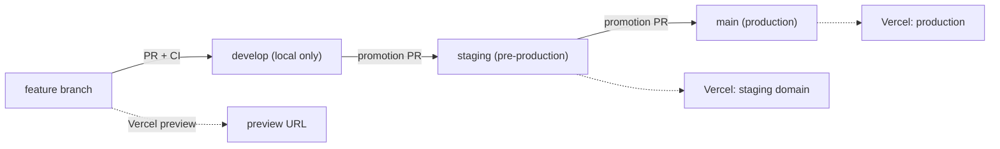
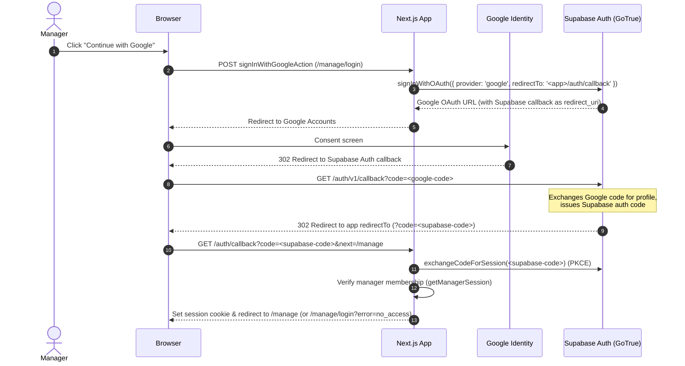

# Deployment & CI/CD

## Flow



`develop` is **not deployed**: it is exercised locally only. Pull requests get a Vercel preview, `staging` is the pre-production environment and `main` is production. This is encoded in [`vercel.json`](../vercel.json) (`git.deploymentEnabled`).

## GitHub Actions

| Workflow                                                    | Trigger                                   | What it does                                                                                         |
| ----------------------------------------------------------- | ----------------------------------------- | ---------------------------------------------------------------------------------------------------- |
| [`ci.yml`](../.github/workflows/ci.yml)                     | PR / push on `develop`, `staging`, `main` | [Validation gate](CONTRIBUTING.md#validation-gate) + `npm audit`; uploads coverage, posts PR comment |
| [`promote.yml`](../.github/workflows/promote.yml)           | Manual (`workflow_dispatch`)              | Opens `develop → staging` or `staging → main` PR (skips if one is open)                              |
| [`issue-status.yml`](../.github/workflows/issue-status.yml) | PR merged into `develop`                  | Sets `status: completed` on issues the PR closes (`Closes #N`)                                       |
| [`dependabot.yml`](../.github/dependabot.yml)               | Weekly                                    | Grouped npm minor/patch updates and Actions updates, targeting `develop`                             |

The build step uses placeholder Supabase values, so CI needs no secrets. Merged feature branches are deleted automatically (repository setting), so the legacy cleanup workflow was not ported.

## Vercel setup (manual, one time)

1. Import `MikeDzossa/foodbiz-pwa` in Vercel. Framework: Next.js (auto-detected).
2. **Production Branch:** `main`. Ensure Preview deployments are on for all branches.
3. Environment variables (Settings → Environment Variables), one Supabase project per environment:
   - **Production** → production Supabase URL + publishable key.
   - **Preview** → staging/dev Supabase URL + publishable key. Use a branch-specific value for `staging` if staging has its own project.
   - Only `NEXT_PUBLIC_SUPABASE_URL` and `NEXT_PUBLIC_SUPABASE_PUBLISHABLE_KEY` today. Never add the service-role key as `NEXT_PUBLIC_*`.
   - `NEXT_PUBLIC_SITE_URL`: canonical origin (e.g. `https://foodbiz.app` for production).
4. **Staging domain:** Settings → Domains → add a domain (e.g. `staging.<your-domain>`) and assign it to the `staging` Git branch.
5. Optional: enable Deployment Protection on previews/staging.

## Google sign-in (Supabase Auth)

### Flow architecture



The app initiates OAuth with Supabase (`signInWithOAuth`), which directs Google to redirect back to **Supabase Auth (`/auth/v1/callback`)**, NOT the application callback. Supabase exchanges the Google credentials, establishes the user identity, and then redirects the browser to the application's `redirectTo` endpoint (`/auth/callback?code=...`) to complete the PKCE token exchange.

### Google Cloud console configuration

In the Google Cloud Console (APIs & Services > Credentials > OAuth 2.0 Client IDs > Web application):

1. **Authorised redirect URIs**:
   The redirect URI configured in Google Cloud must point to **Supabase Auth**, not the Next.js app callback:

   | Environment                    | Authorised redirect URI                              |
   | ------------------------------ | ---------------------------------------------------- |
   | Local (devcontainer CLI stack) | `http://127.0.0.1:54321/auth/v1/callback`            |
   | Hosted (Staging / Production)  | `https://<project-ref>.supabase.co/auth/v1/callback` |

2. **Authorised JavaScript origins**:
   Not required for server redirect OAuth flow (only needed for Google Identity Services / One Tap). Leaving `http://localhost:3000` or production domain is harmless.

### Where secrets live

- **Hosted Supabase Project (Staging & Production):**
  - Google Client ID and Client Secret are stored **ONLY** in the Supabase Dashboard: **Authentication > Providers > Google**.
  - Toggle **Enable Sign in with Google** to ON.
  - Paste the Client ID and Client Secret into the respective fields.
  - **Never** add Google OAuth credentials to the git repository, `.env` files, or Vercel environment variables.
- **Local Development (CLI Stack):**
  - The local Supabase CLI reads credentials via `env()` references in `supabase/config.toml`:
    - `client_id = "env(SUPABASE_AUTH_EXTERNAL_GOOGLE_CLIENT_ID)"`
    - `secret = "env(SUPABASE_AUTH_EXTERNAL_GOOGLE_SECRET)"`
  - Real values live in `supabase/.env` (which is git-ignored by `.env*`):
    ```bash
    cp supabase/.env.example supabase/.env
    # Add real SUPABASE_AUTH_EXTERNAL_GOOGLE_CLIENT_ID and SUPABASE_AUTH_EXTERNAL_GOOGLE_SECRET
    ```
  - `NEXT_PUBLIC_SITE_URL` in `.env.local` sets the canonical origin (e.g. `http://localhost:3000`).

### Supabase URL Configuration (Dashboard)

Navigate to **Authentication > URL Configuration**:

- **Site URL**:
  - Hosted: `https://<your-production-domain>` (e.g. `https://foodbiz.app`)
  - Local: `http://localhost:3000`
- **Redirect URLs (Allow-list)**:
  Add the explicit callback URLs and preview wildcard pattern:
  - `https://<your-production-domain>/auth/callback**`
  - `https://staging.<your-domain>/auth/callback**` (if staging domain configured)
  - `https://*-<team-slug>.vercel.app/auth/callback**` (wildcard placeholder for Vercel preview deployments)
  - `http://localhost:3000/auth/callback**` (for local development)

### Google OAuth consent screen

- **User type**: External.
- **Publishing status**:
  - During development/testing: set status to **Testing** and add authorized test users (e.g. manager Gmail addresses, up to 100 users).
  - For production: publish the consent screen to **In production**. Because the app requests only standard non-sensitive scopes (`openid`, `email`, `profile`), Google App Verification is **not** required.
- **Scopes**: `.../auth/userinfo.email`, `.../auth/userinfo.profile`, `openid`.

### Troubleshooting

| Issue / Error                                              | Root cause                                                                                                                                                                               | Fix                                                                                                                                                                                                                                                            |
| ---------------------------------------------------------- | ---------------------------------------------------------------------------------------------------------------------------------------------------------------------------------------- | -------------------------------------------------------------------------------------------------------------------------------------------------------------------------------------------------------------------------------------------------------------- |
| Redirect lands on `/?code=...` instead of `/auth/callback` | The `redirectTo` parameter sent by the app does not match any entry in Supabase's redirect allow-list. Supabase falls back to `site_url`.                                                | In Supabase Dashboard (or `supabase/config.toml` for local), add `https://<domain>/auth/callback**` (or `http://localhost:3000/auth/callback**`) to **Redirect URLs**.                                                                                         |
| `redirect_uri_mismatch` on Google consent screen           | The redirect URI registered in Google Cloud Console is pointing to the Next.js app (e.g. `http://localhost:3000/api/auth/callback/google` or `/auth/callback`) instead of Supabase Auth. | In Google Cloud Console > Credentials, change Authorised redirect URI to `http://127.0.0.1:54321/auth/v1/callback` (local) or `https://<project-ref>.supabase.co/auth/v1/callback` (hosted).                                                                   |
| Redirect to `/manage/login?error=no_access`                | The Google user authenticated successfully with Supabase, but their account email has no active membership in `business_members` table (or allow-list in dev).                           | A business owner or admin must provision membership for that email using `npm run db:provision-member -- --business-slug <slug> --email <email>` or add them to the business. The user can click "Sign out" on the error banner to try another Google account. |
| `/manage/login?error=auth_failed` in production            | `NEXT_PUBLIC_SITE_URL` is not configured in Vercel environment variables. In production, the app strictly requires a configured canonical origin and refuses forwarded headers.          | Set `NEXT_PUBLIC_SITE_URL=https://<your-domain>` in Vercel project environment variables (Production and Preview).                                                                                                                                             |

## Development allow-list & auto-provisioning

In local development and test environments (`APP_ENV=development` or `APP_ENV=test`), sign-in for developers and testers is streamlined via the manager email allow-list (`ALLOWED_MANAGER_EMAILS`).

### Behavior

1. **Auto-Provisioning in Dev/Test**:
   When a signed-in Google user has no existing row in the `business_members` table, the server automatically provisions a membership row with role `manager` attached to the seeded demo business (`DEV_BUSINESS_SLUG`, default: `la-petite-boulangerie`). This ensures that Postgres RLS policies grant immediate access to real database records.
2. **Strict Security Invariants**:
   - **Environment restricted**: Auto-provisioning and the server-side admin client (`createAdminClient()`) throw and fail closed if invoked outside `development` or `test` (e.g. in `production` or `staging`).
   - **Google provider only**: The user's account must originate from the Google OAuth provider (`user.app_metadata.provider === 'google'`).
   - **Verified email**: The user's email must be verified (`user.email_confirmed_at` is set).
   - **Explicit allow-list**: The verified email must match an entry in `ALLOWED_MANAGER_EMAILS`.
3. **Production Isolation**:
   In production and staging environments, `ALLOWED_MANAGER_EMAILS` is unconditionally ignored and auto-provisioning never runs. Manager access strictly requires an existing `business_members` row created via admin invitation or provisioning CLI (`npm run db:provision-member`).

### Local quickstart

1. Start and seed the local Supabase stack:
   ```bash
   npm run db:start
   ```
2. In `.env.local`, set your verified Google email in `ALLOWED_MANAGER_EMAILS`:
   ```bash
   ALLOWED_MANAGER_EMAILS=dev@example.com
   ```
3. Sign in via Google OAuth on `/manage/login`.
4. Upon successful sign-in, the server creates the `business_members` row and redirects to `/manage`. Real orders and products are immediately accessible through RLS.

## Branch protection (recommended)

Required status check: `Quality gate`. For `develop`, `staging` and `main`: require PRs, require the check to pass, block force pushes and deletions. Note that GitHub only enforces branch protection on private repositories with a paid plan; on the free plan the rules are a team convention.

## Production manager access & provisioning

In production, manager access is strictly restricted to authenticated users provisioned in `public.business_members` (enforced via Supabase RLS).

### Prerequisites & Design Constraints

1. **User Must Sign In First**: The target manager or staff member must have signed in with Google once via `/manage/login` so their auth user account exists in Supabase Auth. By design, the provisioning script resolves existing auth records and does not create or invite users out-of-band, preventing phantom or unverified pre-created accounts.
2. **Translated 'No Access' Handling**: If a signed-in user lacks a `business_members` record (and is not auto-provisioned via dev/test `ALLOWED_MANAGER_EMAILS`), the app redirects them to `/manage/login?error=no_access`. A translated alert ("Accès restreint / Access Restricted") is displayed, allowing them to sign out and switch Google accounts.
3. **Single-Business-Per-User Model**: FoodBiz currently models exactly one active business per manager. When resolving active sessions (`findMembershipForUser`), deterministic ordering (`order by created_at asc, id asc limit 1`) selects the user's earliest created membership.

### Provisioning Commands

#### Local CLI stack

```bash
npm run db:provision-member -- --business-slug la-petite-boulangerie --email manager@example.com --role manager
```

#### Hosted / Production Supabase project

Hosted provisioning requires an explicit `--yes` flag and requires the maintainer to supply the real service-role key out-of-band outside the repo:

```bash
SUPABASE_URL="https://your-project.supabase.co" \
SUPABASE_SERVICE_ROLE_KEY="your-service-role-key" \
npm run db:provision-member -- --business-slug <slug> --email <email> --role manager --yes
```

### CLI Options & Safety Flags

- `--business-slug <slug>` or `--business-id <uuid>` (exactly one is required)
- `--email <email>` or `--user-id <uuid>` (exactly one is required)
- `--role <owner|manager|staff>` (defaults to `manager`)
- `--yes`: Required for any non-local target host (anything other than `localhost`, `127.0.0.1`, `::1`, `host.docker.internal`). Prevents unintended writes to production databases.
- `--force`: Required if changing an existing member's role (e.g. promoting from `staff` to `manager` or downgrading). Re-running with the identical role is idempotent and safe without `--force`.

> **Security Note:** `SUPABASE_SERVICE_ROLE_KEY` is an administrative server-only secret that bypasses RLS. It must NEVER be prefixed with `NEXT_PUBLIC_`, never exposed to client code, never committed to git, and must be provided strictly out-of-band by the maintainer when executing administrative CLI scripts.

## Releasing

Promotions are PRs (never direct pushes) opened and merged by maintainers; hotfixes follow the same path unless maintainers decide otherwise.

1. Run **Actions → Promote → staging**, merge the PR with a **merge commit** (not squash) once CI is green, and qualify on staging.
2. Run **Actions → Promote → main**, merge, and tag the release (`git tag -a vX.Y.Z`, semantic versioning).
