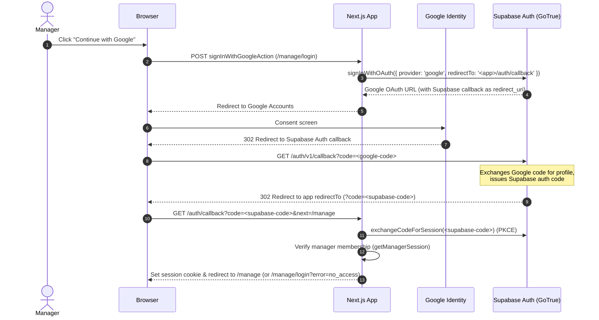

# Deployment and environments

Read this first: **nothing is live yet.** Staging and preview deployments are being set up ([#112](https://github.com/mikael-dzoss/foodbiz-pwa/issues/112)); production does not exist yet. `develop` is exercised locally and in CI only. Sections are labelled **Active** (true today) or **Planned** (does not exist yet).

# Active today

## Environments

| Environment | State                                                                                           |
| ----------- | ----------------------------------------------------------------------------------------------- |
| Local       | Active: devcontainer, `npm run dev`, local Supabase (`npm run db:start`), mock or Supabase mode |
| CI          | Active: GitHub Actions, see below                                                               |
| Staging     | Being set up (#112)                                                                             |
| Preview     | Being set up: shares the staging Supabase project                                               |
| Production  | Planned: no Supabase or hosting project ([ADR 0001](decisions/0001-hosting-and-backups.md))     |

## CI

[`ci.yml`](../.github/workflows/ci.yml) runs on pull requests, on pushes to `develop`, `staging` and `main`, and manually. It has three tiers (`check` always, `integration` and `e2e` only when the change needs them) and one required check, `Quality Gate - Summary`. Which paths trigger which tier, and the cost, are in [`CONTRIBUTING.md`](CONTRIBUTING.md#ci-tiers-and-cost). The `integration` job starts a local Supabase stack seeded by `supabase/seed.sql`, so CI needs no secrets.

| Workflow                                                                | Trigger                                | What it does                                                                                            |
| ----------------------------------------------------------------------- | -------------------------------------- | ------------------------------------------------------------------------------------------------------- |
| [`ci.yml`](../.github/workflows/ci.yml)                                 | PR, push to protected branches, manual | The tiered gate above                                                                                   |
| [`promote.yml`](../.github/workflows/promote.yml)                       | Manual                                 | Opens a `develop` to `staging` or `staging` to `main` PR                                                |
| [`db-migrate-staging.yml`](../.github/workflows/db-migrate-staging.yml) | Manual (`staging` branch only)         | Dry-runs and pushes `supabase/migrations/` to staging, runs pgTAP tests, and checks for invalid indexes |
| [`issue-status.yml`](../.github/workflows/issue-status.yml)             | PR merged into `develop`               | Sets `status: completed` on issues the PR closes                                                        |
| [`dependabot.yml`](../.github/dependabot.yml)                           | Weekly                                 | Grouped npm and Actions update PRs against `develop`                                                    |

## Branch protection

`develop`, `staging` and `main` exist. One repository ruleset ("Protected Ref") applies to all three: no deletion, no force push, changes only through a pull request (zero approvals required), and the check `Quality Gate - Summary` must pass. Nothing builds or deploys from `staging` or `main`.

Enforcement depends on repository visibility and plan. Rulesets are enforced while the repository is public. On a private repository, enforcement depends on the GitHub plan (not verified here). The owner intends to make the repository private again; in that case the local husky hooks (`.husky/`) and the agent hooks (`.claude/hooks/`) are the only enforcement.

## What merging to develop does

CI runs again on the push (a format check when the merge commit equals the verified PR head, otherwise the same scope rules on the merge diff). `issue-status.yml` marks the closed issues. No deployment happens: `vercel.json` enables deployments for `main` and `staging` only, and no Vercel project is connected.

## Environment variables

Parsed in [`src/config/env.ts`](../src/config/env.ts); template in [`.env.example`](../.env.example). The devcontainer copies it to `.env.local` on first start.

| Variable                               | Scope  | Required when                                                                           | What it does                                                                                                                                                                                                                    |
| -------------------------------------- | ------ | --------------------------------------------------------------------------------------- | ------------------------------------------------------------------------------------------------------------------------------------------------------------------------------------------------------------------------------- |
| `NEXT_PUBLIC_SUPABASE_URL`             | public | Always                                                                                  | Supabase project URL; also allows `next/image` to load that project's `product-images` bucket                                                                                                                                   |
| `NEXT_PUBLIC_SUPABASE_PUBLISHABLE_KEY` | public | Always                                                                                  | Supabase publishable (anon) key                                                                                                                                                                                                 |
| `NEXT_PUBLIC_SITE_URL`                 | public | Optional in the schema; required in production and set on the `staging` branch override | Canonical origin for the OAuth `redirectTo`. Unset on Vercel previews (`VERCEL_ENV=preview`) so `resolveAuthBaseUrl` resolves the preview host; outside production, falls back to the request origin or `http://localhost:3000` |
| `DATA_SOURCE`                          | server | Optional, default `mock`                                                                | `mock` or `supabase`. `mock` is rejected when `NODE_ENV` or `APP_ENV` is `production`; `npm run build` defaults it to `supabase`                                                                                                |
| `STOREFRONT_BUSINESS_ID`               | server | `DATA_SOURCE=supabase`                                                                  | UUID of the business the public storefront serves. The seed uses `11111111-1111-4111-8111-111111111111`; mock mode defaults to the demo business                                                                                |
| `APP_ENV`                              | server | Optional                                                                                | `development`, `test`, `staging` or `production`; falls back to `NODE_ENV`. Use `staging` on hosted staging and Vercel previews. Dev/test features require both `NODE_ENV` and `APP_ENV` to resolve to `development` or `test`  |
| `ALLOWED_MANAGER_EMAILS`               | server | Optional                                                                                | Comma-separated emails auto-provisioned as managers of the demo business; honoured only in development and test                                                                                                                 |
| `DEV_BUSINESS_SLUG`                    | server | Optional                                                                                | Business slug for that auto-provisioning (default `la-petite-boulangerie`)                                                                                                                                                      |
| `SUPABASE_SERVICE_ROLE_KEY`            | server | Dev and test auto-provisioning; the `db:provision-member` script reads it too           | Admin key that bypasses RLS. Never `NEXT_PUBLIC_*`, never in client code, never set on Vercel. The app throws if it is used outside development or test                                                                         |
| `VERCEL_ENV`                           | server | Set by Vercel; leave unset locally                                                      | `production`, `preview` or `development`. Only `preview` enables the validated Vercel host fallback in `resolveAuthBaseUrl`                                                                                                     |
| `VERCEL_URL`                           | server | Set by Vercel; leave unset locally                                                      | Deployment hostname without protocol (e.g. `foodbiz-pwa-abc123-<team>.vercel.app`), used to validate preview OAuth origins                                                                                                      |
| `VERCEL_BRANCH_URL`                    | server | Set by Vercel; leave unset locally                                                      | Branch hostname without protocol (e.g. `foodbiz-pwa-git-<branch>-<team>.vercel.app`), preferred preview fallback when `origin` does not match                                                                                   |

# Planned

## Staged path to launch

| When                                      | What                                                                                                                                                                                                                                                                     | Why                                            | Tracking                                                                                              |
| ----------------------------------------- | ------------------------------------------------------------------------------------------------------------------------------------------------------------------------------------------------------------------------------------------------------------------------ | ---------------------------------------------- | ----------------------------------------------------------------------------------------------------- |
| NOW (foundation work)                     | Tiered CI and local gate                                                                                                                                                                                                                                                 | Cheap, trustworthy checks                      | done                                                                                                  |
| NOW                                       | Database-enforced order limits, idempotency and rate limits                                                                                                                                                                                                              | Public ordering must survive abuse and retries | done                                                                                                  |
| NOW                                       | Migration safety runbook ([Applying migrations](#applying-migrations-to-a-hosted-project-active))                                                                                                                                                                        | Safe first push to a hosted database           | done                                                                                                  |
| NOW                                       | Local secret scan                                                                                                                                                                                                                                                        | No secrets in git                              | done                                                                                                  |
| NOW                                       | `instrumentation.ts` request-error logging                                                                                                                                                                                                                               | See server errors                              | built: JSON lines in Vercel runtime logs ([architecture.md#server-logs](architecture.md#server-logs)) |
| BEFORE v0.9                               | Staging Supabase project and Vercel project with preview deploys. Decided: all preview deployments share the staging Supabase project; production builds keep refusing `DATA_SOURCE=mock`                                                                                | Somewhere to test on real infrastructure       | #112                                                                                                  |
| BEFORE v0.9                               | Security headers and CSP                                                                                                                                                                                                                                                 | Browser hardening                              | #108                                                                                                  |
| BEFORE v0.9                               | Error tracking provider                                                                                                                                                                                                                                                  | See production failures                        | #109                                                                                                  |
| BEFORE v0.9                               | Service worker and offline page                                                                                                                                                                                                                                          | Offline fallback                               | #101                                                                                                  |
| BEFORE v0.9                               | PNG and maskable icons, install experience                                                                                                                                                                                                                               | Installable app                                | #99, #100                                                                                             |
| BEFORE v0.9                               | Legal pages (mentions legales, privacy, terms) and a privacy notice at checkout                                                                                                                                                                                          | Legal requirement for taking customer data     | #97                                                                                                   |
| BEFORE v0.9                               | Sitemap, robots, metadata, Open Graph                                                                                                                                                                                                                                    | Search and sharing                             | #95, #96                                                                                              |
| BEFORE v0.9                               | Demo seed for staging                                                                                                                                                                                                                                                    | Realistic test data                            | #113                                                                                                  |
| BEFORE v0.9                               | Acceptance checklist and bug bash                                                                                                                                                                                                                                        | Release confidence                             | #114                                                                                                  |
| BEFORE v0.9                               | CI for promotion PRs ([below](#planned-ci-for-promotion-prs))                                                                                                                                                                                                            | Promotion PRs get checks of their own          | none                                                                                                  |
| BEFORE v1                                 | Production environment and custom domain                                                                                                                                                                                                                                 | Launch                                         | none                                                                                                  |
| BEFORE v1                                 | Database backups with a tested restore                                                                                                                                                                                                                                   | Recover from data loss                         | #330, #331                                                                                            |
| BEFORE v1                                 | Uptime monitoring                                                                                                                                                                                                                                                        | Know when it is down                           | #332                                                                                                  |
| BEFORE v1                                 | Privacy-friendly product analytics                                                                                                                                                                                                                                       | Usage insight                                  | #110                                                                                                  |
| BEFORE v1                                 | GDPR: data export and erasure for guests, retention period and purge job, record of processing                                                                                                                                                                           | Legal requirement                              | none                                                                                                  |
| BEFORE v1                                 | Phone verification or CAPTCHA, and edge rate limiting                                                                                                                                                                                                                    | Stop fake orders the database limits cannot    | none                                                                                                  |
| BEFORE v1                                 | Pagination                                                                                                                                                                                                                                                               | Lists hit the 1,000-row cap                    | none                                                                                                  |
| BEFORE v1                                 | Lighthouse budgets                                                                                                                                                                                                                                                       | Keep performance                               | #107                                                                                                  |
| BEFORE v1                                 | Staff accounts and roles                                                                                                                                                                                                                                                 | More than one person in the dashboard          | #135                                                                                                  |
| BEFORE MAKING THE REPOSITORY PUBLIC AGAIN | Decide on rewriting git history to remove the personal email from commit metadata. The owner chose to rewrite, deferred until then. Limits: pull-request refs cannot be rewritten without GitHub Support, existing clones keep the old history, all commit hashes change | Privacy of the owner                           | none                                                                                                  |
| BEFORE MAKING THE REPOSITORY PUBLIC AGAIN | Confirm the licence statement                                                                                                                                                                                                                                            | The README says all rights reserved            | none                                                                                                  |
| BEFORE MAKING THE REPOSITORY PUBLIC AGAIN | Re-enable secret scanning, push protection, Dependabot alerts and CodeQL (free only on public repositories)                                                                                                                                                              | Security scanning                              | none                                                                                                  |
| BEFORE MAKING THE REPOSITORY PUBLIC AGAIN | Delete stale remote branches                                                                                                                                                                                                                                             | Tidy                                           | none                                                                                                  |
| BEFORE MAKING THE REPOSITORY PUBLIC AGAIN | Re-check the Actions allow-list and the ruleset                                                                                                                                                                                                                          | No surprises on visibility change              | none                                                                                                  |

## Staging and preview setup

One Supabase project (`foodbiz-staging`) serves both the `staging` branch and all Vercel preview deployments on a Vercel Hobby project (Production Branch: `main`). There is no mock-data exception for previews: production builds (`next build` runs with `NODE_ENV=production`) refuse `DATA_SOURCE=mock`.

| Variable                               | Preview (all branches)  | Preview (`staging` branch override)                                                 | Production                                                                                                                    |
| -------------------------------------- | ----------------------- | ----------------------------------------------------------------------------------- | ----------------------------------------------------------------------------------------------------------------------------- |
| `NEXT_PUBLIC_SUPABASE_URL`             | Staging Supabase URL    | Inherits Preview (same staging URL)                                                 | Not set until a production project exists ([ADR 0001](decisions/0001-hosting-and-backups.md): Netlify, subject to spike #327) |
| `NEXT_PUBLIC_SUPABASE_PUBLISHABLE_KEY` | Staging publishable key | Inherits Preview (same staging key)                                                 | Not set                                                                                                                       |
| `DATA_SOURCE`                          | `supabase`              | Inherits Preview (`supabase`)                                                       | Not set                                                                                                                       |
| `STOREFRONT_BUSINESS_ID`               | `<demo business uuid>`  | Inherits Preview (`<demo business uuid>`)                                           | Not set                                                                                                                       |
| `APP_ENV`                              | `staging`               | Inherits Preview (`staging`)                                                        | Not set                                                                                                                       |
| `NEXT_PUBLIC_SITE_URL`                 | **Unset**               | `https://foodbiz-pwa-git-staging-<team-slug>.vercel.app` (or custom staging domain) | Not set                                                                                                                       |
| `SUPABASE_SERVICE_ROLE_KEY`            | **Never set on Vercel** | **Never set on Vercel**                                                             | **Never set on Vercel**                                                                                                       |

- **Build-time requirement:** the same variables must be available at **build time** (enabled for Build & Runtime in Vercel). The storefront prerenders its catalog against Supabase during `next build`, and an unreachable database fails the build instead of shipping placeholder data.
- **No service-role key on Vercel:** the runtime app throws if `createAdminClient()` is invoked outside `development` or `test`. Only the provisioning CLI (`npm run db:provision-member`) uses `SUPABASE_SERVICE_ROLE_KEY`, supplied out-of-band by the maintainer.
- **Vercel Deployment Protection:** enabled by default for preview deployments on Hobby, which blocks anonymous visitors behind Vercel login. Decide in **Project Settings → Deployment Protection** whether to keep it on for the staging URL (or disable it / use shareable bypass links so anonymous storefront visits work without a Vercel account).

## Planned: CI for promotion PRs

`promote.yml` creates its PR with `GITHUB_TOKEN`, and PRs created that way do not trigger `pull_request` workflows, so promotion PRs get no CI of their own. Nothing is needed today (staging and production do not exist yet), and it stays harmless while the promotion PR's head is the tip of `develop` (or `staging`): the required check `Quality Gate - Summary` is evaluated on the head SHA, and that SHA already has it from the `push` run of `ci.yml`. When environments exist and that no longer holds, apply one of: (a) after creating the PR, have `promote.yml` run `gh workflow run ci.yml --ref <source branch>` (`workflow_dispatch` is exempt from the `GITHUB_TOKEN` rule; needs `actions: write`), or (b) create the PR with a fine-grained token or GitHub App token so `pull_request` fires normally.

## Google sign-in (Supabase Auth): Active locally, Planned for hosted

### Flow architecture



The app initiates OAuth with Supabase (`signInWithOAuth`), which directs Google to redirect back to **Supabase Auth (`/auth/v1/callback`)**, NOT the application callback. Supabase exchanges the Google credentials, establishes the user identity, and then redirects the browser to the application's `redirectTo` endpoint (`/auth/callback?code=...`) to complete the PKCE token exchange.

### Google Cloud console configuration

In the Google Cloud Console (APIs & Services > Credentials > OAuth 2.0 Client IDs > Web application):

1. **Authorised redirect URIs**:
   The redirect URI configured in Google Cloud must point to **Supabase Auth**, not the Next.js app callback:

   | Environment                    | Authorised redirect URI                              |
   | ------------------------------ | ---------------------------------------------------- |
   | Local (devcontainer CLI stack) | `http://127.0.0.1:54321/auth/v1/callback`            |
   | Staging                        | `https://<staging-ref>.supabase.co/auth/v1/callback` |
   | Production (Planned)           | `https://<prod-ref>.supabase.co/auth/v1/callback`    |

2. **Test users (while in Testing)**:
   Under **APIs & Services > OAuth consent screen > Audience / Test users**, add each manager's Gmail address while the publishing status is **Testing** (up to 100 users).

3. **Authorised JavaScript origins**:
   Not required for server redirect OAuth flow (only needed for Google Identity Services / One Tap). Leaving `http://localhost:3000` or the staging domain is harmless.

### Where secrets live

- **Hosted Supabase Project (Staging & Production):**
  - Google Client ID and Client Secret are stored **ONLY** in the Supabase Dashboard: **Authentication > Providers > Google**.
  - Toggle **Enable Sign in with Google** to ON.
  - Paste the Client ID and Client Secret into the respective fields.
  - **Never** add Google OAuth credentials to the git repository, `.env` files, or Vercel environment variables.
- **Local Development (CLI Stack):**
  - The local Supabase CLI reads credentials via `env()` references in `supabase/config.toml`:
    - `client_id = "env(SUPABASE_AUTH_EXTERNAL_GOOGLE_CLIENT_ID)"`
    - `secret = "env(SUPABASE_AUTH_EXTERNAL_GOOGLE_SECRET)"`
  - Real values live in `supabase/.env` (which is git-ignored by `.env*`):
    ```bash
    cp supabase/.env.example supabase/.env
    # Add real SUPABASE_AUTH_EXTERNAL_GOOGLE_CLIENT_ID and SUPABASE_AUTH_EXTERNAL_GOOGLE_SECRET
    ```
  - `NEXT_PUBLIC_SITE_URL` in `.env.local` sets the canonical origin (e.g. `http://localhost:3000`).

### Supabase URL Configuration (Dashboard)

In the staging Supabase project, navigate to **Authentication > URL Configuration**:

- **Site URL**:
  - Staging: `https://foodbiz-pwa-git-staging-<team-slug>.vercel.app` (or a custom staging domain if added)
  - Local: `http://localhost:3000`
- **Redirect URLs (Allow-list)**:
  Add these exact entries on the staging project:
  - `https://foodbiz-pwa-git-staging-<team-slug>.vercel.app/auth/callback**`
  - `https://foodbiz-pwa-*-<team-slug>.vercel.app/auth/callback**`
  - `http://localhost:3000/auth/callback**`

### Preview origin resolution

When `NEXT_PUBLIC_SITE_URL` is set (such as on the `staging` branch override or in production), `resolveAuthBaseUrl` ([`src/config/site-url.ts`](../src/config/site-url.ts)) always uses it. On Vercel previews (`VERCEL_ENV=preview`) where `NEXT_PUBLIC_SITE_URL` is left unset, it accepts the request `origin` header only if it exactly equals `https://${VERCEL_URL}` or `https://${VERCEL_BRANCH_URL}` (falling back to `VERCEL_BRANCH_URL`, then `VERCEL_URL`), keeping the PKCE verifier cookie on the preview host without ever trusting `host`/`x-forwarded-host` or applying the preview fallback when `VERCEL_ENV=production`.

### Google OAuth consent screen

- **User type**: External.
- **Publishing status**:
  - During development/testing: set status to **Testing** and add authorized test users (e.g. manager Gmail addresses, up to 100 users).
  - For production: publish the consent screen to **In production**. Because the app requests only standard non-sensitive scopes (`openid`, `email`, `profile`), Google App Verification is **not** required.
- **Scopes**: `.../auth/userinfo.email`, `.../auth/userinfo.profile`, `openid`.

### Troubleshooting

| Issue / Error                                              | Root cause                                                                                                                                                                                                                                                                                                                              | Fix                                                                                                                                                                                                                                                                                                         |
| ---------------------------------------------------------- | --------------------------------------------------------------------------------------------------------------------------------------------------------------------------------------------------------------------------------------------------------------------------------------------------------------------------------------- | ----------------------------------------------------------------------------------------------------------------------------------------------------------------------------------------------------------------------------------------------------------------------------------------------------------- |
| Redirect lands on `/?code=...` instead of `/auth/callback` | The `redirectTo` parameter sent by the app does not match any entry in Supabase's redirect allow-list. Supabase falls back to `site_url`.                                                                                                                                                                                               | In Supabase Dashboard (or `supabase/config.toml` for local), add `https://<domain>/auth/callback**` (or `http://localhost:3000/auth/callback**`) to **Redirect URLs**.                                                                                                                                      |
| `redirect_uri_mismatch` on Google consent screen           | The redirect URI registered in Google Cloud Console is pointing to the Next.js app (e.g. `http://localhost:3000/api/auth/callback/google` or `/auth/callback`) instead of Supabase Auth.                                                                                                                                                | In Google Cloud Console > Credentials, change Authorised redirect URI to `http://127.0.0.1:54321/auth/v1/callback` (local) or `https://<project-ref>.supabase.co/auth/v1/callback` (hosted).                                                                                                                |
| Redirect to `/manage/login?error=no_access`                | The Google user authenticated successfully with Supabase, but their account email has no active membership in `business_members` table (or allow-list in dev).                                                                                                                                                                          | A business owner or admin must provision membership for that email using `npm run db:provision-member -- --business-slug <slug> --email <email>` or add them to the business. The user can click "Sign out" on the error banner to try another Google account.                                              |
| `/manage/login?error=auth_failed` in production or preview | `resolveAuthBaseUrl` could not resolve a trusted origin: in production (`VERCEL_ENV=production` or non-Vercel production), `NEXT_PUBLIC_SITE_URL` is unset; on a Vercel preview (`VERCEL_ENV=preview`), `NEXT_PUBLIC_SITE_URL` is unset and both `VERCEL_BRANCH_URL` and `VERCEL_URL` are missing. Forwarded headers are never trusted. | In production (and the `staging` branch override), set `NEXT_PUBLIC_SITE_URL=https://<canonical-origin>`. On other Vercel preview branches, leave `NEXT_PUBLIC_SITE_URL` unset and ensure Vercel System Environment Variables (`VERCEL_ENV`, `VERCEL_URL`, `VERCEL_BRANCH_URL`) are exposed to deployments. |

## Development allow-list and auto-provisioning: Active

In local development and test environments (`APP_ENV=development` or `APP_ENV=test`), sign-in for developers and testers is streamlined via the manager email allow-list (`ALLOWED_MANAGER_EMAILS`).

### Behavior

1. **Auto-Provisioning in Dev/Test**:
   When a signed-in Google user has no existing row in the `business_members` table, the server automatically provisions a membership row with role `manager` attached to the seeded demo business (`DEV_BUSINESS_SLUG`, default: `la-petite-boulangerie`). This ensures that Postgres RLS policies grant immediate access to real database records.
2. **Strict Security Invariants**:
   - **Environment restricted**: Auto-provisioning and the server-side admin client (`createAdminClient()`) throw and fail closed if invoked outside `development` or `test` (e.g. in `production` or `staging`).
   - **Google provider only**: The user's account must originate from the Google OAuth provider (`user.app_metadata.provider === 'google'`).
   - **Verified email**: The user's email must be verified (`user.email_confirmed_at` is set).
   - **Explicit allow-list**: The verified email must match an entry in `ALLOWED_MANAGER_EMAILS`.
3. **Production Isolation**:
   In production and staging environments, `ALLOWED_MANAGER_EMAILS` is unconditionally ignored and auto-provisioning never runs. Manager access strictly requires an existing `business_members` row created via admin invitation or provisioning CLI (`npm run db:provision-member`).

### Local quickstart

1. Start and seed the local Supabase stack:
   ```bash
   npm run db:start
   ```
2. In `.env.local`, set your verified Google email in `ALLOWED_MANAGER_EMAILS`:
   ```bash
   ALLOWED_MANAGER_EMAILS=dev@example.com
   ```
3. Sign in via Google OAuth on `/manage/login`.
4. Upon successful sign-in, the server creates the `business_members` row and redirects to `/manage`. Real orders and products are immediately accessible through RLS.

## Provisioning a manager: Active locally, Planned for hosted

Manager access is strictly restricted to authenticated users provisioned in `public.business_members` (enforced via Supabase RLS).

### Prerequisites & Design Constraints

1. **User Must Sign In First**: The target manager or staff member must have signed in with Google once via `/manage/login` so their auth user account exists in Supabase Auth. By design, the provisioning script resolves existing auth records and does not create or invite users out-of-band, preventing phantom or unverified pre-created accounts.
2. **Translated 'No Access' Handling**: If a signed-in user lacks a `business_members` record (and is not auto-provisioned via dev/test `ALLOWED_MANAGER_EMAILS`), the app redirects them to `/manage/login?error=no_access`. A translated alert ("Accès restreint / Access Restricted") is displayed, allowing them to sign out and switch Google accounts.
3. **Single-Business-Per-User Model**: FoodBiz currently models exactly one active business per manager. When resolving active sessions (`findMembershipForUser`), deterministic ordering (`order by created_at asc, id asc limit 1`) selects the user's earliest created membership.

### Provisioning Commands

#### Local CLI stack

```bash
npm run db:provision-member -- --business-slug la-petite-boulangerie --email manager@example.com --role manager
```

#### Hosted / Production Supabase project

Hosted provisioning requires an explicit `--yes` flag and requires the maintainer to supply the real service-role key out-of-band outside the repo:

```bash
SUPABASE_URL="https://your-project.supabase.co" \
SUPABASE_SERVICE_ROLE_KEY="your-service-role-key" \
npm run db:provision-member -- --business-slug <slug> --email <email> --role manager --yes
```

### CLI Options & Safety Flags

- `--business-slug <slug>` or `--business-id <uuid>` (exactly one is required)
- `--email <email>` or `--user-id <uuid>` (exactly one is required)
- `--role <owner|manager|staff>` (defaults to `manager`)
- `--yes`: Required for any non-local target host (anything other than `localhost`, `127.0.0.1`, `::1`, `host.docker.internal`). Prevents unintended writes to production databases.
- `--force`: Required if changing an existing member's role (e.g. promoting from `staff` to `manager` or downgrading). Re-running with the identical role is idempotent and safe without `--force`.

> **Security Note:** `SUPABASE_SERVICE_ROLE_KEY` is an administrative server-only secret that bypasses RLS. It must NEVER be prefixed with `NEXT_PUBLIC_`, never exposed to client code, never committed to git, and must be provided strictly out-of-band by the maintainer when executing administrative CLI scripts.

## Applying migrations to a hosted project: Active

Migrations to staging run exclusively through [`.github/workflows/db-migrate-staging.yml`](../.github/workflows/db-migrate-staging.yml) (**Actions → Migrate staging database → Run workflow** with branch `staging`). The workflow refuses any branch other than `refs/heads/staging`, uses repository secrets (`STAGING_SUPABASE_PROJECT_REF`, `STAGING_SUPABASE_ACCESS_TOKEN`, `STAGING_SUPABASE_DB_PASSWORD`), runs a dry-run push, pushes pending `supabase/migrations/` (never `--include-seed`), runs the pgTAP suite (`supabase test db --remote --yes`), and fails if any invalid index exists in `pg_index`.

- **Concurrent indexes:** migrations `20260101000008` to `20260101000010` and `20260101000013` (as well as `20260101000016` to `20260101000019` and `20260101000021`) use `create index concurrently` in single-statement files so they run outside a transaction block. The first run of `db-migrate-staging` verifies that Supabase CLI v3 executes them outside a transaction against the hosted project (the statement fails inside one).
- **Invalid index check and recovery:** the workflow runs `select indexrelid::regclass from pg_index where not indisvalid;` after every push and fails if any row is returned. If a failed concurrent build leaves an invalid index, run `drop index concurrently <name>;` and re-run the migration (`create index concurrently if not exists` silently skips an existing invalid index, so drop it first).
- **Lock timeouts:** migrations `20260101000006`, `20260101000007` and `20260101000012` set `lock_timeout = '5s'` so they fail fast instead of queueing behind long transactions; re-run when traffic is low if one times out.
- **Deploy order:** apply migrations **before** the app code that requires them. Because `db-migrate-staging` reads migrations from `refs/heads/staging`, run the workflow **right after merging** a promotion PR into `staging` (and redeploy `staging` in Vercel if the automatic build started before the migration finished). For breaking schema or RPC changes (for example migration `20260101000014`, which replaced the 12-argument `place_order` signature with the `p_idempotency_key` signature), land and apply the migration before deploying app code that calls the new signature.

## Owner checklist for staging (#112)

Run these steps in order to bring up the hosted staging environment:

1. **Create the Supabase staging project** in the Supabase dashboard: EU region, Free organisation, project name `foodbiz-staging`. Save the database password in your password manager. Note the 20-character project ref (`https://supabase.com/dashboard/project/<staging-ref>`) and copy the Project URL and Publishable key from **Project Settings → API**.
2. **Create a Supabase personal access token** at **Account → Access Tokens** (used by the migration workflow).
3. **Add three GitHub repository secrets** in **Settings → Secrets and variables → Actions → Repository secrets** (repository secrets, not GitHub Environments, so they work once the repo is private on the Free plan):
   - `STAGING_SUPABASE_PROJECT_REF` = `<staging-ref>`
   - `STAGING_SUPABASE_ACCESS_TOKEN` = `<access-token>`
   - `STAGING_SUPABASE_DB_PASSWORD` = `<db-password>`
4. **Sync `staging` with `develop`** if `staging` is behind: run **Actions → Promote → `staging`** and merge the resulting PR with a **merge commit**.
5. **Run the migration workflow**: go to **Actions → Migrate staging database → Run workflow**, select branch **`staging`**, and run it. Confirm that the dry-run, migration push (including concurrent indexes), pgTAP suite, and invalid-index check all pass.
6. **Enable Google OAuth in staging Supabase**: go to **Authentication → Providers → Google**, toggle **Enable Sign in with Google** ON, and paste your Google OAuth Client ID and Client Secret (never store them in git, `.env`, or Vercel).
7. **Update Google Cloud Console** (**APIs & Services → Credentials → OAuth 2.0 Client ID**):
   - Add Authorised redirect URI: `https://<staging-ref>.supabase.co/auth/v1/callback`
   - Under **OAuth consent screen → Test users** (while in **Testing**), add the manager Gmail addresses that will test staging.
8. **Configure staging Supabase URLs** (**Authentication → URL Configuration**):
   - **Site URL**: `https://foodbiz-pwa-git-staging-<team-slug>.vercel.app`
   - **Redirect URLs**:
     - `https://foodbiz-pwa-git-staging-<team-slug>.vercel.app/auth/callback**`
     - `https://foodbiz-pwa-*-<team-slug>.vercel.app/auth/callback**`
     - `http://localhost:3000/auth/callback**`
9. **Import the repo in Vercel** (Hobby plan, **Production Branch:** `main`):
   - In **Settings → Environment Variables**, configure the Preview (all branches) and `staging` branch override variables from the [Staging and preview setup](#staging-and-preview-setup) table (leave Production empty; never add `SUPABASE_SERVICE_ROLE_KEY`; ensure Build & Runtime are both enabled).
   - In **Settings → General → Node.js Version**, verify **22.x** is selected if not auto-detected from `package.json`.
   - In **Settings → Deployment Protection**, decide whether to keep protection enabled on previews/staging.
10. **Trigger a `staging` deployment** in Vercel (Deployments → Redeploy `staging`, or push/promote to `staging`) and confirm the build succeeds and loads at `https://foodbiz-pwa-git-staging-<team-slug>.vercel.app`.
11. **Provision yourself as manager/owner**: once the demo business exists in staging (from #113), sign in once at `<staging-url>/manage/login` (this creates your Supabase Auth user and lands on `no_access`), then run locally with the staging service-role key supplied out-of-band:
    ```bash
    SUPABASE_URL="https://<staging-ref>.supabase.co" \
    SUPABASE_SERVICE_ROLE_KEY="<staging-service-role-key>" \
    npm run db:provision-member -- --business-slug <demo-business-slug> --email <your-email> --yes
    ```
    _(Omitting `--role` assigns `owner` to the first member of a business so owner-only settings are unlocked; pass `--role manager` for additional managers.)_

**Then tell Claude: "staging is up".** Claude will run a smoke check against the staging URL, flip the staging and preview entries in `docs/DEPLOYMENT.md` to **Active**, and close #112.

## Releasing

**Planned.** Staging and production do not exist yet. (The heading carries no label because `promote.yml` links to `#releasing`.)

Promotions are PRs (never direct pushes) opened and merged by maintainers; hotfixes follow the same path unless maintainers decide otherwise.

1. Run **Actions → Promote → staging**, merge the PR with a **merge commit** (not squash) once CI is green, and qualify on staging.
2. Run **Actions → Promote → main**, merge, and tag the release (`git tag -a vX.Y.Z`, semantic versioning).
