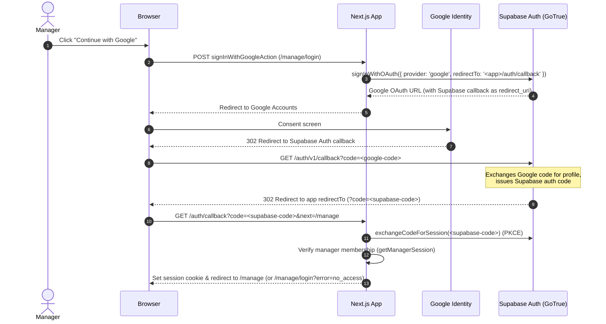

# Deployment and environments

Read this first: **nothing is deployed.** There is no staging or production environment, no Vercel project and no hosted Supabase project. `develop` is exercised locally and in CI only. Sections are labelled **Active** (true today) or **Planned** (does not exist yet).

# Active today

## Environments

| Environment | State                                                                                           |
| ----------- | ----------------------------------------------------------------------------------------------- |
| Local       | Active: devcontainer, `npm run dev`, local Supabase (`npm run db:start`), mock or Supabase mode |
| CI          | Active: GitHub Actions, see below                                                               |
| Staging     | Planned: no Supabase or Vercel project                                                          |
| Production  | Planned: same                                                                                   |

## CI

[`ci.yml`](../.github/workflows/ci.yml) runs on pull requests, on pushes to `develop`, `staging` and `main`, and manually. It has three tiers (`check` always, `integration` and `e2e` only when the change needs them) and one required check, `Quality Gate - Summary`. Which paths trigger which tier, and the cost, are in [`CONTRIBUTING.md`](CONTRIBUTING.md#ci-tiers-and-cost). The `integration` job starts a local Supabase stack seeded by `supabase/seed.sql`, so CI needs no secrets.

| Workflow                                                    | Trigger                                | What it does                                                                                                  |
| ----------------------------------------------------------- | -------------------------------------- | ------------------------------------------------------------------------------------------------------------- |
| [`ci.yml`](../.github/workflows/ci.yml)                     | PR, push to protected branches, manual | The tiered gate above                                                                                         |
| [`promote.yml`](../.github/workflows/promote.yml)           | Manual                                 | Opens a `develop` to `staging` or `staging` to `main` PR. Works, but nothing consumes `staging` or `main` yet |
| [`issue-status.yml`](../.github/workflows/issue-status.yml) | PR merged into `develop`               | Sets `status: completed` on issues the PR closes                                                              |
| [`dependabot.yml`](../.github/dependabot.yml)               | Weekly                                 | Grouped npm and Actions update PRs against `develop`                                                          |

## Branch protection

`develop`, `staging` and `main` exist. One repository ruleset ("Protected Ref") applies to all three: no deletion, no force push, changes only through a pull request (zero approvals required), and the check `Quality Gate - Summary` must pass. Nothing builds or deploys from `staging` or `main`.

Enforcement depends on repository visibility and plan. Rulesets are enforced while the repository is public. On a private repository, enforcement depends on the GitHub plan (not verified here). The owner intends to make the repository private again; in that case the local husky hooks (`.husky/`) and the agent hooks (`.claude/hooks/`) are the only enforcement.

## What merging to develop does

CI runs again on the push (a format check when the merge commit equals the verified PR head, otherwise the same scope rules on the merge diff). `issue-status.yml` marks the closed issues. No deployment happens: `vercel.json` enables deployments for `main` and `staging` only, and no Vercel project is connected.

## Environment variables

Parsed in [`src/config/env.ts`](../src/config/env.ts); template in [`.env.example`](../.env.example). The devcontainer copies it to `.env.local` on first start.

| Variable                               | Scope  | Required when                                                                 | What it does                                                                                                                                     |
| -------------------------------------- | ------ | ----------------------------------------------------------------------------- | ------------------------------------------------------------------------------------------------------------------------------------------------ |
| `NEXT_PUBLIC_SUPABASE_URL`             | public | Always                                                                        | Supabase project URL; also allows `next/image` to load that project's `product-images` bucket                                                    |
| `NEXT_PUBLIC_SUPABASE_PUBLISHABLE_KEY` | public | Always                                                                        | Supabase publishable (anon) key                                                                                                                  |
| `NEXT_PUBLIC_SITE_URL`                 | public | Optional in the schema; Google sign-in fails in production without it         | Canonical origin for the OAuth `redirectTo`. Outside production the request origin or `http://localhost:3000` is the fallback                    |
| `DATA_SOURCE`                          | server | Optional, default `mock`                                                      | `mock` or `supabase`. `mock` is rejected when `NODE_ENV` or `APP_ENV` is `production`; `npm run build` defaults it to `supabase`                 |
| `STOREFRONT_BUSINESS_ID`               | server | `DATA_SOURCE=supabase`                                                        | UUID of the business the public storefront serves. The seed uses `11111111-1111-4111-8111-111111111111`; mock mode defaults to the demo business |
| `APP_ENV`                              | server | Optional                                                                      | `development`, `test`, `staging` or `production`; falls back to `NODE_ENV`. Dev and test features need it to resolve to development or test      |
| `ALLOWED_MANAGER_EMAILS`               | server | Optional                                                                      | Comma-separated emails auto-provisioned as managers of the demo business; honoured only in development and test                                  |
| `DEV_BUSINESS_SLUG`                    | server | Optional                                                                      | Business slug for that auto-provisioning (default `la-petite-boulangerie`)                                                                       |
| `SUPABASE_SERVICE_ROLE_KEY`            | server | Dev and test auto-provisioning; the `db:provision-member` script reads it too | Admin key that bypasses RLS. Never `NEXT_PUBLIC_*`, never in client code. The app throws if it is used outside development or test               |

# Planned

## Staged path to launch

| When                                      | What                                                                                                                                                                                                                                                                     | Why                                            | Tracking                                                                                              |
| ----------------------------------------- | ------------------------------------------------------------------------------------------------------------------------------------------------------------------------------------------------------------------------------------------------------------------------ | ---------------------------------------------- | ----------------------------------------------------------------------------------------------------- |
| NOW (foundation work)                     | Tiered CI and local gate                                                                                                                                                                                                                                                 | Cheap, trustworthy checks                      | done                                                                                                  |
| NOW                                       | Database-enforced order limits, idempotency and rate limits                                                                                                                                                                                                              | Public ordering must survive abuse and retries | done                                                                                                  |
| NOW                                       | Migration safety runbook ([Applying migrations](#applying-migrations-to-a-hosted-project-planned))                                                                                                                                                                       | Safe first push to a hosted database           | done                                                                                                  |
| NOW                                       | Local secret scan                                                                                                                                                                                                                                                        | No secrets in git                              | done                                                                                                  |
| NOW                                       | `instrumentation.ts` request-error logging                                                                                                                                                                                                                               | See server errors                              | built: JSON lines in Vercel runtime logs ([architecture.md#server-logs](architecture.md#server-logs)) |
| BEFORE v0.9                               | Staging Supabase project and Vercel project with preview deploys. Production builds refuse mock data, so previews need a real Supabase project or a deliberate preview-only exception: open decision for the owner                                                       | Somewhere to test on real infrastructure       | #112                                                                                                  |
| BEFORE v0.9                               | Security headers and CSP                                                                                                                                                                                                                                                 | Browser hardening                              | #108                                                                                                  |
| BEFORE v0.9                               | Error tracking provider                                                                                                                                                                                                                                                  | See production failures                        | #109                                                                                                  |
| BEFORE v0.9                               | Service worker and offline page                                                                                                                                                                                                                                          | Offline fallback                               | #101                                                                                                  |
| BEFORE v0.9                               | PNG and maskable icons, install experience                                                                                                                                                                                                                               | Installable app                                | #99, #100                                                                                             |
| BEFORE v0.9                               | Legal pages (mentions legales, privacy, terms) and a privacy notice at checkout                                                                                                                                                                                          | Legal requirement for taking customer data     | #97                                                                                                   |
| BEFORE v0.9                               | Sitemap, robots, metadata, Open Graph                                                                                                                                                                                                                                    | Search and sharing                             | #95, #96                                                                                              |
| BEFORE v0.9                               | Demo seed for staging                                                                                                                                                                                                                                                    | Realistic test data                            | #113                                                                                                  |
| BEFORE v0.9                               | Acceptance checklist and bug bash                                                                                                                                                                                                                                        | Release confidence                             | #114                                                                                                  |
| BEFORE v0.9                               | CI for promotion PRs ([below](#planned-ci-for-promotion-prs))                                                                                                                                                                                                            | Promotion PRs get checks of their own          | none                                                                                                  |
| BEFORE v1                                 | Production environment and custom domain                                                                                                                                                                                                                                 | Launch                                         | none                                                                                                  |
| BEFORE v1                                 | Database backups with a tested restore                                                                                                                                                                                                                                   | Recover from data loss                         | none                                                                                                  |
| BEFORE v1                                 | Uptime monitoring                                                                                                                                                                                                                                                        | Know when it is down                           | none                                                                                                  |
| BEFORE v1                                 | Privacy-friendly product analytics                                                                                                                                                                                                                                       | Usage insight                                  | #110                                                                                                  |
| BEFORE v1                                 | GDPR: data export and erasure for guests, retention period and purge job, record of processing                                                                                                                                                                           | Legal requirement                              | none                                                                                                  |
| BEFORE v1                                 | Phone verification or CAPTCHA, and edge rate limiting                                                                                                                                                                                                                    | Stop fake orders the database limits cannot    | none                                                                                                  |
| BEFORE v1                                 | Pagination                                                                                                                                                                                                                                                               | Lists hit the 1,000-row cap                    | none                                                                                                  |
| BEFORE v1                                 | Lighthouse budgets                                                                                                                                                                                                                                                       | Keep performance                               | #107                                                                                                  |
| BEFORE v1                                 | Staff accounts and roles                                                                                                                                                                                                                                                 | More than one person in the dashboard          | #135                                                                                                  |
| BEFORE MAKING THE REPOSITORY PUBLIC AGAIN | Decide on rewriting git history to remove the personal email from commit metadata. The owner chose to rewrite, deferred until then. Limits: pull-request refs cannot be rewritten without GitHub Support, existing clones keep the old history, all commit hashes change | Privacy of the owner                           | none                                                                                                  |
| BEFORE MAKING THE REPOSITORY PUBLIC AGAIN | Confirm the licence statement                                                                                                                                                                                                                                            | The README says all rights reserved            | none                                                                                                  |
| BEFORE MAKING THE REPOSITORY PUBLIC AGAIN | Re-enable secret scanning, push protection, Dependabot alerts and CodeQL (free only on public repositories)                                                                                                                                                              | Security scanning                              | none                                                                                                  |
| BEFORE MAKING THE REPOSITORY PUBLIC AGAIN | Delete stale remote branches                                                                                                                                                                                                                                             | Tidy                                           | none                                                                                                  |
| BEFORE MAKING THE REPOSITORY PUBLIC AGAIN | Re-check the Actions allow-list and the ruleset                                                                                                                                                                                                                          | No surprises on visibility change              | none                                                                                                  |

## Vercel and Supabase setup: Planned

1. Import `mikael-dzoss/foodbiz-pwa` in Vercel. Framework: Next.js (auto-detected).
2. **Production Branch:** `main`. Ensure Preview deployments are on for all branches.
3. Environment variables (Settings → Environment Variables), one Supabase project per environment:
   - **Production** → production Supabase URL + publishable key.
   - **Preview** → staging/dev Supabase URL + publishable key. Use a branch-specific value for `staging` if staging has its own project.
   - Never add the service-role key as `NEXT_PUBLIC_*`.
   - `NEXT_PUBLIC_SITE_URL`: canonical origin (e.g. `https://foodbiz.app` for production).
     The variables are also needed at **build** time (see the table above): the storefront prerenders its catalog, so the build must be able to reach Supabase with the same values, and an unreachable database fails the build instead of shipping placeholder data.

4. **Staging domain:** Settings → Domains → add a domain (e.g. `staging.<your-domain>`) and assign it to the `staging` Git branch.
5. Optional: enable Deployment Protection on previews/staging.

## Planned: CI for promotion PRs

`promote.yml` creates its PR with `GITHUB_TOKEN`, and PRs created that way do not trigger `pull_request` workflows, so promotion PRs get no CI of their own. Nothing is needed today (staging and production do not exist yet), and it stays harmless while the promotion PR's head is the tip of `develop` (or `staging`): the required check `Quality Gate - Summary` is evaluated on the head SHA, and that SHA already has it from the `push` run of `ci.yml`. When environments exist and that no longer holds, apply one of: (a) after creating the PR, have `promote.yml` run `gh workflow run ci.yml --ref <source branch>` (`workflow_dispatch` is exempt from the `GITHUB_TOKEN` rule; needs `actions: write`), or (b) create the PR with a fine-grained token or GitHub App token so `pull_request` fires normally.

## Google sign-in (Supabase Auth): Active locally, Planned for hosted

### Flow architecture



The app initiates OAuth with Supabase (`signInWithOAuth`), which directs Google to redirect back to **Supabase Auth (`/auth/v1/callback`)**, NOT the application callback. Supabase exchanges the Google credentials, establishes the user identity, and then redirects the browser to the application's `redirectTo` endpoint (`/auth/callback?code=...`) to complete the PKCE token exchange.

### Google Cloud console configuration

In the Google Cloud Console (APIs & Services > Credentials > OAuth 2.0 Client IDs > Web application):

1. **Authorised redirect URIs**:
   The redirect URI configured in Google Cloud must point to **Supabase Auth**, not the Next.js app callback:

   | Environment                    | Authorised redirect URI                              |
   | ------------------------------ | ---------------------------------------------------- |
   | Local (devcontainer CLI stack) | `http://127.0.0.1:54321/auth/v1/callback`            |
   | Hosted (Staging / Production)  | `https://<project-ref>.supabase.co/auth/v1/callback` |

2. **Authorised JavaScript origins**:
   Not required for server redirect OAuth flow (only needed for Google Identity Services / One Tap). Leaving `http://localhost:3000` or production domain is harmless.

### Where secrets live

- **Hosted Supabase Project (Staging & Production):**
  - Google Client ID and Client Secret are stored **ONLY** in the Supabase Dashboard: **Authentication > Providers > Google**.
  - Toggle **Enable Sign in with Google** to ON.
  - Paste the Client ID and Client Secret into the respective fields.
  - **Never** add Google OAuth credentials to the git repository, `.env` files, or Vercel environment variables.
- **Local Development (CLI Stack):**
  - The local Supabase CLI reads credentials via `env()` references in `supabase/config.toml`:
    - `client_id = "env(SUPABASE_AUTH_EXTERNAL_GOOGLE_CLIENT_ID)"`
    - `secret = "env(SUPABASE_AUTH_EXTERNAL_GOOGLE_SECRET)"`
  - Real values live in `supabase/.env` (which is git-ignored by `.env*`):
    ```bash
    cp supabase/.env.example supabase/.env
    # Add real SUPABASE_AUTH_EXTERNAL_GOOGLE_CLIENT_ID and SUPABASE_AUTH_EXTERNAL_GOOGLE_SECRET
    ```
  - `NEXT_PUBLIC_SITE_URL` in `.env.local` sets the canonical origin (e.g. `http://localhost:3000`).

### Supabase URL Configuration (Dashboard)

Navigate to **Authentication > URL Configuration**:

- **Site URL**:
  - Hosted: `https://<your-production-domain>` (e.g. `https://foodbiz.app`)
  - Local: `http://localhost:3000`
- **Redirect URLs (Allow-list)**:
  Add the explicit callback URLs and preview wildcard pattern:
  - `https://<your-production-domain>/auth/callback**`
  - `https://staging.<your-domain>/auth/callback**` (if staging domain configured)
  - `https://*-<team-slug>.vercel.app/auth/callback**` (wildcard placeholder for Vercel preview deployments)
  - `http://localhost:3000/auth/callback**` (for local development)

### Google OAuth consent screen

- **User type**: External.
- **Publishing status**:
  - During development/testing: set status to **Testing** and add authorized test users (e.g. manager Gmail addresses, up to 100 users).
  - For production: publish the consent screen to **In production**. Because the app requests only standard non-sensitive scopes (`openid`, `email`, `profile`), Google App Verification is **not** required.
- **Scopes**: `.../auth/userinfo.email`, `.../auth/userinfo.profile`, `openid`.

### Troubleshooting

| Issue / Error                                              | Root cause                                                                                                                                                                               | Fix                                                                                                                                                                                                                                                            |
| ---------------------------------------------------------- | ---------------------------------------------------------------------------------------------------------------------------------------------------------------------------------------- | -------------------------------------------------------------------------------------------------------------------------------------------------------------------------------------------------------------------------------------------------------------- |
| Redirect lands on `/?code=...` instead of `/auth/callback` | The `redirectTo` parameter sent by the app does not match any entry in Supabase's redirect allow-list. Supabase falls back to `site_url`.                                                | In Supabase Dashboard (or `supabase/config.toml` for local), add `https://<domain>/auth/callback**` (or `http://localhost:3000/auth/callback**`) to **Redirect URLs**.                                                                                         |
| `redirect_uri_mismatch` on Google consent screen           | The redirect URI registered in Google Cloud Console is pointing to the Next.js app (e.g. `http://localhost:3000/api/auth/callback/google` or `/auth/callback`) instead of Supabase Auth. | In Google Cloud Console > Credentials, change Authorised redirect URI to `http://127.0.0.1:54321/auth/v1/callback` (local) or `https://<project-ref>.supabase.co/auth/v1/callback` (hosted).                                                                   |
| Redirect to `/manage/login?error=no_access`                | The Google user authenticated successfully with Supabase, but their account email has no active membership in `business_members` table (or allow-list in dev).                           | A business owner or admin must provision membership for that email using `npm run db:provision-member -- --business-slug <slug> --email <email>` or add them to the business. The user can click "Sign out" on the error banner to try another Google account. |
| `/manage/login?error=auth_failed` in production            | `NEXT_PUBLIC_SITE_URL` is not configured in Vercel environment variables. In production, the app strictly requires a configured canonical origin and refuses forwarded headers.          | Set `NEXT_PUBLIC_SITE_URL=https://<your-domain>` in Vercel project environment variables (Production and Preview).                                                                                                                                             |

## Development allow-list and auto-provisioning: Active

In local development and test environments (`APP_ENV=development` or `APP_ENV=test`), sign-in for developers and testers is streamlined via the manager email allow-list (`ALLOWED_MANAGER_EMAILS`).

### Behavior

1. **Auto-Provisioning in Dev/Test**:
   When a signed-in Google user has no existing row in the `business_members` table, the server automatically provisions a membership row with role `manager` attached to the seeded demo business (`DEV_BUSINESS_SLUG`, default: `la-petite-boulangerie`). This ensures that Postgres RLS policies grant immediate access to real database records.
2. **Strict Security Invariants**:
   - **Environment restricted**: Auto-provisioning and the server-side admin client (`createAdminClient()`) throw and fail closed if invoked outside `development` or `test` (e.g. in `production` or `staging`).
   - **Google provider only**: The user's account must originate from the Google OAuth provider (`user.app_metadata.provider === 'google'`).
   - **Verified email**: The user's email must be verified (`user.email_confirmed_at` is set).
   - **Explicit allow-list**: The verified email must match an entry in `ALLOWED_MANAGER_EMAILS`.
3. **Production Isolation**:
   In production and staging environments, `ALLOWED_MANAGER_EMAILS` is unconditionally ignored and auto-provisioning never runs. Manager access strictly requires an existing `business_members` row created via admin invitation or provisioning CLI (`npm run db:provision-member`).

### Local quickstart

1. Start and seed the local Supabase stack:
   ```bash
   npm run db:start
   ```
2. In `.env.local`, set your verified Google email in `ALLOWED_MANAGER_EMAILS`:
   ```bash
   ALLOWED_MANAGER_EMAILS=dev@example.com
   ```
3. Sign in via Google OAuth on `/manage/login`.
4. Upon successful sign-in, the server creates the `business_members` row and redirects to `/manage`. Real orders and products are immediately accessible through RLS.

## Provisioning a manager: Active locally, Planned for hosted

Manager access is strictly restricted to authenticated users provisioned in `public.business_members` (enforced via Supabase RLS).

### Prerequisites & Design Constraints

1. **User Must Sign In First**: The target manager or staff member must have signed in with Google once via `/manage/login` so their auth user account exists in Supabase Auth. By design, the provisioning script resolves existing auth records and does not create or invite users out-of-band, preventing phantom or unverified pre-created accounts.
2. **Translated 'No Access' Handling**: If a signed-in user lacks a `business_members` record (and is not auto-provisioned via dev/test `ALLOWED_MANAGER_EMAILS`), the app redirects them to `/manage/login?error=no_access`. A translated alert ("Accès restreint / Access Restricted") is displayed, allowing them to sign out and switch Google accounts.
3. **Single-Business-Per-User Model**: FoodBiz currently models exactly one active business per manager. When resolving active sessions (`findMembershipForUser`), deterministic ordering (`order by created_at asc, id asc limit 1`) selects the user's earliest created membership.

### Provisioning Commands

#### Local CLI stack

```bash
npm run db:provision-member -- --business-slug la-petite-boulangerie --email manager@example.com --role manager
```

#### Hosted / Production Supabase project

Hosted provisioning requires an explicit `--yes` flag and requires the maintainer to supply the real service-role key out-of-band outside the repo:

```bash
SUPABASE_URL="https://your-project.supabase.co" \
SUPABASE_SERVICE_ROLE_KEY="your-service-role-key" \
npm run db:provision-member -- --business-slug <slug> --email <email> --role manager --yes
```

### CLI Options & Safety Flags

- `--business-slug <slug>` or `--business-id <uuid>` (exactly one is required)
- `--email <email>` or `--user-id <uuid>` (exactly one is required)
- `--role <owner|manager|staff>` (defaults to `manager`)
- `--yes`: Required for any non-local target host (anything other than `localhost`, `127.0.0.1`, `::1`, `host.docker.internal`). Prevents unintended writes to production databases.
- `--force`: Required if changing an existing member's role (e.g. promoting from `staff` to `manager` or downgrading). Re-running with the identical role is idempotent and safe without `--force`.

> **Security Note:** `SUPABASE_SERVICE_ROLE_KEY` is an administrative server-only secret that bypasses RLS. It must NEVER be prefixed with `NEXT_PUBLIC_`, never exposed to client code, never committed to git, and must be provided strictly out-of-band by the maintainer when executing administrative CLI scripts.

## Applying migrations to a hosted project: Planned

> Planned: no hosted Supabase environment exists yet; this is the runbook to follow once one does.

- Migrations `20260101000008` to `20260101000010` and `20260101000013` use `create index concurrently` in single-statement files so they can run outside a transaction block. Before the first `supabase db push` to a hosted project, apply them to a branch or staging database and verify the CLI runs them outside a transaction (the statement fails inside one).
- After any deploy, check for indexes left invalid by a failed concurrent build: `select indexrelid::regclass from pg_index where not indisvalid;`. If a row comes back, run `drop index concurrently <name>;` and re-apply the migration (`create index concurrently if not exists` silently skips an existing invalid index, so drop it first).
- Migrations `20260101000006`, `20260101000007` and `20260101000012` set `lock_timeout = '5s'` so they fail fast instead of queueing behind long transactions; re-run when traffic is low if one times out.
- Deploy order: app code that passes `p_idempotency_key` to `place_order` must be deployed after migration `20260101000014` (the old 12-argument signature no longer exists after it, and the new one only exists then).

## Releasing

**Planned.** Staging and production do not exist yet. (The heading carries no label because `promote.yml` links to `#releasing`.)

Promotions are PRs (never direct pushes) opened and merged by maintainers; hotfixes follow the same path unless maintainers decide otherwise.

1. Run **Actions → Promote → staging**, merge the PR with a **merge commit** (not squash) once CI is green, and qualify on staging.
2. Run **Actions → Promote → main**, merge, and tag the release (`git tag -a vX.Y.Z`, semantic versioning).
