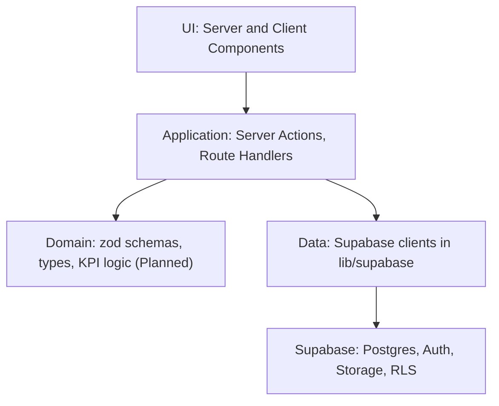
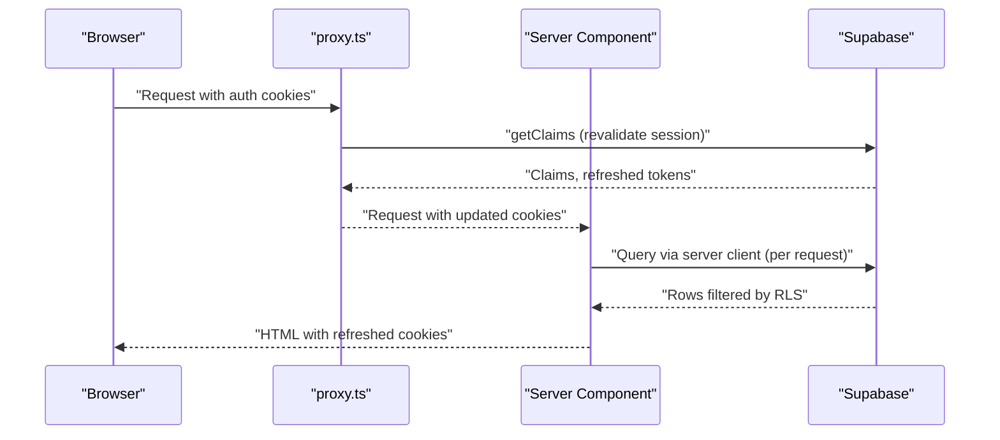
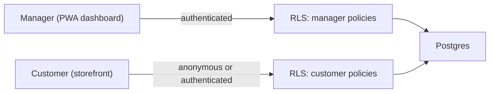
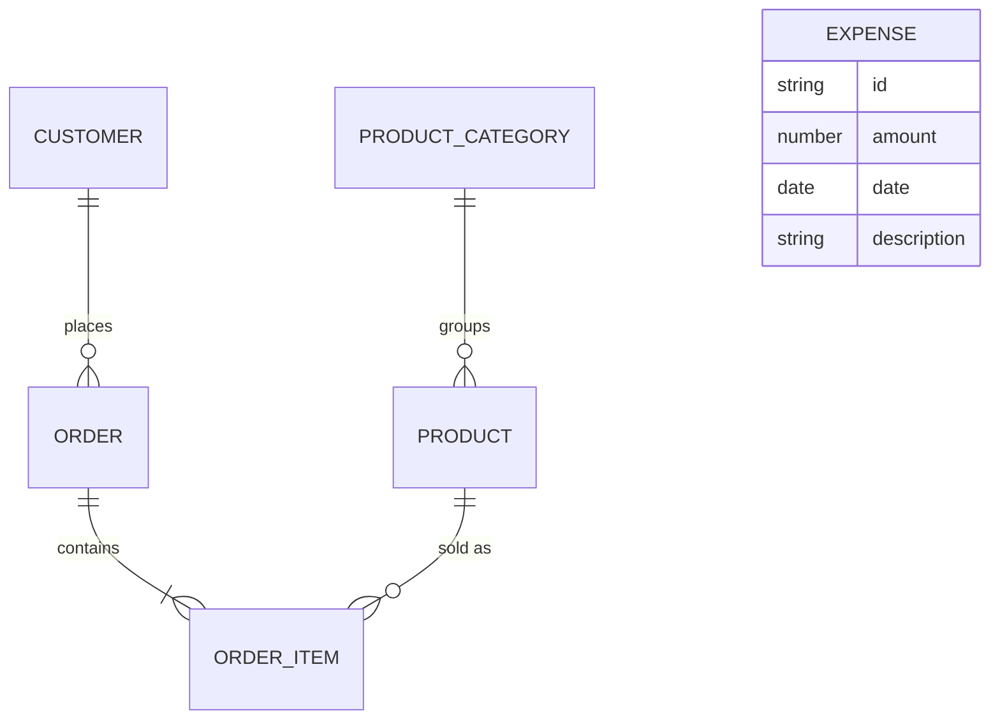

# Architecture: FoodBiz PWA

One Next.js codebase serves two audiences: the **manager** (installable dashboard PWA) and the **customer** (SSR, SEO-friendly storefront). Rationale: see [`../migration_plan.md`](../migration_plan.md).

> Status legend: items marked **Planned** do not exist in the code yet. Currently implemented: the Phase 1 scaffold (home page, manifest, env parsing, Supabase clients, session-refresh proxy).

## Stack

| Layer      | Technology                                                  |
| ---------- | ----------------------------------------------------------- |
| Framework  | Next.js 16.4 (App Router, Cache Components, Turbopack)      |
| UI         | React 19.3                                                  |
| Language   | TypeScript (strict)                                         |
| Styling    | Tailwind CSS v4 (shadcn/ui **Planned**, Phase 5)            |
| Backend    | Supabase (Postgres, Auth, Storage, RLS) via `@supabase/ssr` |
| Validation | zod 4                                                       |
| Testing    | Vitest + React Testing Library (jsdom)                      |
| Deployment | Vercel                                                      |
| Fonts      | Geist Sans / Geist Mono (`next/font/google`)                |

`next.config.ts` enables `cacheComponents` and `partialPrefetching`.

## Folder layout

```text
src/
├── app/                 Routes, layouts, manifest.ts (PWA), globals.css
├── config/              env.ts (zod-parsed public env), app.ts (APP_METADATA)
├── lib/supabase/        client.ts (browser), server.ts (server), proxy.ts (session refresh)
└── proxy.ts             Next.js proxy: runs updateSession on matched requests
```

Planned feature areas (not yet created), carried over from the mobile app: dashboard, orders, products, expenses, analytics, settings, plus the customer storefront. Domain schemas (zod) and KPI logic will live in a `domain/` layer so they stay separate from UI and data access.

## Layers



## Server vs Client Components

Components are Server Components by default.

| Use a Server Component for                      | Use a Client Component (`"use client"`) for   |
| ----------------------------------------------- | --------------------------------------------- |
| Data fetching, Supabase server client           | Event handlers, local state, effects          |
| Storefront pages (SEO, SSR)                     | Browser APIs (install prompt, service worker) |
| Reading cookies or headers                      | Supabase browser client usage                 |
| Anything using secrets or `server-only` modules | Interactive forms, cart, charts               |

Rules:

- Keep `"use client"` boundaries as low in the tree as possible; pass server-fetched data down as props.
- `src/lib/supabase/server.ts` imports `server-only` and must never be imported from a Client Component.
- With `cacheComponents` enabled, runtime data (`cookies()`, `headers()`, uncached fetches) must sit under a `<Suspense>` boundary; cacheable work uses `"use cache"`. Reference: `node_modules/next/dist/docs/01-app/01-getting-started/08-caching.md`.

## Data flow with Supabase SSR clients

| Client        | File                     | Used from                                         |
| ------------- | ------------------------ | ------------------------------------------------- |
| Browser       | `lib/supabase/client.ts` | Client Components                                 |
| Server        | `lib/supabase/server.ts` | Server Components, Server Actions, Route Handlers |
| Proxy session | `lib/supabase/proxy.ts`  | `src/proxy.ts`                                    |

- The server client is created **per request** and reads/writes the auth cookies through `next/headers`. Writing cookies from a Server Component is a no-op; the proxy handles refresh.
- `src/proxy.ts` (Next.js 16 replacement for `middleware`, Node.js runtime) calls `updateSession`, which creates a Supabase server client and calls `auth.getClaims()` to revalidate and refresh the session cookie. No code may run between client creation and `getClaims()`.
- The proxy matcher skips `_next/static`, `_next/image`, `favicon.ico`, `manifest.webmanifest`, `sw.js`, `icons/` and common image files.
- Configuration uses only `NEXT_PUBLIC_SUPABASE_URL` and `NEXT_PUBLIC_SUPABASE_PUBLISHABLE_KEY`, validated by zod in `config/env.ts`.



## Auth and RLS: manager vs customer

**Planned.** Only session refresh exists today; there are no sign-in routes, tables or policies yet.

Intended design (from the migration plan): Supabase Auth plus Row Level Security segregate **manager** data from **customer** data.

- Managers manage the catalog, orders, expenses and analytics; their rows are protected by RLS so only authorised managers can read or write them.
- Customers browse products and place orders; RLS limits them to public catalog reads and their own orders.
- Authorisation is enforced in the database (RLS), not only in the UI. Route-level redirects in `proxy.ts` may be added as a convenience; they are not a security boundary.
- Legacy sign-in used Google OAuth with an allowed-email guard; the exact provider setup for the PWA is undecided.



## Data model (Planned)

Carried over from the mobile app; the database schema is not yet defined. Names may change when the schema is designed.



See [`FUNCTIONAL_SPECIFICATION.md`](FUNCTIONAL_SPECIFICATION.md) for entity fields and business rules.

## PWA

Implemented:

- `src/app/manifest.ts` serves the web app manifest: name, short name, description, `start_url: "/"`, `display: "standalone"`, `orientation: "portrait"`, theme/background colours from `config/app.ts`, and an SVG icon at `/icons/icon.svg`.
- Root layout sets `appleWebApp` metadata and the viewport `themeColor`.

**Planned** (not implemented): service worker (`sw.js` is already excluded from the proxy matcher), offline caching of the manager dashboard, PNG/maskable icons. The legacy app was fully local-first/offline; offline behaviour for the PWA is not yet designed, and the storefront needs connectivity.

## Environments

| Environment    | Source                       | Notes                                                                     |
| -------------- | ---------------------------- | ------------------------------------------------------------------------- |
| Local          | `npm run dev` / devcontainer | Uses `.env.local` (copy from `.env.example`)                              |
| Vercel preview | Pull requests                | Automatic deployment per PR (Vercel Git integration; see `DEPLOYMENT.md`) |
| Staging        | `staging` branch             | Pre-production qualification                                              |
| Production     | `main` branch                | Released by promoting `staging`                                           |

Each environment needs its own Supabase URL and publishable key. Branch flow: see [`CONTRIBUTING.md`](CONTRIBUTING.md).

## Differences from the legacy mobile app

| Legacy (Expo)                         | PWA                                           |
| ------------------------------------- | --------------------------------------------- |
| `@react-navigation` tabs/stack/drawer | App Router file-based routes                  |
| `StoreContext` + AsyncStorage         | Supabase data via server/browser clients      |
| `StyleSheet` + design tokens          | Tailwind CSS v4 (tokens defined with Phase 5) |
| In-memory repositories + mock data    | Supabase (Planned schema)                     |
| Single role (owner)                   | Manager and customer roles                    |
