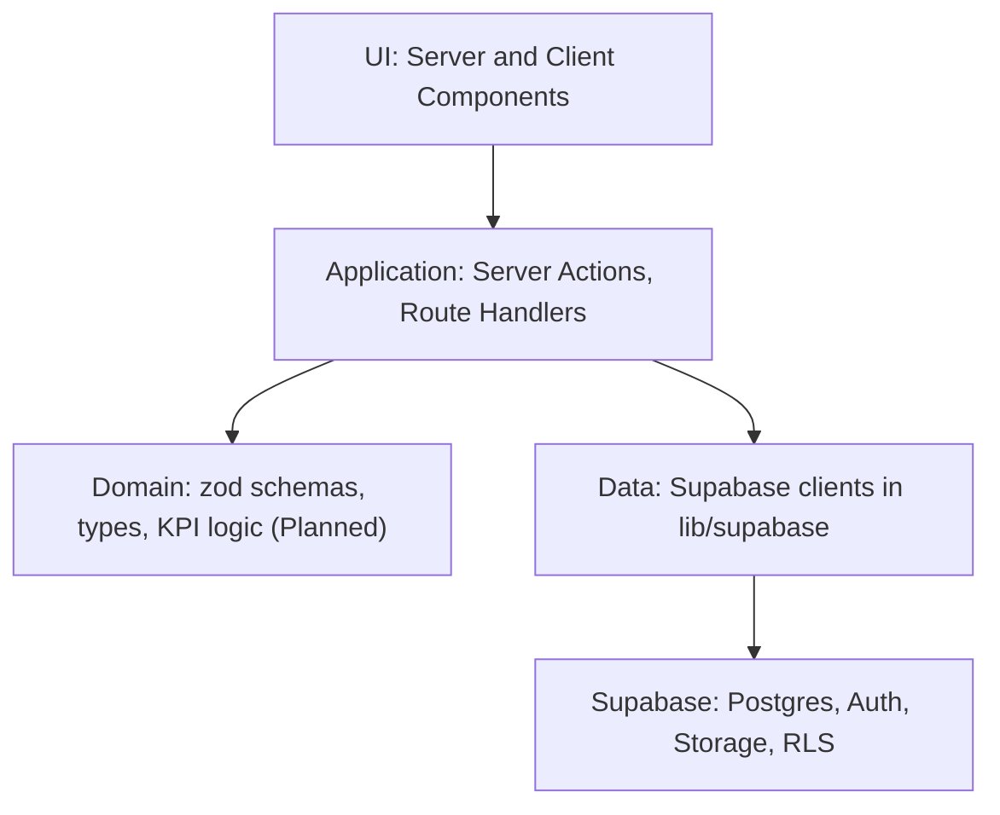
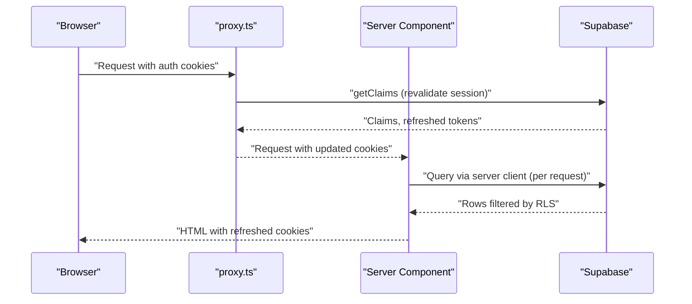
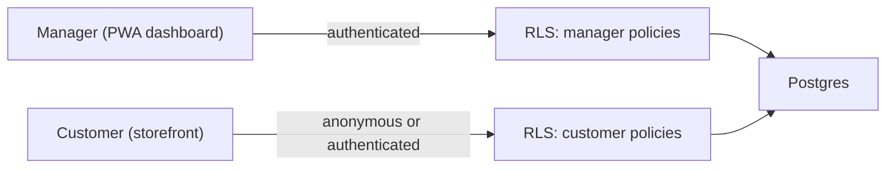
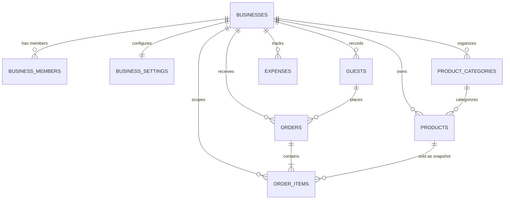

# Architecture: FoodBiz PWA

One Next.js codebase serves two audiences: the **manager** (installable dashboard PWA) and the **customer** (SSR, SEO-friendly storefront). Why a PWA instead of the legacy Expo app: one codebase for both audiences, an indexable storefront, ordering from a URL without an app store, and an installable manager app.

> Status legend: items marked **Planned** do not exist in the code yet. Currently implemented: the initial scaffold (home page, manifest, env parsing, Supabase clients, session-refresh proxy).

## Stack

| Layer      | Technology                                                  |
| ---------- | ----------------------------------------------------------- |
| Framework  | Next.js 16.4 (App Router, Cache Components, Turbopack)      |
| UI         | React 19.3                                                  |
| Language   | TypeScript (strict)                                         |
| Styling    | Tailwind CSS v4 (shadcn/ui **Planned**)                     |
| Backend    | Supabase (Postgres, Auth, Storage, RLS) via `@supabase/ssr` |
| Validation | zod 4                                                       |
| Testing    | Vitest + React Testing Library (jsdom)                      |
| Deployment | Vercel                                                      |
| Fonts      | Geist Sans / Geist Mono (`next/font/google`)                |

`next.config.ts` enables `cacheComponents` and `partialPrefetching`.

## Folder layout

Target layout and conventions: [`AGENTS.md#project-layout`](../AGENTS.md#project-layout). Implemented today: `src/app/`, `src/config/`, `src/lib/supabase/`, `src/proxy.ts`. `src/domain/`, `src/features/`, `src/components/` and `supabase/migrations/` are **Planned**.

## Layers

## Server vs Client Components

Components are Server Components by default.

| Use a Server Component for                      | Use a Client Component (`"use client"`) for   |
| ----------------------------------------------- | --------------------------------------------- |
| Data fetching, Supabase server client           | Event handlers, local state, effects          |
| Storefront pages (SEO, SSR)                     | Browser APIs (install prompt, service worker) |
| Reading cookies or headers                      | Supabase browser client usage                 |
| Anything using secrets or `server-only` modules | Interactive forms, cart, charts               |

Rules: [web.instructions.md#rendering--caching](../.agents/rules/web.instructions.md#rendering--caching). `src/lib/supabase/server.ts` imports `server-only` and must never be imported from a Client Component.

## Data flow with Supabase SSR clients

| Client        | File                     | Used from                                         |
| ------------- | ------------------------ | ------------------------------------------------- |
| Browser       | `lib/supabase/client.ts` | Client Components                                 |
| Server        | `lib/supabase/server.ts` | Server Components, Server Actions, Route Handlers |
| Proxy session | `lib/supabase/proxy.ts`  | `src/proxy.ts`                                    |

- The server client is created **per request** and reads/writes the auth cookies through `next/headers`. Writing cookies from a Server Component is a no-op; the proxy handles refresh.
- `src/proxy.ts` (Next.js 16 replacement for `middleware`, Node.js runtime) calls `updateSession`, which creates a Supabase server client and calls `auth.getClaims()` to revalidate and refresh the session cookie. No code may run between client creation and `getClaims()`.
- The proxy matcher skips `_next/static`, `_next/image`, `favicon.ico`, `manifest.webmanifest`, `sw.js`, `icons/` and common image files.
- Configuration uses only `NEXT_PUBLIC_SUPABASE_URL` and `NEXT_PUBLIC_SUPABASE_PUBLISHABLE_KEY`, validated by zod in `config/env.ts`.

## Auth and RLS: manager vs customer

**Planned.** Only session refresh exists today; there are no sign-in routes, tables or policies yet.

Intended design: Supabase Auth plus Row Level Security segregate **manager** data from **customer** data.

- Managers manage the catalog, orders, expenses and analytics; their rows are protected by RLS so only authorised managers can read or write them.
- Customers browse products and place orders; RLS limits them to public catalog reads and their own orders.
- Authorisation is enforced in the database (RLS), not only in the UI. Route-level redirects in `proxy.ts` may be added as a convenience; they are not a security boundary.
- Legacy sign-in used Google OAuth with an allowed-email guard; the exact provider setup for the PWA is undecided.

## Data model

The relational database schema is defined in [`docs/database/schema.md`](database/schema.md) and derived from domain models in `src/domain/`.

See [`docs/database/schema.md`](database/schema.md) for full DDL, enums, indexes, and RLS policies, and [`FUNCTIONAL_SPECIFICATION.md`](FUNCTIONAL_SPECIFICATION.md) for entity fields and business rules.

## PWA

Implemented:

- `src/app/manifest.ts` serves the web app manifest: name, short name, description, `start_url: "/"`, `display: "standalone"`, `orientation: "portrait"`, theme/background colours from `config/app.ts`, and an SVG icon at `/icons/icon.svg`.
- Root layout sets `appleWebApp` metadata and the viewport `themeColor`.

**Planned** (not implemented): service worker (`sw.js` is already excluded from the proxy matcher), offline caching of the manager dashboard, PNG/maskable icons. The legacy app was fully local-first/offline; offline behaviour for the PWA is not yet designed, and the storefront needs connectivity.

## Checkout anti-abuse and idempotency

`placeOrderAction` ([`storefront-actions.ts`](../src/features/storefront/storefront-actions.ts)) rejects bots (honeypot), caps quantities (50 per product, 100 per order, after merging duplicate lines), and rate-limits per client IP (5 / 10 min, in memory: the only layer that can see the IP). Everything else is enforced by the database inside `place_order`, so it also holds across serverless instances and for callers that bypass the action: quantity caps (50 per product, 100 per order, 50 lines), the per-phone limit (3 / 10 min, hashed phone), a per-business flood brake (120 / 10 min) and idempotent replay of a repeated `idempotencyKey` (unique `(business_id, idempotency_key)` on `orders`). Replays are not charged to the IP limiter. Requests without a client IP skip only the IP limit, so unknown clients never share one bucket. See [`schema.md` section 5.5](database/schema.md). Rejections are logged with salted-HMAC hashes of IP/phone only ([`anti-abuse-log.ts`](../src/lib/anti-abuse-log.ts)).

### Known limitations

| Area                  | Today                                                                                                                        | Impact in production (serverless, several instances)                                                                                                                                                 | Target                                                                                           |
| --------------------- | ---------------------------------------------------------------------------------------------------------------------------- | ---------------------------------------------------------------------------------------------------------------------------------------------------------------------------------------------------- | ------------------------------------------------------------------------------------------------ |
| Rate limiter (per IP) | In-memory fixed window ([`rate-limiter.ts`](../src/lib/rate-limiter.ts)), per server instance, first layer only              | Counters are not shared across instances and reset on cold start, so the per-IP limit is weaker than configured. Per-phone, per-business and lookup limits live in the database and are not affected | Move to a shared store only if the database layer proves insufficient (it cannot see client IPs) |
| Stock reservation     | Read, check, then write per product through the repository; released on later failure. Not atomic across concurrent requests | Two simultaneous orders for the last units can both succeed (lost update)                                                                                                                            | Single conditional decrement (`stock >= qty`) in one SQL statement or RPC inside one transaction |
| Log hash correlation  | Random per-process salt, so hashes do not match across instances or restarts                                                 | Cannot correlate one abuser across instances in logs; hashes cannot be reversed                                                                                                                      | Keep as is, or add a managed secret salt if cross-instance correlation becomes necessary         |

Per-phone, per-business and order-lookup rate limiting and idempotency no longer depend on in-memory state in Supabase mode: they live in the database (`rate_limit_attempts`, `orders.idempotency_key`). The mock repository mirrors them so both data sources honor the same contract.

## Environments

| Environment    | Source                       | Notes                                                                     |
| -------------- | ---------------------------- | ------------------------------------------------------------------------- |
| Local          | `npm run dev` / devcontainer | Uses `.env.local` (copy from `.env.example`)                              |
| Vercel preview | Pull requests                | Automatic deployment per PR (Vercel Git integration; see `DEPLOYMENT.md`) |
| Staging        | `staging` branch             | Pre-production qualification                                              |
| Production     | `main` branch                | Released by promoting `staging`                                           |

Each environment needs its own Supabase URL and publishable key. Branch flow: see [`CONTRIBUTING.md`](CONTRIBUTING.md).

## Differences from the legacy mobile app

| Legacy (Expo)                         | PWA                                      |
| ------------------------------------- | ---------------------------------------- |
| `@react-navigation` tabs/stack/drawer | App Router file-based routes             |
| `StoreContext` + AsyncStorage         | Supabase data via server/browser clients |
| `StyleSheet` + design tokens          | Tailwind CSS v4 + `@theme` tokens        |
| In-memory repositories + mock data    | Supabase (Planned schema)                |
| Single role (owner)                   | Manager and customer roles               |
