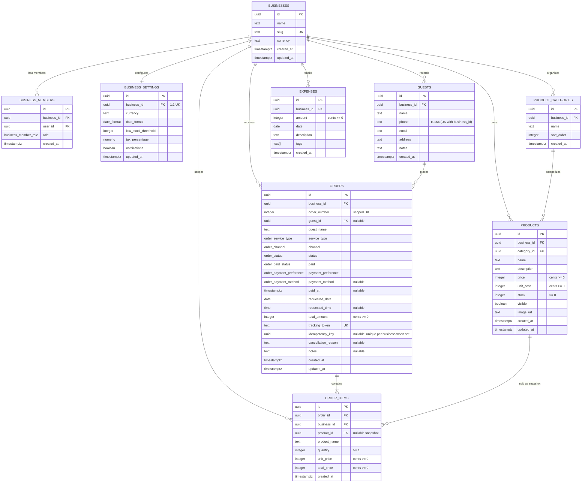

# Database Schema Specification

This document defines the canonical relational database schema for FoodBiz PWA on Supabase (PostgreSQL), derived from the domain models in [`src/domain/`](../../src/domain/) and functional requirements in [`FUNCTIONAL_SPECIFICATION.md`](../FUNCTIONAL_SPECIFICATION.md).

> **Contract Notice:** This reviewed schema serves as the single source of truth for database migrations (#119), Row Level Security (RLS) policies (#120), atomic order transactions (#121), and Supabase repository adapters (#122).

---

## 1. Entity-Relationship Diagram (ERD)



---

## 2. Design Principles & Architecture Standards

1. **Strict Multi-Tenancy Scoping:** Every business entity stores `business_id uuid not null references businesses(id) on delete cascade`. Even child tables such as `order_items` explicitly carry `business_id` to allow direct RLS evaluation without costly joins.
2. **Deterministic Primary Keys:** Primary keys use `uuid default gen_random_uuid()`.
3. **Integer Minor Units for Currency:** In alignment with `moneySchema` (`src/domain/common.ts`) and backend guidelines, currency amounts are stored as integer cents (`integer check (amount >= 0)`), preventing floating-point rounding errors.
4. **Native PostgreSQL Enums:** Categorical domains are modeled as explicit PostgreSQL `ENUM` types, matching TypeScript Zod enums in `src/domain/`.
5. **Business Rules Enforcement:**
   - **Negative inventory prevention:** `stock integer not null check (stock >= 0)`.
   - **Soft deletion / catalog visibility:** `visible boolean not null default true`.
   - **Guest phone deduplication:** `UNIQUE (business_id, phone) WHERE phone IS NOT NULL`.
   - **Order tracking dual access:**
     - **Direct Link (Capability Token):** Cryptographically random `tracking_token text not null unique` allowing 1-click guest tracking (`/[locale]/order/[token]`) without sign-in.
     - **Ticket N° + Phone Lookup:** Customers who lose their direct link or hold a physical counter ticket can look up their live order using `order_number` (ticket #) and their validated E.164 phone number via the `storefront_order_tracking_token` RPC (rate limited, see 5.5).
   - **Order number scoping:** Sequential `order_number` per business enforced via `UNIQUE (business_id, order_number)`.
   - **Payment integrity:** Orders with `paid = 'paid'` require both `payment_method` and `paid_at`.
   - **Tenant-safe references:** the foreign keys are composite on `(business_id, id)`, so a row can only reference a row of its own business: `products (business_id, category_id)` → `product_categories` (restrict), `orders (business_id, guest_id)` → `guests` (restrict), `order_items (business_id, order_id)` → `orders` (cascade), `order_items (business_id, product_id)` → `products` (`on delete set null (product_id)`, the column-list form keeps `business_id`). Migrations 16-23 add them without locking writes: concurrent unique indexes, constraints promoted from the indexes, composite keys added `NOT VALID` after a pre-check that lists any offending ids, validated in a later file, then the single-column keys are dropped.
   - **Case-insensitive category names:** unique index on `(business_id, lower(btrim(name)))`, added after a pre-check that lists duplicates (migrations 20-21).

---

## 3. SQL DDL Specification

```sql
-- ============================================================================
-- FoodBiz PWA — Core Schema DDL
-- ============================================================================

-- Extensions
create extension if not exists "pgcrypto";

-- ----------------------------------------------------------------------------
-- Custom ENUM Types
-- ----------------------------------------------------------------------------
create type category_role as enum ('regular', 'drinks', 'snacks');
create type business_member_role as enum ('owner', 'manager', 'staff');
create type date_format as enum ('DD/MM/YYYY', 'MM/DD/YYYY', 'YYYY-MM-DD');

create type order_status as enum (
  'NEW',
  'CONFIRMED',
  'PREPARING',
  'READY',
  'COMPLETED',
  'CANCELLED'
);

create type order_paid_status as enum ('paid', 'unpaid');
create type order_service_type as enum ('pickup', 'delivery', 'dine-in');
create type order_channel as enum ('storefront', 'phone', 'whatsapp', 'in-person');
create type order_payment_preference as enum ('revolut', 'wero', 'on_handover');
create type order_payment_method as enum ('cash', 'revolut', 'wero', 'card');

-- ----------------------------------------------------------------------------
-- 1. Businesses & Tenancy
-- ----------------------------------------------------------------------------
create table businesses (
  id uuid primary key default gen_random_uuid(),
  name text not null check (char_length(trim(name)) >= 1),
  instagram_url text check (instagram_url = '' or instagram_url ~ '^https://'),
  facebook_url text check (facebook_url = '' or facebook_url ~ '^https://'),
  tiktok_url text check (tiktok_url = '' or tiktok_url ~ '^https://'),
  latitude double precision check (latitude is null or latitude between -90 and 90),
  longitude double precision check (longitude is null or longitude between -180 and 180),
  slug text not null check (slug ~ '^[a-z0-9-]+$'),
  currency text not null default 'EUR' check (currency = 'EUR'),
  created_at timestamptz not null default now(),
  updated_at timestamptz not null default now(),
  constraint businesses_slug_unique unique (slug)
);

create table business_members (
  id uuid primary key default gen_random_uuid(),
  business_id uuid not null references businesses(id) on delete cascade,
  user_id uuid not null references auth.users(id) on delete cascade,
  role business_member_role not null default 'staff',
  created_at timestamptz not null default now(),
  constraint business_members_business_user_unique unique (business_id, user_id)
);

create index idx_business_members_business_id on business_members(business_id);
create index idx_business_members_user_id on business_members(user_id);

create table business_settings (
  id uuid primary key default gen_random_uuid(),
  business_id uuid not null references businesses(id) on delete cascade,
  currency text not null default 'EUR' check (currency = 'EUR'),
  date_format date_format not null default 'DD/MM/YYYY',
  low_stock_threshold integer not null default 5 check (low_stock_threshold >= 0),
  tax_percentage numeric(5, 2) not null default 0 check (tax_percentage >= 0 and tax_percentage <= 100),
  notifications boolean not null default true,
  -- Display-only preparation lead time (#225); '~' is added on display
  lead_time_value integer not null default 1 check (lead_time_value between 1 and 999),
  lead_time_unit text not null default 'business_days'
    check (lead_time_unit in ('minutes', 'hours', 'business_days')),
  -- Business operating time zone (#168): IANA name, validated by trigger (see 5.2.3)
  timezone text not null default 'Europe/Paris',
  -- Enabled payment options (#377 adds "card": false by default)
  payment_methods jsonb not null default '{"cash": true, "card": false, "revolut": true, "wero": true}'::jsonb,
  -- Structured weekly opening hours (#372): nullable jsonb validated by valid_weekly_hours (see 5.2.4)
  -- Structured weekly opening hours (#372) and exceptions (#375) (see 5.2.4)
  weekly_hours jsonb null constraint business_settings_weekly_hours_valid check (weekly_hours is null or public.valid_weekly_hours(weekly_hours)),
  hours_exceptions jsonb not null default '[]'::jsonb constraint business_settings_hours_exceptions_valid check (public.valid_hours_exceptions(hours_exceptions)),
  updated_at timestamptz not null default now(),
  constraint business_settings_business_id_unique unique (business_id)
);

-- ----------------------------------------------------------------------------
-- 2. Product Catalog & Inventory
-- ----------------------------------------------------------------------------
create table product_categories (
  id uuid primary key default gen_random_uuid(),
  business_id uuid not null references businesses(id) on delete cascade,
  name text not null check (char_length(trim(name)) between 1 and 50),
  sort_order integer not null default 0 check (sort_order >= 0),
  role category_role not null default 'regular',
  created_at timestamptz not null default now(),
  constraint product_categories_business_name_unique unique (business_id, name)
);

create index idx_product_categories_business_sort on product_categories(business_id, sort_order);

create table products (
  id uuid primary key default gen_random_uuid(),
  business_id uuid not null references businesses(id) on delete cascade,
  category_id uuid not null references product_categories(id) on delete restrict,
  name text not null check (char_length(trim(name)) >= 1),
  description text check (description is null or char_length(description) <= 1000),
  price integer not null check (price >= 0), -- integer cents
  unit_cost integer not null default 0 check (unit_cost >= 0), -- integer cents
  stock integer not null default 0 check (stock >= 0), -- negative inventory prevention
  visible boolean not null default true, -- soft deletion / catalog visibility
  allergens text[] not null default '{}',
  suggest_add_ons boolean not null default true,
  image_url text,
  created_at timestamptz not null default now(),
  updated_at timestamptz not null default now()
);

create index idx_products_business_category on products(business_id, category_id);
create index idx_products_business_visible on products(business_id, visible);
create index idx_products_business_name on products(business_id, name);
create index idx_products_category_id on products(category_id); -- FK check on category delete (20260101000008)

-- ----------------------------------------------------------------------------
-- 3. Guests (Storefront Customers)
-- ----------------------------------------------------------------------------
-- Note on right-to-erasure: guests are anonymised in place (name = 'Deleted customer',
-- phone/email/address/notes = null) rather than deleted so historical orders keep a valid guest_id.
create table guests (
  id uuid primary key default gen_random_uuid(),
  business_id uuid not null references businesses(id) on delete cascade,
  name text not null check (char_length(trim(name)) between 2 and 50),
  phone text check (phone is null or phone ~ '^\+[1-9]\d{6,14}$'), -- E.164 canonical
  email text check (email is null or email ~* '^[A-Za-z0-9._%+-]+@[A-Za-z0-9.-]+\.[A-Za-z]{2,}$'),
  address text,
  notes text,
  created_at timestamptz not null default now()
);

-- Unique phone per business when phone is provided (AC requirement)
create unique index idx_guests_business_phone_unique on guests(business_id, phone) where phone is not null;
create index idx_guests_business_created on guests(business_id, created_at desc);

-- ----------------------------------------------------------------------------
-- 4. Orders & Order Items
-- ----------------------------------------------------------------------------
create table orders (
  id uuid primary key default gen_random_uuid(),
  business_id uuid not null references businesses(id) on delete cascade,
  order_number integer not null check (order_number > 0),
  guest_id uuid not null references guests(id) on delete restrict,
  submitted_name text check (submitted_name is null or char_length(trim(submitted_name)) between 2 and 50), -- audit only on name mismatch
  service_type order_service_type not null,
  channel order_channel not null,
  status order_status not null default 'NEW',
  paid order_paid_status not null default 'unpaid',
  payment_preference order_payment_preference not null default 'on_handover',
  payment_method order_payment_method,
  paid_at timestamptz,
  requested_date date not null,
  requested_time time,
  total_amount integer not null check (total_amount >= 0), -- integer cents
  tracking_token text not null default encode(gen_random_bytes(16), 'hex'), -- public order tracking token
  idempotency_key uuid, -- added by 20260101000012; client-generated retry key (see 5.5)
  idempotency_payload_hash text, -- added by 20260101000012; SHA-256 of the placed payload, NULL on legacy rows
  cancellation_reason text,
  notes text,
  created_at timestamptz not null default now(),
  updated_at timestamptz not null default now(),
  constraint orders_business_number_unique unique (business_id, order_number),
  constraint orders_tracking_token_unique unique (tracking_token),
  constraint orders_paid_consistency check (
    paid = 'unpaid' or (payment_method is not null and paid_at is not null)
  )
);

create index idx_orders_business_status on orders(business_id, status);
create index idx_orders_business_requested_date on orders(business_id, requested_date);
create index idx_orders_business_guest on orders(business_id, guest_id);
create index idx_orders_business_created on orders(business_id, created_at desc);
-- idx_orders_tracking_token duplicated orders_tracking_token_unique and was dropped (20260101000007)
create index idx_orders_guest_id on orders(guest_id); -- FK check on guest delete (20260101000009)
create unique index idx_orders_business_idempotency_key
  on orders(business_id, idempotency_key) where idempotency_key is not null; -- 20260101000013 (created concurrently)

create table order_items (
  id uuid primary key default gen_random_uuid(),
  order_id uuid not null references orders(id) on delete cascade,
  business_id uuid not null references businesses(id) on delete cascade,
  product_id uuid references products(id) on delete set null, -- snapshot retains line if product is deleted
  product_name text not null check (char_length(trim(product_name)) >= 1),
  quantity integer not null check (quantity >= 1),
  unit_price integer not null check (unit_price >= 0), -- integer cents at time of order
  total_price integer not null check (total_price >= 0), -- integer cents
  created_at timestamptz not null default now()
);

create index idx_order_items_order_id on order_items(order_id);
create index idx_order_items_business_product on order_items(business_id, product_id);
create index idx_order_items_product_id on order_items(product_id); -- FK action on product delete (20260101000010)

-- ----------------------------------------------------------------------------
-- 5. Expenses
-- ----------------------------------------------------------------------------
create table expenses (
  id uuid primary key default gen_random_uuid(),
  business_id uuid not null references businesses(id) on delete cascade,
  amount integer not null check (amount >= 0), -- integer cents
  date date not null,
  description text not null check (char_length(trim(description)) >= 1),
  tags text[] not null default '{}',
  created_at timestamptz not null default now()
);

create index idx_expenses_business_date on expenses(business_id, date desc);
create index idx_expenses_tags_gin on expenses using gin (tags);

-- ----------------------------------------------------------------------------
-- 6. Updated_at Trigger Automation
-- ----------------------------------------------------------------------------
create or replace function set_updated_at()
returns trigger
language plpgsql
set search_path = '' -- pinned by 20260101000007 (now() lives in pg_catalog)
as $$
begin
  new.updated_at = now();
  return new;
end;
$$;

create trigger trigger_businesses_updated_at
  before update on businesses
  for each row execute function set_updated_at();

create trigger trigger_business_settings_updated_at
  before update on business_settings
  for each row execute function set_updated_at();

create trigger trigger_products_updated_at
  before update on products
  for each row execute function set_updated_at();

create trigger trigger_orders_updated_at
  before update on orders
  for each row execute function set_updated_at();
```

---

## 4. Indexing Strategy Summary

| Table                 | Index Name                                   | Columns / Expressions               | Type                    | Rationale                                                          |
| :-------------------- | :------------------------------------------- | :---------------------------------- | :---------------------- | :----------------------------------------------------------------- |
| `businesses`          | `businesses_slug_unique`                     | `(slug)`                            | B-tree (Unique)         | Fast domain & storefront slug resolution                           |
| `business_members`    | `idx_business_members_business_id`           | `(business_id)`                     | B-tree                  | Member listing and tenant filtering                                |
| `business_members`    | `idx_business_members_user_id`               | `(user_id)`                         | B-tree                  | RLS helper function query on `auth.uid()`                          |
| `business_settings`   | `business_settings_business_id_unique`       | `(business_id)`                     | B-tree (Unique)         | 1:1 business settings lookup                                       |
| `product_categories`  | `idx_product_categories_business_sort`       | `(business_id, sort_order)`         | B-tree                  | Ordered category display in manager & storefront                   |
| `products`            | `idx_products_business_category`             | `(business_id, category_id)`        | B-tree                  | Filter products by category                                        |
| `products`            | `idx_products_business_visible`              | `(business_id, visible)`            | B-tree                  | Storefront catalog listing (active items only)                     |
| `products`            | `idx_products_business_name`                 | `(business_id, name)`               | B-tree                  | Manager product search and sorting                                 |
| `products`            | `idx_products_category_id`                   | `(category_id)`                     | B-tree                  | FK check when a category is deleted                                |
| `product_categories`  | `uq_product_categories_business_name_ci`     | `(business_id, lower(btrim(name)))` | B-tree (Unique)         | Category names unique per business ignoring case (as the app does) |
| `product_categories`  | `product_categories_business_id_id_unique`   | `(business_id, id)`                 | B-tree (Unique)         | Parent side of the tenant-safe composite foreign key               |
| `products`            | `products_business_id_id_unique`             | `(business_id, id)`                 | B-tree (Unique)         | Parent side of `order_items_business_product_fkey`                 |
| `guests`              | `guests_business_id_id_unique`               | `(business_id, id)`                 | B-tree (Unique)         | Parent side of `orders_business_guest_fkey`                        |
| `orders`              | `orders_business_id_id_unique`               | `(business_id, id)`                 | B-tree (Unique)         | Parent side of `order_items_business_order_fkey`                   |
| `guests`              | `idx_guests_business_phone_unique`           | `(business_id, phone)`              | B-tree (Unique Partial) | Prevents duplicate guest records with the same phone               |
| `guests`              | `idx_guests_business_created`                | `(business_id, created_at desc)`    | B-tree                  | Recent customer lookups                                            |
| `orders`              | `idx_orders_business_status`                 | `(business_id, status)`             | B-tree                  | Order board filtering (`NEW`, `PREPARING`, etc.)                   |
| `orders`              | `idx_orders_business_requested_date`         | `(business_id, requested_date)`     | B-tree                  | Kitchen dispatch by day                                            |
| `orders`              | `idx_orders_business_guest`                  | `(business_id, guest_id)`           | B-tree                  | Order history per customer                                         |
| `orders`              | `orders_tracking_token_unique`               | `(tracking_token)`                  | B-tree (Unique)         | Public order tracking lookup (`/[locale]/order/[token]`)           |
| `orders`              | `idx_orders_guest_id`                        | `(guest_id)`                        | B-tree                  | FK check when a guest is deleted                                   |
| `orders`              | `idx_orders_business_idempotency_key`        | `(business_id, idempotency_key)`    | B-tree (Unique Partial) | Idempotent `place_order` replay (`idempotency_key` set)            |
| `order_items`         | `idx_order_items_order_id`                   | `(order_id)`                        | B-tree                  | Order details retrieval                                            |
| `order_items`         | `idx_order_items_business_product`           | `(business_id, product_id)`         | B-tree                  | Sales per product reporting                                        |
| `order_items`         | `idx_order_items_product_id`                 | `(product_id)`                      | B-tree                  | FK action when a product is deleted                                |
| `rate_limit_attempts` | `idx_rate_limit_attempts_bucket_key_created` | `(bucket, key_hash, created_at)`    | B-tree                  | Window counts and opportunistic pruning (see 5.5)                  |
| `expenses`            | `idx_expenses_business_date`                 | `(business_id, date desc)`          | B-tree                  | Monthly KPI and analytics time ranges                              |
| `expenses`            | `idx_expenses_tags_gin`                      | `(tags)`                            | GIN                     | Fast tag filtering (`tags @> array['Ingredients']`)                |

---

## 5. Security & Row Level Security (RLS) Strategy

All tables will have RLS enabled (`alter table <name> enable row level security;`).

### 5.1 Manager Membership Helper

```sql
create or replace function auth.is_business_member(target_business_id uuid)
returns boolean security definer set search_path = public as $$
  select exists (
    select 1 from business_members
    where business_id = target_business_id
      and user_id = (select auth.uid())
  );
$$ language sql stable;
```

### 5.2 Access Control Matrix

| Table                 | Role: `anon` (Storefront Customer)                                                                           | Role: `authenticated` (Manager / Staff)                                                                                                        |
| :-------------------- | :----------------------------------------------------------------------------------------------------------- | :--------------------------------------------------------------------------------------------------------------------------------------------- |
| `businesses`          | `SELECT` public profile by `slug`                                                                            | `SELECT`, `UPDATE` via `is_business_member(id)`; changing `slug` needs `owner` (trigger)                                                       |
| `business_members`    | Deny                                                                                                         | `SELECT` for business members; write for `owner` role                                                                                          |
| `business_settings`   | `SELECT` on the storefront column list only (`business_settings_select_anon` + column grants, #120)          | `SELECT`, `UPDATE` via `is_business_member(business_id)`; payment columns need `owner` (trigger); `INSERT` for `owner`; no `DELETE` for anyone |
| `product_categories`  | `SELECT` for active businesses                                                                               | `ALL` via `is_business_member(business_id)`                                                                                                    |
| `products`            | `SELECT` where `visible = true`, **public columns only** (no `unit_cost`, see 5.5)                           | `SELECT`/`INSERT`/`UPDATE` via `is_business_member(business_id)`; `DELETE` for `owner` only                                                    |
| `guests`              | Direct read denied; inserted via atomic checkout function (#121)                                             | `SELECT`/`INSERT`/`UPDATE` via `is_business_member(business_id)`; `DELETE` for `owner` only                                                    |
| `orders`              | No direct access: RPC only (`place_order`, `get_order_by_tracking_token`, `storefront_order_tracking_token`) | `SELECT` via `is_business_member(business_id)`; **no direct `INSERT`/`UPDATE`** (functions only, see 5.6); `DELETE` for `owner` only           |
| `order_items`         | No direct access: item snapshots only inside the `get_order_by_tracking_token` RPC payload                   | `SELECT` via `is_business_member(business_id)`; no direct write (`place_order`, `replace_order_items`)                                         |
| `rate_limit_attempts` | No access (RLS, no policies, privileges revoked); written by `SECURITY DEFINER` functions only               | No access                                                                                                                                      |
| `expenses`            | Deny all                                                                                                     | `SELECT`/`INSERT`/`UPDATE` via `is_business_member(business_id)`; `DELETE` for `owner` only                                                    |

### 5.2.1 Roles: owner-only actions

`business_members.role` is `owner`, `manager` or `staff`. Everything is member-wide (`is_business_member`) except, for owners only (`is_business_owner`; migration `20260101000028_owner_only_actions.sql`):

- `business_settings.revolut_revtag`, `wero_identifier`, `payment_methods`, `payment_instructions_en`, `payment_instructions_fr` (there is no bank-details column; payment instructions is where bank details would be typed) and `businesses.slug`: a `BEFORE UPDATE` trigger (`enforce_owner_only_columns`) raises `OWNER_REQUIRED` (SQLSTATE `42501`) when one of them changes and the caller is a non-owner member. RLS cannot compare old and new values, and a trigger needs no change to the write path. Callers with no user identity (`auth.uid()` is null: `service_role`, direct database connections) are exempt. Writing a protected column back to its current value is not a change.
- `DELETE` on `orders`, `expenses`, `guests` and `products` (policies use `is_business_owner`). `product_categories` stay deletable by any member (the products foreign key refuses a non-empty category).
- `business_settings`: `INSERT` is owner-only and nobody can `DELETE` (policy dropped, privilege revoked); deleting a business cascades.

The Server Actions repeat the check (`requireOwnerAction`, typed `FORBIDDEN` result) and the repositories raise `OwnerRequiredError` for the database refusal.

### 5.2.2 Order writes: functions only (5.6)

See [5.6](#56-order-state-functions).

### 5.2.3 Business time zone

`business_settings.timezone` (`text not null default 'Europe/Paris'`, migration `20260101000029_business_timezone.sql`) is the IANA zone every date is computed and rendered in: KPI day boundaries, "today", opening hours, order timestamps. The default fits the euro-only currency and makes the migration safe on existing rows. A `CHECK` cannot look a name up (`pg_timezone_names` is a view, so an `IMMUTABLE` wrapper would be a lie), so the `BEFORE INSERT OR UPDATE` trigger `business_settings_validate_timezone` raises `INVALID_TIMEZONE` (SQLSTATE `22023`) for a name missing from `pg_timezone_names`; it only runs when the value changes. Manager-editable (not owner-only) and readable by `anon` (column grant) because the storefront formats pickup and order times in the shop's zone. The zod schema (`timeZoneSchema`, `src/domain/timezone.ts`) mirrors the check.

### 5.2.4 Structured weekly opening hours & exceptions

`business_settings.weekly_hours` (`jsonb null`, #372) and `business_settings.hours_exceptions` (`jsonb not null default '[]'::jsonb`, #375) — both added in migration `20260101000033_weekly_opening_hours.sql` — store structured per-weekday opening ranges (`mon`..`sun`) and exceptional day/holiday overrides (`[{from, to, ranges, note?}]`). `weekly_hours` stays nullable so existing shops keep their legacy free-text `opening_hours` until a manager configures structured hours, while exceptions always override weekly hours for the dates they cover (even when `weekly_hours` is `null`). Both columns are manager-editable (not owner-only) and readable by `anon` (storefront column-level `SELECT` grant). Four SQL helpers mirror [`src/domain/opening-hours.ts`](../../src/domain/opening-hours.ts) (`revoke execute from public`, granted to `anon`, `authenticated`, `service_role`, `set search_path = ''`):

- `public.valid_weekly_hours(p jsonb) returns boolean` (`IMMUTABLE`, no `::time` casts): validates the exact 7 keys `mon`..`sun`, each an array of at most 4 `{open, close}` objects where `open` matches `00:00`–`23:59`, `close` matches `00:00`–`23:59` or `24:00`, `close > open` (`COLLATE "C"`), and ranges are strictly sorted and non-touching (`prev.close < next.open`). Used by `business_settings_weekly_hours_valid`.
- `public.valid_hours_exceptions(p jsonb) returns boolean` (`IMMUTABLE`, no `::time`/`::date` casts — uses regex, calendar validation and `IMMUTABLE` `pg_catalog.make_date`): validates an array of at most 100 non-overlapping `{from, to, ranges, note?}` objects with valid `YYYY-MM-DD` dates, `to >= from`, inclusive span ≤ 60 days, optional `note` ≤ 50 characters, and `ranges` following the same per-day rules as `weekly_hours`. Used by `business_settings_hours_exceptions_valid`.
- `public.is_open_at(p_hours jsonb, p_exceptions jsonb, p_tz text, p_at timestamptz) returns boolean` (`STABLE`): resolves any covering exception on the local date in `p_tz` first; if none matches and `p_hours` is `null`, returns `true`; otherwise evaluates half-open `[open, close)` membership in `p_tz` (DST-safe, supports `24:00` close).
- `public.slot_error(p_hours jsonb, p_exceptions jsonb, p_tz text, p_now timestamptz, p_date date, p_time time, p_is_asap boolean, p_horizon_days integer default 30) returns text` (`STABLE`): returns `null` when valid, or one of `'date_out_of_window'`, `'closed_now'`, `'closed_day'`, `'time_outside_hours'`, `'time_in_past'` in the same order and semantics as `validateSlot` (booking window `[today, today + p_horizon_days]` always checked in `p_tz`; exceptions override weekly hours even when `p_hours` is `null`; dates with neither skip opening-hour checks; time-optional checks remaining 15-minute stepped slots with lead 0). Ready for later enforcement in `place_order`.

### 5.3 Public Guest Tracking & Verification

To allow storefront customers to track orders securely without authenticating, two complementary mechanisms are supported:

1. **Direct Token Route (`/[locale]/order/[token]`):**
   - The query matches directly on `orders.tracking_token = :token`.
   - Returns order status and item snapshots without any input prompt.

2. **Ticket N° + Phone Verification (`/track` or modal lookup):**
   - Enables walk-in or lost-link customers with a physical receipt or ticket number to locate their order by providing their ticket number and validated phone number.
   - Executed via the `security definer` RPC `storefront_order_tracking_token(business_id, order_number, phone_e164)`, which returns **only the tracking token** (`text`, `NULL` when nothing matches); the page then loads the guest-PII-free projection through `get_order_by_tracking_token` (never joining `guests.name`; items are an explicit `{product_name, quantity, unit_price, total_price}` list).
   - Enumeration is prevented by three layers: callers must supply both the scoped ticket number and the exact matching E.164 phone; failed lookups are counted per hashed `(business, phone)` (5 per 10 minutes, then `RATE_LIMITED`) and per business (300 per 10 minutes) inside the function, so direct PostgREST callers are limited too; the app adds a per-IP limit (see 5.5).

---

### 5.4 Public Featured Products (#204; Supabase follow-up #116)

The storefront uses `OrderRepository.sumQuantitiesByProduct` on the server, never
`orders.list` or guest records. Rank up to six visible, in-stock products by quantity
ordered in the inclusive trailing **7 days** ending at an injected `now`; use **30 days**
only if the seven-day ranking has no eligible products. Use `orders.created_at`, not
requested fulfilment dates. Exclude `CANCELLED` (the only rejected-equivalent status
in the current model) and `paid = 'refunded'`, including completed refunds. Other
statuses and unpaid orders count. Ties use latest order, then product name and ID.

`getStorefrontCatalog` computes the clock inside its `use cache` scope with
`cacheLife("hours")` and existing catalog tags. The list refreshes with that cache,
not on every render. Mock fixture creation shifts four existing orders relative to
its clock (injectable for tests); historical exported fixtures and counts stay intact.

In #116, implement a `security definer` RPC
`storefront_featured_products(business_id, from, to)` returning **only aggregate
product IDs and quantities**, not order IDs, guest data, tokens, or item snapshots.
Grant execution to `anon`; keep direct order/guest reads denied. Because the definer
bypasses RLS, explicitly reproduce the public catalog's tenant and visibility policy,
validate bounded trailing windows to prevent arbitrary time-range probing, qualify
all relations and lock the search path. Illustrative SQL (not a migration):

```sql
create function public.storefront_featured_products(
  p_business_id uuid, p_from timestamptz, p_to timestamptz
)
returns table (product_id uuid, quantity bigint)
language sql stable security definer set search_path = '' as $$
  select p.id, sum(oi.quantity)::bigint
  from public.orders o
  join public.order_items oi on oi.order_id = o.id and oi.business_id = o.business_id
  join public.products p on p.id = oi.product_id and p.business_id = o.business_id
  where o.business_id = p_business_id
    and p.visible = true and p.stock > 0
    and o.status <> 'CANCELLED' and o.paid::text <> 'refunded'
    and o.created_at between p_from and p_to
    and p_to <= now() and p_to >= now() - interval '2 hours'
    and p_to - p_from in (interval '7 days', interval '30 days')
  group by p.id;
$$;
revoke all on function public.storefront_featured_products(uuid, timestamptz, timestamptz) from public;
grant execute on function public.storefront_featured_products(uuid, timestamptz, timestamptz) to anon, authenticated;
```

The adapter's aggregate contract also needs `lastOrderedAt` for deterministic ties.
The production RPC may add `max(o.created_at)` as `last_ordered_at` (still aggregate-only)
to support that contract; never resolve it through a public full-order query. Apply the
active-business/public-storefront eligibility check alongside `p.visible` once that
policy is available. Add RPC permission/tenant/privacy tests in #116.

### Public order lookup (#230)

`/[locale]/track` resolves a tracking token from a ticket number and the guest's phone
through `OrderRepository.findTrackingTokenByTicketAndPhone`, which returns **only the
token** (never order or guest data). The Server Action validates with zod, rate-limits
per IP (10 per 10 minutes, in memory), rejects honeypot submissions and answers unknown
orders and phone mismatches with the same generic error. The RPC
`storefront_order_tracking_token(business_id, order_number, phone_e164)` returns a single
`text` column, is granted to `anon`, has a locked search path and enforces the per-phone
limit itself (5 failed lookups per 10 minutes, see 5.5), so direct RPC callers cannot
enumerate order numbers either.

### 5.5 Public surface hardening (`anon` through PostgREST)

The storefront runs with the public key, so everything `anon` can reach directly must be
safe without the app: honeypots, in-memory limiters and Server Action checks are bypassed
by calling PostgREST. Migrations `20260101000006` to `20260101000015`:

**Column privacy.** `anon` has no table-level `SELECT` on `products`; it is granted exactly
`id, business_id, category_id, name, description, price, stock, visible, suggest_add_ons,
allergens, image_url`, the same list as `PUBLIC_PRODUCT_COLUMNS` in
`src/lib/repositories/supabase/adapter.ts` (each side carries a comment pointing at the
other; `supabase/tests/public_surface.test.sql` asserts the grant). `unit_cost`,
`created_at` and `updated_at` are withheld (`select unit_cost` and `select *` fail with
`42501`). `products_select_authenticated` is now members-only: the former
`or visible = true` branch let any logged-in user read other tenants' rows, `unit_cost`
included (column grants cannot separate rows). `businesses` (profile, contact and social
fields, address, coordinates, logo) and `product_categories` (menu structure) have
`using (true)` for `anon`; every column of both is public storefront data, so no column
grants are needed (note: anon can list all businesses).

**`place_order(..., p_idempotency_key uuid default null)`** is the only overload (the
12-argument one is dropped); executable by `anon`, `authenticated`, `service_role`.

| Rule (storefront channel unless noted)               | Limit                                                                                    | Error prefix (SQLSTATE)                                                             |
| ---------------------------------------------------- | ---------------------------------------------------------------------------------------- | ----------------------------------------------------------------------------------- |
| Quantity per product (duplicate lines merged)        | 50 (`MAX_QUANTITY_PER_LINE`)                                                             | `MAX_LINE_QUANTITY_EXCEEDED` (22023)                                                |
| Total quantity per order                             | 100 (`MAX_QUANTITY_PER_ORDER`)                                                           | `MAX_ORDER_QUANTITY_EXCEEDED` (22023)                                               |
| Lines in `p_items`                                   | 50 (`MAX_LINES_PER_ORDER`)                                                               | `MAX_LINES_EXCEEDED` (22023)                                                        |
| Delivery address / notes (all channels)              | 300 / 500 characters                                                                     | `INVALID_DELIVERY_ADDRESS` / `INVALID_NOTES`                                        |
| Guest name (all channels)                            | 2 to 50 characters                                                                       | `INVALID_GUEST_NAME`                                                                |
| Guest phone (all channels)                           | E.164                                                                                    | `INVALID_GUEST_PHONE`                                                               |
| Requested date                                       | yesterday to today + 60 days (no horizon exists in the spec or settings; 60 days chosen) | `INVALID_REQUESTED_DATE`                                                            |
| Requested time                                       | whole minutes                                                                            | `INVALID_REQUESTED_TIME`                                                            |
| Payment preference                                   | an enabled method (`on_handover` = `cash` or `card`)                                     | `INVALID_PAYMENT_PREFERENCE`                                                        |
| Service type, store open, minimum order              | as before                                                                                | `SERVICE_TYPE_NOT_AVAILABLE`, `ORDERS_NOT_ACCEPTED`, `MINIMUM_ORDER_AMOUNT_NOT_MET` |
| Orders per phone (anonymous callers)                 | 3 per 10 minutes (`RATE_LIMIT_PHONE_MAX_REQUESTS`)                                       | `RATE_LIMITED` (P0006)                                                              |
| Orders per business (anonymous callers, flood brake) | 120 per 10 minutes (`RATE_LIMIT_BUSINESS_MAX_ORDERS`)                                    | `RATE_LIMITED` (P0006)                                                              |

The limits mirror `src/domain/anti-abuse.ts` (both sides document the pairing; the shared
contract suite `order-placement.contract.ts`, run against the mock, the fake client and
the live database, fails when they diverge). The app maps `MAX_*` and `RATE_LIMITED` to
`ANTI_ABUSE_REJECTION` (localized `orderErrorAntiAbuse`) and every `INVALID_*` prefix to
`INVALID_INPUT`.

**Idempotency.** `orders.idempotency_key` (nullable `uuid`) with a unique partial index on
`(business_id, idempotency_key)`. A repeated call with the same key returns the original
`{order_id, order_number, tracking_token, submitted_name, total_amount}` plus
`replayed: true` (`false` otherwise), without creating an order, touching stock or
consuming rate-limit allowance. Calls are serialized per key with an advisory lock; a key
reused with a different guest phone, or with a different payload (merged items and
quantities, service type, requested date and time, payment preference, phone: compared by a
SHA-256 stored in `orders.idempotency_payload_hash`; legacy rows without a hash skip the
payload check), raises `INVALID_IDEMPOTENCY_KEY`, so a caller is never told "success" for a
cart that was not placed. The Server Action passes the client's key (now validated as a
uuid). The columns (`20260101000012`) and the unique index (`20260101000013`, concurrent) ship
before the function (`20260101000014`).

**Rate limiting table.** `rate_limit_attempts(id, bucket, key_hash, created_at)`; `bucket`
is `order_phone`, `order_business`, `lookup_phone` or `lookup_business`; `key_hash` is the
SHA-256 hex of `<business_id>:<phone or empty>` (the raw phone is never stored). RLS is
enabled with no policies and all table privileges are revoked from `anon`, `authenticated`
and `service_role`: only the `SECURITY DEFINER` functions `rate_limit_key`,
`rate_limit_is_exceeded` and `rate_limit_record` (revoked from every API role) touch it.
Rows are NOT deleted on a timer: expired rows of a bucket are pruned opportunistically
(at most 500 per call, using the `(bucket, created_at)` index) the next time that same
bucket is checked, so a hashed phone can persist in an idle bucket until then. There is no
cron. Order attempts are written in the order's own transaction, so only successful
placements count (a rejected order rolls its attempt back); members and `service_role` are
exempt. Locking: the per-phone buckets take a transaction-scoped advisory lock on their key
so two concurrent callers of one phone cannot both pass; the per-business buckets (orders
120 and failed lookups 300 per 10 minutes) are soft flood brakes counted without any lock
(off by a few under concurrency), so a flood never queues real customers behind a
business-wide lock. Callers that vary the phone number are bounded by those per-business
ceilings and by the app's per-IP limiter (the database cannot trust client IP headers).

**Order lookup.** `storefront_order_tracking_token` records failed lookups per hashed
`(business, phone)` and, after 5 in 10 minutes (`LOOKUP_RATE_LIMIT_PHONE_MAX_REQUESTS`),
raises `RATE_LIMITED` instead of returning `NULL`; a second lock-free counter caps failed
lookups per business at 300 per 10 minutes (`LOOKUP_RATE_LIMIT_BUSINESS_MAX_REQUESTS`) with
the same error. The checks run before the lookup, so the response is identical whether or
not the order exists (no oracle), and a legitimate customer is told to wait instead of
seeing a false "not found". The function is `VOLATILE`.

**Tracking payload.** `get_order_by_tracking_token` returns `items` as explicit objects
`{product_name, quantity, unit_price, total_price}` (what the tracking and confirmation UI
read), not `to_jsonb(order_items)`.

**Hygiene.** `set_updated_at()` pins `search_path`; `auth.role()` (deprecated) is replaced
by `coalesce(auth.jwt() ->> 'role', '')` in `place_order`, `find_or_create_guest`,
`cancel_order` and `replace_order_items`, which together with `get_order_by_tracking_token`,
`storefront_order_tracking_token` and the `rate_limit_*` helpers now run with an empty
`search_path` (all relations schema-qualified); the duplicate `idx_orders_tracking_token` is
dropped; FK-leading indexes were added for `products.category_id`, `orders.guest_id` and
`order_items.product_id` (the existing `(business_id, ...)` composites cannot serve those
FK checks). No table `CHECK` was added for the new text limits: historical rows may exceed
them and a `CHECK` would also block updating those rows.

### 5.6 Order state functions

Direct `INSERT`/`UPDATE` on `orders` and `INSERT`/`UPDATE`/`DELETE` on `order_items` are revoked from `anon` and `authenticated` (migration `20260101000027_orders_write_privileges.sql`): a member could rewrite `total_amount`, `tracking_token`, `order_number`, `guest_id`, `business_id`, `status_history` or `idempotency_key`. Order state changes go through `SECURITY DEFINER` functions (`set search_path = ''`, member check inside, `revoke ... from public, anon`, granted to `authenticated` and `service_role`):

| Function                                                          | Purpose                                                                                                                                                                                                                                                                                                                                                                                                                               | Errors (prefix / SQLSTATE)                                                                                                                       |
| :---------------------------------------------------------------- | :------------------------------------------------------------------------------------------------------------------------------------------------------------------------------------------------------------------------------------------------------------------------------------------------------------------------------------------------------------------------------------------------------------------------------------ | :----------------------------------------------------------------------------------------------------------------------------------------------- |
| `place_order`                                                     | Creates an order (storefront or non-storefront channel); total from `order_total_cents`; `orders_init_status_history` trigger writes the first history entry                                                                                                                                                                                                                                                                          | see 5.5                                                                                                                                          |
| `transition_order_status(business, order, expected, new, reason)` | The lifecycle of `src/domain/order-lifecycle.ts` (`NEW`→`CONFIRMED`/`CANCELLED`, `CONFIRMED`→`PREPARING`/`CANCELLED`, `PREPARING`→`READY`/`CANCELLED`, `READY`→`COMPLETED`/`CANCELLED`), reason required for `NEW`→`CANCELLED`, `COMPLETED` only when paid, stock restored on cancellation, history appended in the same statement                                                                                                    | `ORDER_STATE_CONFLICT` `P0007` (current status is not `expected`), `INVALID_STATUS_TRANSITION` `22023`, `ORDER_NOT_FOUND` `P0002`, `42501`       |
| `cancel_order(business, order, reason)`                           | Same core, no expected status and no reason requirement (unchanged contract), writes its history entry                                                                                                                                                                                                                                                                                                                                | as above                                                                                                                                         |
| `record_order_payment(business, order, method, and_complete)`     | Records payment on any non-cancelled, non-refunded order; `and_complete` (mark paid and complete) needs `READY` and completes in the same step                                                                                                                                                                                                                                                                                        | `INVALID_PAYMENT_STATE` `22023`, `ORDER_STATE_CONFLICT` `P0007`                                                                                  |
| `mark_order_unpaid(business, order)`                              | Undo a payment (not on `COMPLETED`, refunded or unpaid orders)                                                                                                                                                                                                                                                                                                                                                                        | `INVALID_PAYMENT_STATE` `22023`                                                                                                                  |
| `record_order_refund(business, order, reason)`                    | Refund a paid order (any status)                                                                                                                                                                                                                                                                                                                                                                                                      | `INVALID_PAYMENT_STATE` `22023`                                                                                                                  |
| `replace_order_items(business, order, items)`                     | Items are `[{product_id, quantity}]` only. Names and prices come from `products` of the same business (lines already on the order keep their snapshot name and unit price), duplicates are summed, quantity 1 to 9999, 1 to 100 lines. Stock moves by the per-product delta under row locks in id order; `orders.total_amount` is recomputed with `order_total_cents`. Refused once the order is `COMPLETED`, `CANCELLED` or refunded | `ORDER_STATE_CONFLICT` `P0007`, `INSUFFICIENT_STOCK` `P0001`, `PRODUCT_NOT_FOUND` `P0002`, `INVALID_ORDER_ITEMS`/`INVALID_ITEM_QUANTITY` `22023` |

Internal helpers, executable by no API role: `apply_order_transition` (core of every status change), `order_total_cents(business, service_type, subtotal)` (items subtotal plus the delivery fee of a delivery order; tax is not part of the total), `order_history_entry`.

---

## 6. Domain Model Mapping

| PostgreSQL Table     | TypeScript Domain Model (`src/domain/`)                                       | Repository Interface (`src/domain/repositories/types.ts`) |
| :------------------- | :---------------------------------------------------------------------------- | :-------------------------------------------------------- |
| `businesses`         | [`Business`](../../src/domain/business.ts) (`businessSchema`)                 | `BusinessRepository`                                      |
| `business_members`   | [`BusinessMember`](../../src/domain/business.ts) (`businessMemberSchema`)     | `MemberRepository`                                        |
| `business_settings`  | [`BusinessSettings`](../../src/domain/business.ts) (`businessSettingsSchema`) | `BusinessRepository.getSettings`                          |
| `product_categories` | [`ProductCategory`](../../src/domain/product.ts) (`productCategorySchema`)    | `CategoryRepository`                                      |
| `products`           | [`Product`](../../src/domain/product.ts) (`productSchema`)                    | `ProductRepository`                                       |
| `guests`             | [`Guest`](../../src/domain/guest.ts) (`guestSchema`)                          | `GuestRepository`                                         |
| `orders`             | [`Order`](../../src/domain/order.ts) (`orderSchema`)                          | `OrderRepository`                                         |
| `order_items`        | [`OrderItem`](../../src/domain/order.ts) (`orderItemSchema`)                  | Nested within `OrderRepository`                           |
| `expenses`           | [`Expense`](../../src/domain/expense.ts) (`expenseSchema`)                    | `ExpenseRepository`                                       |
