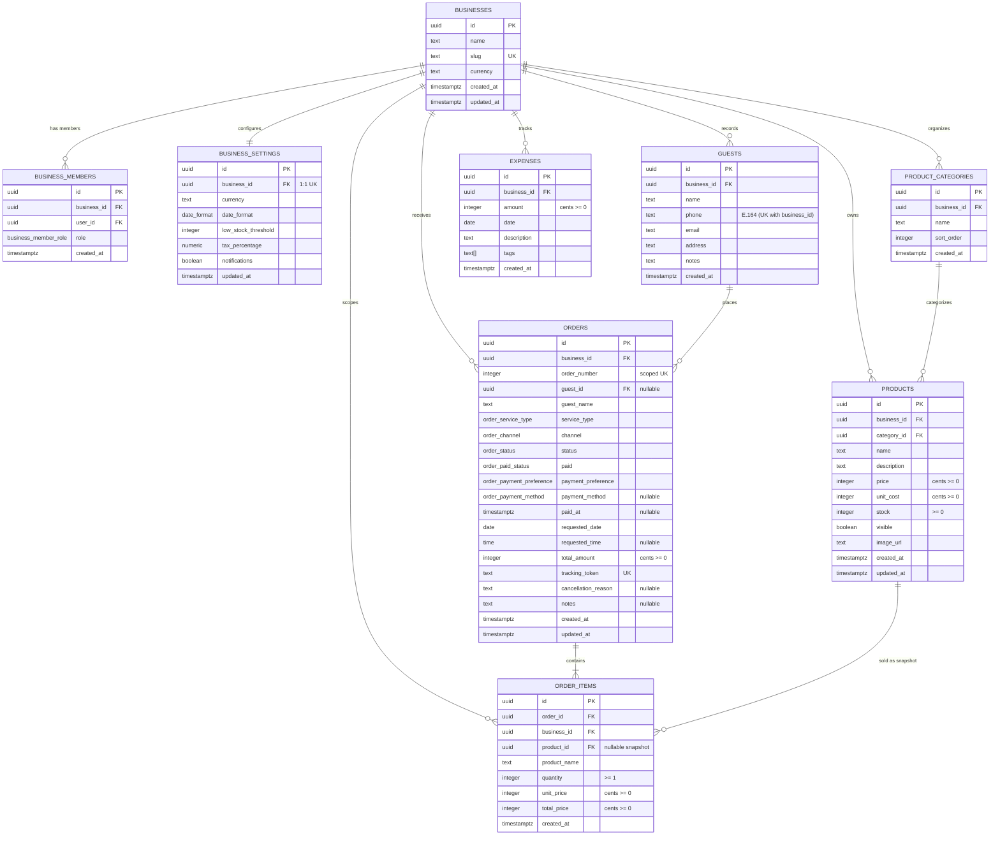

# Database Schema Specification

This document defines the canonical relational database schema for FoodBiz PWA on Supabase (PostgreSQL), derived from the domain models in [`src/domain/`](../../src/domain/) and functional requirements in [`FUNCTIONAL_SPECIFICATION.md`](../FUNCTIONAL_SPECIFICATION.md).

> **Contract Notice:** This reviewed schema serves as the single source of truth for database migrations (#119), Row Level Security (RLS) policies (#120), atomic order transactions (#121), and Supabase repository adapters (#122).

---

## 1. Entity-Relationship Diagram (ERD)



---

## 2. Design Principles & Architecture Standards

1. **Strict Multi-Tenancy Scoping:** Every business entity stores `business_id uuid not null references businesses(id) on delete cascade`. Even child tables such as `order_items` explicitly carry `business_id` to allow direct RLS evaluation without costly joins.
2. **Deterministic Primary Keys:** Primary keys use `uuid default gen_random_uuid()`.
3. **Integer Minor Units for Currency:** In alignment with `moneySchema` (`src/domain/common.ts`) and backend guidelines, currency amounts are stored as integer cents (`integer check (amount >= 0)`), preventing floating-point rounding errors.
4. **Native PostgreSQL Enums:** Categorical domains are modeled as explicit PostgreSQL `ENUM` types, matching TypeScript Zod enums in `src/domain/`.
5. **Business Rules Enforcement:**
   - **Negative inventory prevention:** `stock integer not null check (stock >= 0)`.
   - **Soft deletion / catalog visibility:** `visible boolean not null default true`.
   - **Guest phone deduplication:** `UNIQUE (business_id, phone) WHERE phone IS NOT NULL`.
   - **Order tracking dual access:**
     - **Direct Link (Capability Token):** Cryptographically random `tracking_token text not null unique` allowing 1-click guest tracking (`/[locale]/order/[token]`) without sign-in.
     - **Ticket N° + Phone Lookup:** Customers who lose their direct link or hold a physical counter ticket can look up their live order using `order_number` (ticket #) and their validated E.164 phone number via `lookup_order_by_ticket_and_phone`.
   - **Order number scoping:** Sequential `order_number` per business enforced via `UNIQUE (business_id, order_number)`.
   - **Payment integrity:** Orders with `paid = 'paid'` require both `payment_method` and `paid_at`.

---

## 3. SQL DDL Specification

```sql
-- ============================================================================
-- FoodBiz PWA — Core Schema DDL
-- ============================================================================

-- Extensions
create extension if not exists "pgcrypto";

-- ----------------------------------------------------------------------------
-- Custom ENUM Types
-- ----------------------------------------------------------------------------
create type category_role as enum ('regular', 'drinks', 'snacks');
create type business_member_role as enum ('owner', 'manager', 'staff');
create type date_format as enum ('DD/MM/YYYY', 'MM/DD/YYYY', 'YYYY-MM-DD');

create type order_status as enum (
  'NEW',
  'CONFIRMED',
  'PREPARING',
  'READY',
  'COMPLETED',
  'CANCELLED'
);

create type order_paid_status as enum ('paid', 'unpaid');
create type order_service_type as enum ('pickup', 'delivery', 'dine-in');
create type order_channel as enum ('storefront', 'phone', 'whatsapp', 'in-person');
create type order_payment_preference as enum ('revolut', 'wero', 'on_handover');
create type order_payment_method as enum ('cash', 'revolut', 'wero');

-- ----------------------------------------------------------------------------
-- 1. Businesses & Tenancy
-- ----------------------------------------------------------------------------
create table businesses (
  id uuid primary key default gen_random_uuid(),
  name text not null check (char_length(trim(name)) >= 1),
  instagram_url text check (instagram_url = '' or instagram_url ~ '^https://'),
  facebook_url text check (facebook_url = '' or facebook_url ~ '^https://'),
  tiktok_url text check (tiktok_url = '' or tiktok_url ~ '^https://'),
  latitude double precision check (latitude is null or latitude between -90 and 90),
  longitude double precision check (longitude is null or longitude between -180 and 180),
  slug text not null check (slug ~ '^[a-z0-9-]+$'),
  currency text not null default 'EUR' check (currency = 'EUR'),
  created_at timestamptz not null default now(),
  updated_at timestamptz not null default now(),
  constraint businesses_slug_unique unique (slug)
);

create table business_members (
  id uuid primary key default gen_random_uuid(),
  business_id uuid not null references businesses(id) on delete cascade,
  user_id uuid not null references auth.users(id) on delete cascade,
  role business_member_role not null default 'staff',
  created_at timestamptz not null default now(),
  constraint business_members_business_user_unique unique (business_id, user_id)
);

create index idx_business_members_business_id on business_members(business_id);
create index idx_business_members_user_id on business_members(user_id);

create table business_settings (
  id uuid primary key default gen_random_uuid(),
  business_id uuid not null references businesses(id) on delete cascade,
  currency text not null default 'EUR' check (currency = 'EUR'),
  date_format date_format not null default 'DD/MM/YYYY',
  low_stock_threshold integer not null default 5 check (low_stock_threshold >= 0),
  tax_percentage numeric(5, 2) not null default 0 check (tax_percentage >= 0 and tax_percentage <= 100),
  notifications boolean not null default true,
  updated_at timestamptz not null default now(),
  constraint business_settings_business_id_unique unique (business_id)
);

-- ----------------------------------------------------------------------------
-- 2. Product Catalog & Inventory
-- ----------------------------------------------------------------------------
create table product_categories (
  id uuid primary key default gen_random_uuid(),
  business_id uuid not null references businesses(id) on delete cascade,
  name text not null check (char_length(trim(name)) between 1 and 50),
  sort_order integer not null default 0 check (sort_order >= 0),
  role category_role not null default 'regular',
  created_at timestamptz not null default now(),
  constraint product_categories_business_name_unique unique (business_id, name)
);

create index idx_product_categories_business_sort on product_categories(business_id, sort_order);

create table products (
  id uuid primary key default gen_random_uuid(),
  business_id uuid not null references businesses(id) on delete cascade,
  category_id uuid not null references product_categories(id) on delete restrict,
  name text not null check (char_length(trim(name)) >= 1),
  description text check (description is null or char_length(description) <= 1000),
  price integer not null check (price >= 0), -- integer cents
  unit_cost integer not null default 0 check (unit_cost >= 0), -- integer cents
  stock integer not null default 0 check (stock >= 0), -- negative inventory prevention
  visible boolean not null default true, -- soft deletion / catalog visibility
  allergens text[] not null default '{}',
  suggest_add_ons boolean not null default true,
  image_url text,
  created_at timestamptz not null default now(),
  updated_at timestamptz not null default now()
);

create index idx_products_business_category on products(business_id, category_id);
create index idx_products_business_visible on products(business_id, visible);
create index idx_products_business_name on products(business_id, name);

-- ----------------------------------------------------------------------------
-- 3. Guests (Storefront Customers)
-- ----------------------------------------------------------------------------
-- Note on right-to-erasure: guests are anonymised in place (name = 'Deleted customer',
-- phone/email/address/notes = null) rather than deleted so historical orders keep a valid guest_id.
create table guests (
  id uuid primary key default gen_random_uuid(),
  business_id uuid not null references businesses(id) on delete cascade,
  name text not null check (char_length(trim(name)) between 2 and 50),
  phone text check (phone is null or phone ~ '^\+[1-9]\d{6,14}$'), -- E.164 canonical
  email text check (email is null or email ~* '^[A-Za-z0-9._%+-]+@[A-Za-z0-9.-]+\.[A-Za-z]{2,}$'),
  address text,
  notes text,
  created_at timestamptz not null default now()
);

-- Unique phone per business when phone is provided (AC requirement)
create unique index idx_guests_business_phone_unique on guests(business_id, phone) where phone is not null;
create index idx_guests_business_created on guests(business_id, created_at desc);

-- ----------------------------------------------------------------------------
-- 4. Orders & Order Items
-- ----------------------------------------------------------------------------
create table orders (
  id uuid primary key default gen_random_uuid(),
  business_id uuid not null references businesses(id) on delete cascade,
  order_number integer not null check (order_number > 0),
  guest_id uuid not null references guests(id) on delete restrict,
  submitted_name text check (submitted_name is null or char_length(trim(submitted_name)) between 2 and 50), -- audit only on name mismatch
  service_type order_service_type not null,
  channel order_channel not null,
  status order_status not null default 'NEW',
  paid order_paid_status not null default 'unpaid',
  payment_preference order_payment_preference not null default 'on_handover',
  payment_method order_payment_method,
  paid_at timestamptz,
  requested_date date not null,
  requested_time time,
  total_amount integer not null check (total_amount >= 0), -- integer cents
  tracking_token text not null default encode(gen_random_bytes(16), 'hex'), -- public order tracking token
  cancellation_reason text,
  notes text,
  created_at timestamptz not null default now(),
  updated_at timestamptz not null default now(),
  constraint orders_business_number_unique unique (business_id, order_number),
  constraint orders_tracking_token_unique unique (tracking_token),
  constraint orders_paid_consistency check (
    paid = 'unpaid' or (payment_method is not null and paid_at is not null)
  )
);

create index idx_orders_business_status on orders(business_id, status);
create index idx_orders_business_requested_date on orders(business_id, requested_date);
create index idx_orders_business_guest on orders(business_id, guest_id);
create index idx_orders_business_created on orders(business_id, created_at desc);
create index idx_orders_tracking_token on orders(tracking_token);

create table order_items (
  id uuid primary key default gen_random_uuid(),
  order_id uuid not null references orders(id) on delete cascade,
  business_id uuid not null references businesses(id) on delete cascade,
  product_id uuid references products(id) on delete set null, -- snapshot retains line if product is deleted
  product_name text not null check (char_length(trim(product_name)) >= 1),
  quantity integer not null check (quantity >= 1),
  unit_price integer not null check (unit_price >= 0), -- integer cents at time of order
  total_price integer not null check (total_price >= 0), -- integer cents
  created_at timestamptz not null default now()
);

create index idx_order_items_order_id on order_items(order_id);
create index idx_order_items_business_product on order_items(business_id, product_id);

-- ----------------------------------------------------------------------------
-- 5. Expenses
-- ----------------------------------------------------------------------------
create table expenses (
  id uuid primary key default gen_random_uuid(),
  business_id uuid not null references businesses(id) on delete cascade,
  amount integer not null check (amount >= 0), -- integer cents
  date date not null,
  description text not null check (char_length(trim(description)) >= 1),
  tags text[] not null default '{}',
  created_at timestamptz not null default now()
);

create index idx_expenses_business_date on expenses(business_id, date desc);
create index idx_expenses_tags_gin on expenses using gin (tags);

-- ----------------------------------------------------------------------------
-- 6. Updated_at Trigger Automation
-- ----------------------------------------------------------------------------
create or replace function set_updated_at()
returns trigger as $$
begin
  new.updated_at = now();
  return new;
end;
$$ language plpgsql;

create trigger trigger_businesses_updated_at
  before update on businesses
  for each row execute function set_updated_at();

create trigger trigger_business_settings_updated_at
  before update on business_settings
  for each row execute function set_updated_at();

create trigger trigger_products_updated_at
  before update on products
  for each row execute function set_updated_at();

create trigger trigger_orders_updated_at
  before update on orders
  for each row execute function set_updated_at();
```

---

## 4. Indexing Strategy Summary

| Table                | Index Name                             | Columns / Expressions            | Type                    | Rationale                                                |
| :------------------- | :------------------------------------- | :------------------------------- | :---------------------- | :------------------------------------------------------- |
| `businesses`         | `businesses_slug_unique`               | `(slug)`                         | B-tree (Unique)         | Fast domain & storefront slug resolution                 |
| `business_members`   | `idx_business_members_business_id`     | `(business_id)`                  | B-tree                  | Member listing and tenant filtering                      |
| `business_members`   | `idx_business_members_user_id`         | `(user_id)`                      | B-tree                  | RLS helper function query on `auth.uid()`                |
| `business_settings`  | `business_settings_business_id_unique` | `(business_id)`                  | B-tree (Unique)         | 1:1 business settings lookup                             |
| `product_categories` | `idx_product_categories_business_sort` | `(business_id, sort_order)`      | B-tree                  | Ordered category display in manager & storefront         |
| `products`           | `idx_products_business_category`       | `(business_id, category_id)`     | B-tree                  | Filter products by category                              |
| `products`           | `idx_products_business_visible`        | `(business_id, visible)`         | B-tree                  | Storefront catalog listing (active items only)           |
| `products`           | `idx_products_business_name`           | `(business_id, name)`            | B-tree                  | Manager product search and sorting                       |
| `guests`             | `idx_guests_business_phone_unique`     | `(business_id, phone)`           | B-tree (Unique Partial) | Prevents duplicate guest records with the same phone     |
| `guests`             | `idx_guests_business_created`          | `(business_id, created_at desc)` | B-tree                  | Recent customer lookups                                  |
| `orders`             | `idx_orders_business_status`           | `(business_id, status)`          | B-tree                  | Order board filtering (`NEW`, `PREPARING`, etc.)         |
| `orders`             | `idx_orders_business_requested_date`   | `(business_id, requested_date)`  | B-tree                  | Kitchen dispatch by day                                  |
| `orders`             | `idx_orders_business_guest`            | `(business_id, guest_id)`        | B-tree                  | Order history per customer                               |
| `orders`             | `idx_orders_tracking_token`            | `(tracking_token)`               | B-tree (Unique)         | Public order tracking lookup (`/[locale]/order/[token]`) |
| `order_items`        | `idx_order_items_order_id`             | `(order_id)`                     | B-tree                  | Order details retrieval                                  |
| `order_items`        | `idx_order_items_business_product`     | `(business_id, product_id)`      | B-tree                  | Sales per product reporting                              |
| `expenses`           | `idx_expenses_business_date`           | `(business_id, date desc)`       | B-tree                  | Monthly KPI and analytics time ranges                    |
| `expenses`           | `idx_expenses_tags_gin`                | `(tags)`                         | GIN                     | Fast tag filtering (`tags @> array['Ingredients']`)      |

---

## 5. Security & Row Level Security (RLS) Strategy

All tables will have RLS enabled (`alter table <name> enable row level security;`).

### 5.1 Manager Membership Helper

```sql
create or replace function auth.is_business_member(target_business_id uuid)
returns boolean security definer set search_path = public as $$
  select exists (
    select 1 from business_members
    where business_id = target_business_id
      and user_id = (select auth.uid())
  );
$$ language sql stable;
```

### 5.2 Access Control Matrix

| Table                | Role: `anon` (Storefront Customer)                                                                            | Role: `authenticated` (Manager / Staff)                  |
| :------------------- | :------------------------------------------------------------------------------------------------------------ | :------------------------------------------------------- |
| `businesses`         | `SELECT` public profile by `slug`                                                                             | `SELECT`, `UPDATE` via `is_business_member(id)`          |
| `business_members`   | Deny                                                                                                          | `SELECT` for business members; write for `owner` role    |
| `business_settings`  | `SELECT` public settings (`currency`, `dateFormat`)                                                           | `SELECT`, `UPDATE` via `is_business_member(business_id)` |
| `product_categories` | `SELECT` for active businesses                                                                                | `ALL` via `is_business_member(business_id)`              |
| `products`           | `SELECT` where `visible = true`                                                                               | `ALL` via `is_business_member(business_id)`              |
| `guests`             | Direct read denied; inserted via atomic checkout function (#121)                                              | `ALL` via `is_business_member(business_id)`              |
| `orders`             | `SELECT` matching `tracking_token`; inserted via atomic checkout function (#121); ticket+phone lookup via RPC | `ALL` via `is_business_member(business_id)`              |
| `order_items`        | `SELECT` linked to valid order tracking token                                                                 | `ALL` via `is_business_member(business_id)`              |
| `expenses`           | Deny all                                                                                                      | `ALL` via `is_business_member(business_id)`              |

### 5.3 Public Guest Tracking & Verification

To allow storefront customers to track orders securely without authenticating, two complementary mechanisms are supported:

1. **Direct Token Route (`/[locale]/order/[token]`):**
   - The query matches directly on `orders.tracking_token = :token`.
   - Returns order status and item snapshots without any input prompt.

2. **Ticket N° + Phone Verification (`/track` or modal lookup):**
   - Enables walk-in or lost-link customers with a physical receipt or ticket number to locate their order by providing their ticket number and validated phone number.
   - Executed via security definer RPC returning an explicit guest-PII-free projection (never joining `guests.name` onto public tracking responses):
     ```sql
     create or replace function public.lookup_order_by_ticket_and_phone(
       p_business_id uuid,
       p_order_number int,
       p_phone text
     )
     returns jsonb security definer set search_path = public as $$
       select jsonb_build_object(
         'order', jsonb_build_object(
           'id', o.id,
           'business_id', o.business_id,
           'order_number', o.order_number,
           'service_type', o.service_type,
           'status', o.status,
           'paid', o.paid,
           'requested_date', o.requested_date,
           'requested_time', o.requested_time,
           'total_amount', o.total_amount,
           'tracking_token', o.tracking_token,
           'created_at', o.created_at,
           'updated_at', o.updated_at
         ),
         'items', coalesce(jsonb_agg(to_jsonb(oi)) filter (where oi.id is not null), '[]'::jsonb)
       )
       from orders o
       join guests g on o.guest_id = g.id
       left join order_items oi on oi.order_id = o.id
       where o.business_id = p_business_id
         and o.order_number = p_order_number
         and g.phone = p_phone
       group by o.id;
     $$ language sql stable;
     ```
   - Enumeration is prevented because callers must supply both the scoped ticket number and the exact matching phone number.

---

## 6. Domain Model Mapping

| PostgreSQL Table     | TypeScript Domain Model (`src/domain/`)                                       | Repository Interface (`src/domain/repositories/types.ts`) |
| :------------------- | :---------------------------------------------------------------------------- | :-------------------------------------------------------- |
| `businesses`         | [`Business`](../../src/domain/business.ts) (`businessSchema`)                 | `BusinessRepository`                                      |
| `business_members`   | [`BusinessMember`](../../src/domain/business.ts) (`businessMemberSchema`)     | `MemberRepository`                                        |
| `business_settings`  | [`BusinessSettings`](../../src/domain/business.ts) (`businessSettingsSchema`) | `BusinessRepository.getSettings`                          |
| `product_categories` | [`ProductCategory`](../../src/domain/product.ts) (`productCategorySchema`)    | `CategoryRepository`                                      |
| `products`           | [`Product`](../../src/domain/product.ts) (`productSchema`)                    | `ProductRepository`                                       |
| `guests`             | [`Guest`](../../src/domain/guest.ts) (`guestSchema`)                          | `GuestRepository`                                         |
| `orders`             | [`Order`](../../src/domain/order.ts) (`orderSchema`)                          | `OrderRepository`                                         |
| `order_items`        | [`OrderItem`](../../src/domain/order.ts) (`orderItemSchema`)                  | Nested within `OrderRepository`                           |
| `expenses`           | [`Expense`](../../src/domain/expense.ts) (`expenseSchema`)                    | `ExpenseRepository`                                       |
